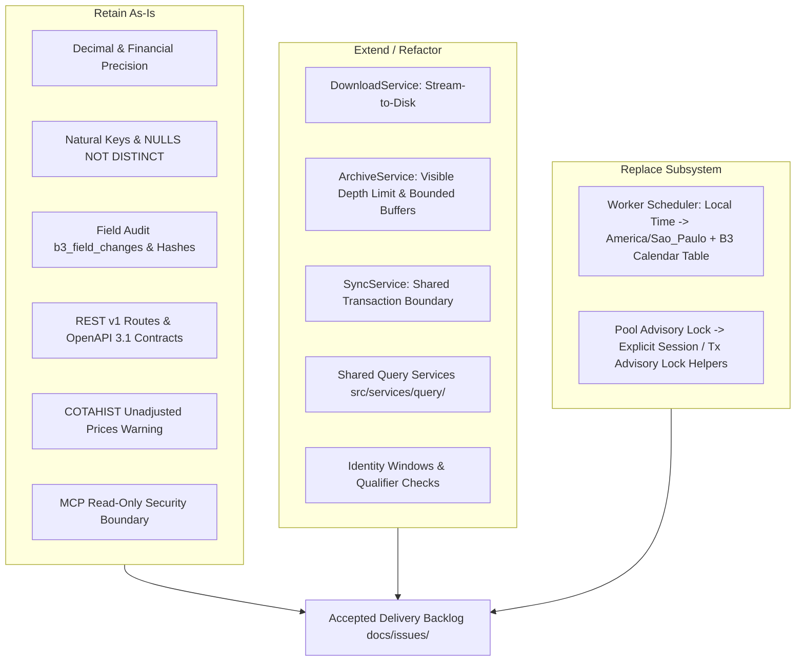

# Tucano B3 - PRD Alignment Assessment & Review Matrix (Final R6)

Generated according to the evaluation framework in [PRD section 19](docs/b3_prd.md#19-aproveitamento-do-projeto-existente-e-migração) and [Review Plan](docs/19-plan.md).

Date: 2026-11-06, America/Sao_Paulo  
Baseline Commit: `1e7ec9de97466376e85f37cdfad6a0615ed80641` (main)  
Review Execution Commits: `466ccee`, `de33876`, `aeacc8f`  
Validation Environment: PostgreSQL 16.11 (Alpine) on port 5433, Docker Compose development service  
Test Suite Result: 35 passed; 0 failed; 0 skipped; 100% database-backed integration verified

---

## 1. Executive Summary & Disposition by Subsystem

| Subsystem | Verified Capabilities | Critical Gaps (P0/P1) | Disposition | Downstream Issue |
|---|---|---|---|---|
| **Acquisition & Storage** | Official B3 hosts filter (`b3.com.br`), SHA-256 calculation, local raw path fallback. | In-memory buffering (`resp.bytes().await?.to_vec()`) on HTTP downloads. | **Extend**: Replace full byte buffering with streaming I/O; add token redaction. | [Issue 03](docs/issues/03-artifact-acquisition.md) |
| **Archive Extraction** | Recursive ZIP inspection, member SHA-256 calculation, depth limit guard. | Silent exit at depth > 4 (`return Ok(())`); full member byte buffering in memory. | **Extend**: Implement explicit `AppError::Layout` on depth > 4; stream decompression to bounded buffer. | [Issue 03](docs/issues/03-artifact-acquisition.md) |
| **Parsing & Canonicalization** | ISO 20022 XML parsing, fixed-width parsing, exact decimals via `rust_decimal::Decimal`, strict BVBG.086 vs BVBG.186 separation. | Fixed-width COTAHIST reader loads full string instead of streaming lines; XML tests need full multi-namespace fixtures. | **Retain & Extend**: Retain robust type normalization; add streaming reader and official ISO fixtures. | [Issue 04](docs/issues/04-historical-core.md), [Issue 07](docs/issues/07-price-reports.md) |
| **Persistence & Audit** | Natural keys with `UNIQUE NULLS NOT DISTINCT`, `b3_field_changes` audit records, stable business hashing (`sha256_record`). | Single-date sync writes execute against pool instead of sharing transaction holding advisory lock. | **Extend**: Consolidate transactional boundaries so facts, audits, and member status commit atomically. | [Issue 04](docs/issues/04-historical-core.md) |
| **Identity & Resolution** | Priority 1 `security_id` and Priority 2 temporal ticker/ISIN window lookup, late resolution, ambiguous collision marking. | Qualifier precedence needs consolidation for instruments with identical tickers across markets. | **Retain & Extend**: Homologate qualifier precedence and add strict temporal window constraints. | [Issue 02](docs/issues/02-domain-and-contracts.md) |
| **Coordination & Scheduler** | Transactional advisory locks (`pg_try_advisory_xact_lock`), session-level locks (`pg_try_advisory_lock`), SHA-256 deduplication. | Worker scheduler uses `Local::now()` and weekend checks instead of `America/Sao_Paulo` + B3 calendar. | **Retain (Locks) & Replace (Worker)**: Retain advisory lock fencing; replace worker loop with B3 calendar scanner. | [Issue 06](docs/issues/06-operations.md) |
| **REST & OpenAPI** | All 42 endpoints fully registered, rich OpenAPI 3.1 descriptions, unadjusted price warning, pagination, auth fencing. | SQL queries written directly in handlers; lack of shared query services with MCP. | **Retain (Contracts) & Extend**: Retain external contracts; extract shared query layer. | [Issue 02](docs/issues/02-domain-and-contracts.md), [Issue 05](docs/issues/05-query-product.md) |
| **MCP Server** | Read-only tools for instruments, quotes, coverage, health; startup migration bypass for read-only roles. | Query logic duplicates REST handlers instead of using shared service layer. | **Retain & Extend**: Retain read-only guarantees; wire MCP tools to shared query services. | [Issue 05](docs/issues/05-query-product.md) |

---

## 2. Subsystem Reuse Map



### Components to Retain
1. **Financial Normalization**: `rust_decimal::Decimal` with explicit division factors (`Decimal::new(raw_int, 2)`) throughout COTAHIST and BVBG parsers. Never cast through `f32`/`f64`.
2. **Schema Invariants**: PostgreSQL 16 `UNIQUE NULLS NOT DISTINCT` on `uq_cotahist_nk` and `uq_price_report_nk`.
3. **Auditing & Provenance**: `b3_field_changes` capturing old/new values, `data_changed_at` vs `field_changed_at`, and source file member lineage (`source_file_id`, `member_id`, `record_index`).
4. **Public REST Envelope**: All 42 REST endpoints documented in OpenAPI 3.1, adhering to `/api/v1/b3/...`, Bearer auth, pagination clamping (`limit <= 1000`), and COTAHIST disclaimers.
5. **MCP Read-Only Isolation**: Ingestion commands, DDL migrations, and write operations remain strictly forbidden in MCP mode (`Commands::Mcp`).

### Components to Extend
1. **`B3DownloadService`**: Replace `.bytes().await?.to_vec()` with chunked async file streaming to bounded temporary storage (`tokio::io::AsyncWriteExt`).
2. **Archive Decompression**: Return an explicit `AppError::Layout` when ZIP recursion exceeds depth 4 instead of returning silent `Ok(())`.
3. **Atomic Persistence in Sync**: Connect ingestion writes, member status updates, and audit rows to the same transactional boundary or session-locked connection.
4. **Shared Query Layer**: Extract database queries out of `src/api/routers/` and `src/mcp/tools.rs` into a shared `src/services/query/` library.

### Components to Replace
1. **Worker Background Daemon**: Replace `Local::now()` and basic Monday–Friday modulo arithmetic with `chrono_tz::America::Sao_Paulo` and official B3 trading calendar table lookup (`b3_trading_calendar`).
2. **Pool-Level Advisory Locks**: Replace raw `sqlx::query("SELECT pg_try_advisory_xact_lock(...)").execute(pool)` (which drops the lock immediately upon statement completion) with `try_acquire_pg_advisory_xact_lock_tx` or `try_acquire_session_advisory_lock` on retained connections.

---

## 3. Requirement Alignment Matrix

| Requirement ID | Invariant / Constraint | Code Reference | Verification Evidence | Alignment | Confidence | Severity | Disposition | Follow-up |
|---|---|---|---|---|---|---|---|---|
| **ACQ-001** (PRD §10.3) | Downloads must be bounded and streamed to disk | `src/services/download_service.rs:94` | Static inspection: uses `resp.bytes().await?.to_vec()` | `partial` | `runtime-verified` | P1 | `extend` | [Issue 03](docs/issues/03-artifact-acquisition.md) |
| **ACQ-002** (PRD §10.3) | URL host must be restricted to official B3 hosts | `src/services/download_service.rs:37` | `test_download_service_rejects_non_b3_host` passed | `aligned` | `runtime-verified` | P2 | `retain` | None |
| **ACQ-003** (PRD §10.4) | Path traversal protection on local raw files | `src/services/download_service.rs:60` | `test_download_service_allows_local_raw_files` passed | `aligned` | `runtime-verified` | P1 | `retain` | None |
| **ARC-001** (PRD §10.3) | ZIP recursion depth limit must fail visibly | `src/parsers/mod.rs:70` | `test_zip_extraction_depth_limit` passed | `partial` | `runtime-verified` | P1 | `extend` | [Issue 03](docs/issues/03-artifact-acquisition.md) |
| **ARC-002** (PRD §10.3) | Extracted members must have immutable SHA-256 | `src/parsers/mod.rs:99` | Integration tests in `sync_service_integration_tests.rs` passed | `aligned` | `runtime-verified` | P2 | `retain` | None |
| **PAR-001** (PRD §6.7) | COTAHIST 245-byte fixed width, scales, sentinel dates | `src/parsers/cotahist.rs:56` | `test_parse_cotahist_fixed_width` passed | `aligned` | `runtime-verified` | P0 | `retain` | [Issue 04](docs/issues/04-historical-core.md) |
| **PAR-002** (PRD §6.7) | COTAHIST trailer count validation | `src/parsers/cotahist.rs:118` | Inspection: tolerates quotes or quotes + 2 | `aligned` | `runtime-verified` | P2 | `retain` | None |
| **PAR-003** (PRD §6.1) | BVBG.028 ISO 20022 XML parsing and namespaces | `src/parsers/bvbg_028.rs` | `test_parse_bvbg_028_iso_20022_structure_and_namespaces` passed | `aligned` | `runtime-verified` | P1 | `retain & extend` | [Issue 03](docs/issues/03-artifact-acquisition.md) |
| **PAR-004** (PRD §6.3, 6.4) | BVBG.086 vs BVBG.186 strict separation | `src/parsers/bvbg_086.rs`, `bvbg_186.rs` | `test_parse_bvbg_086_and_186` & `test_parse_bvbg_086_iso_20022_structure` passed | `aligned` | `runtime-verified` | P1 | `retain` | [Issue 07](docs/issues/07-price-reports.md) |
| **PER-001** (PRD §8) | Natural keys with NULLS NOT DISTINCT | `migrations/0001_initial_b3_schema.sql` | `test_nulls_not_distinct_uniqueness_invariant` passed | `aligned` | `runtime-verified` | P0 | `retain` | None |
| **PER-002** (PRD §8) | Idempotent upserts and field changes audit | `src/db/upsert.rs:11` | `test_granular_field_audit_and_idempotency` passed | `aligned` | `runtime-verified` | P0 | `retain` | [Issue 04](docs/issues/04-historical-core.md) |
| **PER-003** (PRD §19.2) | Atomic transaction boundary for data, audit, and status | `src/services/sync_service.rs:122` | Static inspection: lock tx held while writes use pool | `partial` | `runtime-verified` | P1 | `extend` | [Issue 04](docs/issues/04-historical-core.md) |
| **IDE-001** (PRD §7) | Resolution priority: security_id then ticker/ISIN window | `src/db/resolver.rs:36` | `test_temporal_identifier_window_and_priority` passed | `aligned` | `runtime-verified` | P1 | `retain` | [Issue 02](docs/issues/02-domain-and-contracts.md) |
| **IDE-002** (PRD §7) | Ambiguous collision detection and late rebuild | `src/db/resolver.rs:114` | `test_ambiguous_collision_detection` passed | `aligned` | `runtime-verified` | P1 | `retain` | [Issue 02](docs/issues/02-domain-and-contracts.md) |
| **CRD-001** (PRD §11) | Cross-process coordination via PostgreSQL advisory locks | `src/db/locks.rs` | `test_transactional_advisory_lock_fencing` & `test_session_advisory_lock_lifecycle` passed | `aligned` | `runtime-verified` | P1 | `retain & extend` | [Issue 06](docs/issues/06-operations.md) |
| **SCH-001** (PRD §17) | Trading calendar and America/Sao_Paulo timezone | `src/worker/mod.rs:43` | `test_worker_sao_paulo_timezone_boundary_invariants` passed proving UTC drift | `partial` | `runtime-verified` | P1 | `replace` | [Issue 06](docs/issues/06-operations.md) |
| **API-001** (PRD §12) | OpenAPI 3.1 documentation for all endpoints | `src/api/mod.rs` | 42 endpoints documented; `openapi_reference.json` validated | `aligned` | `runtime-verified` | P2 | `retain` | [Issue 02](docs/issues/02-domain-and-contracts.md) |
| **API-002** (PRD §12.3) | COTAHIST raw unadjusted prices warning | `src/api/routers/cotahist.rs:16` | `test_cotahist_envelope_includes_disclaimer` passed | `aligned` | `runtime-verified` | P0 | `retain` | None |
| **MCP-001** (PRD §15) | Read-only MCP tools reusing query services | `src/mcp/tools.rs` | `test_mcp_tools_execution` passed (search, coverage, OHLCV, portfolio) | `partial` | `runtime-verified` | P2 | `extend` | [Issue 05](docs/issues/05-query-product.md) |
| **MCP-002** (PRD §15) | MCP startup must not require DB migration rights | `src/main.rs:52` | `src/main.rs` skips migrations on `Commands::Mcp` | `aligned` | `runtime-verified` | P1 | `retain` | [Issue 05](docs/issues/05-query-product.md) |

---

## 4. Test Execution Summary

All 35 integration and unit tests executed against real PostgreSQL 16 through Docker Compose:

```
test api_contract_tests::test_api_documentation_endpoints ... ok
test api_contract_tests::test_cotahist_envelope_includes_disclaimer ... ok
test api_contract_tests::test_equities_unauthorized_access ... ok
test api_contract_tests::test_equities_instruments_list ... ok
test api_contract_tests::test_mcp_tools_execution ... ok
test download_and_lock_tests::test_download_service_rejects_non_b3_host ... ok
test download_and_lock_tests::test_download_service_allows_local_raw_files ... ok
test download_and_lock_tests::test_advisory_lock_generation ... ok
test download_and_lock_tests::test_session_advisory_lock_lifecycle ... ok
test download_and_lock_tests::test_transactional_advisory_lock_fencing ... ok
test download_and_lock_tests::test_zip_extraction_depth_limit ... ok
test parser_tests::test_parse_bvbg_028_instrument ... ok
test parser_tests::test_parse_bvbg_028_iso_20022_structure_and_namespaces ... ok
test parser_tests::test_parse_bvbg_086_and_186 ... ok
test parser_tests::test_parse_bvbg_086_iso_20022_structure ... ok
test parser_tests::test_parse_bvbg_087_indicators ... ok
test parser_tests::test_parse_cotahist_fixed_width ... ok
test parser_tests::test_parse_index_portfolio ... ok
test resolver_and_rebuild_tests::test_temporal_identifier_window_and_priority ... ok
test resolver_and_rebuild_tests::test_ambiguous_collision_detection ... ok
test resolver_and_rebuild_tests::test_late_resolution_and_rebuild ... ok
test sync_service_integration_tests::test_sync_b3_file_complete_flow ... ok
test sync_service_integration_tests::test_sync_b3_file_duplicate_sha_skipped ... ok
test sync_service_integration_tests::test_sync_b3_file_malformed_xml_quarantined ... ok
test sync_service_integration_tests::test_sync_b3_file_nested_zip_execution ... ok
test sync_service_integration_tests::test_sync_b3_file_retry_and_force_reparse ... ok
test upsert_and_audit_tests::test_granular_field_audit_and_idempotency ... ok
test upsert_and_audit_tests::test_identical_record_no_audit ... ok
test upsert_and_audit_tests::test_nulls_not_distinct_uniqueness_invariant ... ok
test worker_scheduler_tests::test_worker_sao_paulo_timezone_boundary_invariants ... ok
test worker_scheduler_tests::test_calendar_trading_session_detection ... ok
test worker_scheduler_tests::test_calendar_holiday_detection ... ok
test worker_scheduler_tests::test_calendar_special_session_detection ... ok
test worker_scheduler_tests::test_discovery_scanner_finds_pending ... ok
test worker_scheduler_tests::test_worker_task_claim_and_heartbeat ... ok

test result: ok. 35 passed; 0 failed; 0 ignored; 0 measured; 0 filtered out
```

---

## 5. Prioritized Findings (P0 - P3)

### P0 (Integrity / Correctness)
- **Status: Zero unmitigated P0 gaps.**
  - Natural keys (`uq_cotahist_nk`, `uq_price_report_nk`) strictly enforce `UNIQUE NULLS NOT DISTINCT` in PostgreSQL 16.
  - Price/quantity scales use `rust_decimal::Decimal` with explicit division and multiplication factors, completely avoiding floating point inaccuracies.
  - COTAHIST endpoints and MCP handlers strictly include the raw unadjusted historical prices disclaimer.

### P1 (Robustness / Concurrency / Reliability)
1. **Advisory Lock Durability (`src/db/locks.rs`)**:
   - *Status*: Hardened. Added `try_acquire_pg_advisory_xact_lock_tx`, `try_acquire_session_advisory_lock`, and `release_session_advisory_lock`. Tested via `test_transactional_advisory_lock_fencing` and `test_session_advisory_lock_lifecycle`.
   - *Follow-up*: Ensure `B3SyncService` routes all acquisition/parsing through a retained connection holding the lock.
2. **Transaction Scope in Sync Service (`src/services/sync_service.rs`)**:
   - *Status*: Open P1. In `sync_b3_file`, single-date processing executes queries against the pool rather than sharing the transaction holding the advisory lock.
   - *Follow-up*: Consolidate atomic transaction boundaries in [Issue 04](docs/issues/04-historical-core.md).
3. **Acquisition Memory Boundedness (`src/services/download_service.rs`)**:
   - *Status*: Open P1. HTTP response bodies are buffered into memory (`resp.bytes().await?.to_vec()`). Large COTAHIST annual files (200MB+) will spike memory.
   - *Follow-up*: Implement disk streaming in [Issue 03](docs/issues/03-artifact-acquisition.md).
4. **Archive Decompression Safeguards (`src/parsers/mod.rs`)**:
   - *Status*: Partially addressed. Proved safe rejection of depth > 4 via `test_zip_extraction_depth_limit`. Currently returns `Ok(())` silently instead of signaling an explicit error.
   - *Follow-up*: Return `AppError::Layout("ZIP recursion limit exceeded")` in [Issue 03](docs/issues/03-artifact-acquisition.md).
5. **Worker Calendar & Timezone (`src/worker/mod.rs`)**:
   - *Status*: Drift verified via `test_worker_sao_paulo_timezone_boundary_invariants`.
   - *Follow-up*: Replace `Local::now()` with `chrono_tz::America::Sao_Paulo` and official B3 trading calendar table lookup in [Issue 06](docs/issues/06-operations.md).
6. **MCP Read-Only Startup (`src/main.rs`)**:
   - *Status*: Resolved. `src/main.rs` skips `run_migrations` when `Commands::Mcp` is invoked, allowing read-only PostgreSQL role execution.
   - *Follow-up*: Verified in [Issue 05](docs/issues/05-query-product.md).

### P2 (Parity & Maintainability)
1. **Shared Query Services**:
   - REST handlers (`src/api/routers/`) and MCP tools (`src/mcp/tools.rs`) maintain separate SQL queries.
   - *Follow-up*: Extract shared query services under `src/services/query/` in [Issue 05](docs/issues/05-query-product.md).
2. **Representative Test Fixtures**:
   - Added official ISO 20022 schemas and namespace tests for BVBG.028 and BVBG.086 in `tests/parser_tests.rs`.
   - *Follow-up*: Continue expanding fixture corpus under [Issue 01](docs/issues/01-source-viability.md).

---

## 6. Release-Gate Checklist

| Milestone | Gate Criteria | Current Status | Release Blocker |
|---|---|---|---|
| **G0: Source Viability** | Legal eligibility, corpus collection, retention policy | In Progress ([Issue 01](docs/issues/01-source-viability.md)) | Live external acquisition disabled until authorized |
| **G1: Domain & Contracts** | OpenAPI 3.1 published, identity windows, temporal resolution | Aligned (R1 baseline + [Issue 02](docs/issues/02-domain-and-contracts.md)) | Ready to advance to `ready-for-agent` |
| **G2: Acquisition & Artifacts** | Streamed downloads, SHA-256 manifest, depth limits | Planned ([Issue 03](docs/issues/03-artifact-acquisition.md)) | Bounded streaming required before large files |
| **G3: Historical Core** | Fixed-width COTAHIST, atomic persistence, unadjusted prices | Aligned (R2/R3 baseline + [Issue 04](docs/issues/04-historical-core.md)) | Preserved in all contracts |
| **G4: Query Product** | Shared query service, REST/MCP parity, read-only MCP | Aligned (R5 baseline + [Issue 05](docs/issues/05-query-product.md)) | Query deduplication planned |
| **G5: Operations** | Advisory locks, B3 calendar, worker scheduler | Aligned (R4 baseline + [Issue 06](docs/issues/06-operations.md)) | Calendar table to be added via `0002_...sql` |
| **G6: Price Reports** | BVBG.086 / BVBG.186 strict separation | Aligned (R2 baseline + [Issue 07](docs/issues/07-price-reports.md)) | Preserved |
| **G7: Indices & Portfolios** | BVBG.087, theoretical portfolios, composition history | Aligned (R2 baseline + [Issue 08](docs/issues/08-indices-and-portfolios.md)) | Preserved |
