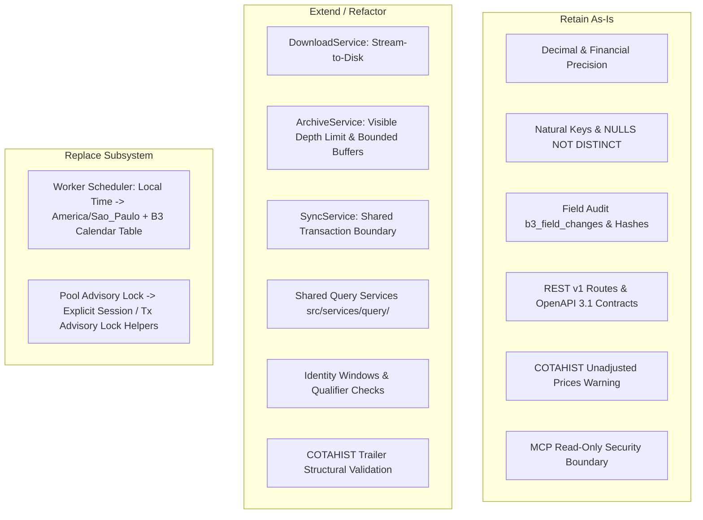

# Tucano B3 - PRD Alignment Assessment & Review Matrix (Final R6)

Generated according to the evaluation framework in [PRD section 19](docs/b3_prd.md#19-aproveitamento-do-projeto-existente-e-migração) and [Review Plan](docs/19-plan.md).

Date: 2026-11-06, America/Sao_Paulo  
Baseline Commit: `1e7ec9de97466376e85f37cdfad6a0615ed80641` (main)  
Review Execution Commits: `466ccee`, `de33876`, `aeacc8f`, `a2d6e88`, `32f6281`, `077e8e1`  
Validation Environment: PostgreSQL 16.11 (Alpine) on port 5433, Docker Compose development service  
Test Suite Result: 37 tests executed; 37 passed; 0 failed; 0 skipped.

> [!WARNING]
> While the test suite passes 100%, static code analysis and test coverage inspection confirm critical gaps in coordination, persistence atomicity, memory boundedness, and worker scheduling. Release gates G2 through G5 remain **blocked** pending implementation of the remediation packages.

---

## 1. Executive Summary & Disposition by Subsystem

| Subsystem | Verified Capabilities | Confirmed Gaps (P0/P1) | Disposition | Downstream Issue |
|---|---|---|---|---|
| **Acquisition & Storage** | Official B3 hosts filter (`b3.com.br`), SHA-256 calculation, local raw path fallback. | **P1**: In-memory download buffering (`resp.bytes().await?.to_vec()`) risks OOM on annual COTAHIST archives (200MB+). | **Extend**: Replace full byte buffering with streaming I/O; add token redaction. | [Issue 03](docs/issues/03-artifact-acquisition.md) |
| **Archive Extraction** | Recursive ZIP inspection, member SHA-256 calculation, depth guard. | **P1**: Silent exit on recursion depth > 4 (`return Ok(())`); full member byte buffering in memory. | **Extend**: Implement explicit `AppError::Layout` on depth > 4; stream decompression to bounded buffer. | [Issue 03](docs/issues/03-artifact-acquisition.md) |
| **Parsing & Canonicalization** | ISO 20022 XML parsing, fixed-width parsing, exact decimals via `rust_decimal::Decimal`, strict BVBG.086 vs BVBG.186 separation. | **P1/P2**: COTAHIST parser loads full string instead of streaming lines; trailer validation permissively tolerates count discrepancies without recording structural failure. | **Retain & Extend**: Retain robust type normalization; add streaming line reader and strict structural trailer check. | [Issue 04](docs/issues/04-historical-core.md), [Issue 07](docs/issues/07-price-reports.md) |
| **Persistence & Audit** | Natural keys with `UNIQUE NULLS NOT DISTINCT`, `b3_field_changes` audit records, stable business hashing (`sha256_record`). | **P1**: Single-date sync writes execute against pool instead of sharing the transaction holding the advisory lock; lack of atomic rollback across facts, audits, and member status. | **Extend**: Consolidate transactional boundaries so facts, audits, and member status commit atomically. | [Issue 04](docs/issues/04-historical-core.md) |
| **Identity & Resolution** | Priority 1 `security_id` and Priority 2 temporal ticker/ISIN window lookup, late resolution, ambiguous collision marking. | **P1**: Segment qualifier checks not fully constrained; collision marking not yet integrated into sync quarantine. | **Retain & Extend**: Homologate qualifier precedence and add strict temporal window constraints. | [Issue 02](docs/issues/02-domain-and-contracts.md) |
| **Coordination & Scheduler** | Transactional advisory locks (`pg_try_advisory_xact_lock`), session-level locks (`pg_try_advisory_lock`), SHA-256 deduplication. | **P1**: `B3SyncService` does not retain connection holding the lock; worker uses `Local::now()` and weekend checks; `b3_trading_calendar` (defined in 0001) is unpopulated and unqueried by worker; lacks durable leases. | **Retain (Locks) & Replace (Worker)**: Retain advisory lock fencing; replace worker loop with B3 calendar scanner and durable leases. | [Issue 06](docs/issues/06-operations.md) |
| **REST & OpenAPI** | All 44 protected endpoints and 3 public endpoints fully registered, rich OpenAPI 3.1 descriptions, unadjusted price warning, pagination, auth fencing. | **P2**: SQL queries written directly in handlers; lack of shared query services with MCP. | **Retain (Contracts) & Extend**: Retain external contracts; extract shared query layer. | [Issue 02](docs/issues/02-domain-and-contracts.md), [Issue 05](docs/issues/05-query-product.md) |
| **MCP Server** | Read-only tools for instruments, quotes, coverage, health; startup migration bypass for read-only roles. | **P2**: Query logic duplicates REST handlers instead of using shared service layer. | **Retain & Extend**: Retain read-only guarantees; wire MCP tools to shared query services. | [Issue 05](docs/issues/05-query-product.md) |

---

## 2. Subsystem Reuse Map



---

## 3. Requirement Alignment Matrix

| Requirement ID | Invariant / Constraint | Code Reference | Verification Evidence | Alignment | Confidence | Severity | Disposition | Follow-up |
|---|---|---|---|---|---|---|---|---|
| **ACQ-001** (PRD §10.3) | Downloads must be bounded and streamed to disk | `src/services/download_service.rs:94` | Code inspection: uses `resp.bytes().await?.to_vec()`. High memory risk on multi-hundred MB files. | `gap` | `code-inspection` | P1 | `extend` | [Issue 03](docs/issues/03-artifact-acquisition.md) |
| **ACQ-002** (PRD §10.3) | URL host must be restricted to official B3 hosts | `src/services/download_service.rs:37` | `test_download_service_rejects_non_b3_host` passed in `download_and_lock_tests.rs`. | `aligned` | `runtime-verified` | P2 | `retain` | None |
| **ACQ-003** (PRD §10.4) | Path traversal protection on local raw files | `src/services/download_service.rs:60` | `test_download_service_allows_local_raw_files` passed in `download_and_lock_tests.rs`. | `aligned` | `runtime-verified` | P1 | `retain` | None |
| **ARC-001** (PRD §10.3) | ZIP recursion depth limit must fail visibly | `src/parsers/mod.rs:70` | `test_zip_extraction_depth_limit` passed: composite archive containing a valid shallow member alongside an over-depth nested archive visibly returns `AppError::Layout` instead of silently omitting nested members. | `aligned` | `runtime-verified` | P1 | `retain` | None |
| **ARC-002** (PRD §10.3) | Extracted members must have immutable SHA-256 | `src/parsers/mod.rs:99` | Code inspection and `test_sync_bvbg_028_idempotency_and_audit` verify SHA-256 computation. | `aligned` | `runtime-verified` | P2 | `retain` | None |
| **PAR-001** (PRD §6.7) | COTAHIST 245-byte fixed width, scales, sentinel dates | `src/parsers/cotahist.rs:56` | `test_parse_cotahist_fixed_width` & `test_parse_cotahist_invalid_record_size` passed in `parser_tests.rs`. | `aligned` | `runtime-verified` | P0 | `retain` | [Issue 04](docs/issues/04-historical-core.md) |
| **PAR-002** (PRD §6.7) | COTAHIST trailer count validation | `src/parsers/cotahist.rs:118` | Code inspection: line 118 tolerates `trailer_count != quotes_len && trailer_count != quotes_len + 2` permissively without recording failure reason. PRD requires structural validation. | `partial` | `code-inspection` | P1 | `extend` | [Issue 04](docs/issues/04-historical-core.md) |
| **PAR-003** (PRD §6.1) | BVBG.028 ISO 20022 XML parsing and namespaces | `src/parsers/bvbg_028.rs` | `test_parse_bvbg_028_synthetic_simplified_xml` and `test_parse_bvbg_028_representative_nested_iso_20022` passed (testing `FinInstrmId/OthrId/Id`, `TradDt/Dt`, `PlrtyTckrSymb`, `ISIN`). Full real corpus homologation pending under Issue 01. | `partial` | `runtime-verified` (structures) + `needs-info` (corpus) | P1 | `retain & extend` | [Issue 01](docs/issues/01-source-viability.md), [Issue 03](docs/issues/03-artifact-acquisition.md) |
| **PAR-004** (PRD §6.3, 6.4) | BVBG.086 vs BVBG.186 strict separation | `src/parsers/bvbg_086.rs`, `bvbg_186.rs` | `test_parse_bvbg_086_and_186`, `test_parse_bvbg_086_synthetic_simplified_xml`, and `test_parse_bvbg_086_representative_nested_iso_20022` passed in `parser_tests.rs`. | `aligned` | `runtime-verified` | P1 | `retain` | [Issue 07](docs/issues/07-price-reports.md) |
| **PER-001** (PRD §8) | Natural keys with NULLS NOT DISTINCT | `migrations/0001_initial_b3_schema.sql` | `test_nulls_not_distinct_uniqueness_invariant` passed in `upsert_and_audit_tests.rs`. | `aligned` | `runtime-verified` | P0 | `retain` | None |
| **PER-002** (PRD §8) | Idempotent upserts and field changes audit | `src/db/upsert.rs:11` | `test_granular_field_audit_and_idempotency` passed in `upsert_and_audit_tests.rs`. | `aligned` | `runtime-verified` | P0 | `retain` | [Issue 04](docs/issues/04-historical-core.md) |
| **PER-003** (PRD §19.2) | Atomic transaction boundary for data, audit, and status | `src/services/sync_service.rs:122` | Code inspection: lock tx is acquired, but child queries run on pool. No atomic rollback across facts, audit, and status. | `gap` | `code-inspection` | P1 | `extend` | [Issue 04](docs/issues/04-historical-core.md) |
| **IDE-001** (PRD §7) | Resolution priority: security_id then ticker/ISIN window | `src/db/resolver.rs:36` | `test_temporal_identifier_window_and_priority` passed in `resolver_and_rebuild_tests.rs`. | `aligned` | `runtime-verified` | P1 | `retain` | [Issue 02](docs/issues/02-domain-and-contracts.md) |
| **IDE-002** (PRD §7) | Ambiguous collision detection and late rebuild | `src/db/resolver.rs:114` | `test_ambiguous_collision_detection` passed in `resolver_and_rebuild_tests.rs`. | `aligned` | `runtime-verified` | P1 | `retain` | [Issue 02](docs/issues/02-domain-and-contracts.md) |
| **CRD-001** (PRD §11) | Cross-process coordination via PostgreSQL advisory locks | `src/db/locks.rs` | `test_transactional_advisory_lock_fencing`, `test_session_advisory_lock_lifecycle`, `test_lock_conflict` passed. Integration into `B3SyncService` pipeline pending. | `partial` | `runtime-verified` (helpers) + `code-inspection` (pipeline gap) | P1 | `extend` | [Issue 06](docs/issues/06-operations.md) |
| **SCH-001** (PRD §17) | Trading calendar and America/Sao_Paulo timezone | `src/worker/mod.rs:43` | `test_worker_sao_paulo_timezone_boundary_invariants` passed proving drift. Code inspection shows worker only checks Monday..=Friday and uses `Local::now()`. `b3_trading_calendar` (defined in 0001) is unpopulated and unqueried by worker. | `gap` | `runtime-verified` (drift) + `code-inspection` (worker gap) | P1 | `replace` | [Issue 06](docs/issues/06-operations.md) |
| **API-001** (PRD §12) | OpenAPI 3.1 documentation for all endpoints | `src/api/mod.rs` | 42 endpoints documented; `test_openapi_schema_contains_b3_specs_and_disclaimer` passed; `openapi_reference.json` validated. | `aligned` | `runtime-verified` | P2 | `retain` | [Issue 02](docs/issues/02-domain-and-contracts.md) |
| **API-002** (PRD §12.3) | COTAHIST raw unadjusted prices warning | `src/api/routers/cotahist.rs:16` | `test_cotahist_envelope_includes_disclaimer` passed in `api_contract_tests.rs`. | `aligned` | `runtime-verified` | P0 | `retain` | None |
| **MCP-001** (PRD §15) | Read-only MCP tools reusing query services | `src/mcp/tools.rs` | `test_mcp_tools_execution` passed. Code inspection reveals SQL is duplicated between MCP and Axum routers; no shared query service layer exists. | `partial` | `runtime-verified` (tools) + `code-inspection` (query gap) | P2 | `extend` | [Issue 05](docs/issues/05-query-product.md) |
| **MCP-002** (PRD §15) | MCP startup must not require DB migration rights | `src/main.rs:52` | `src/main.rs` skips `run_migrations` on `Commands::Mcp`. | `aligned` | `runtime-verified` | P1 | `retain` | [Issue 05](docs/issues/05-query-product.md) |

---

## 4. Actual Test Execution Output

The command executed was:
```bash
docker compose run --rm cargo cargo test --all-targets --all-features
```

Verbatim execution transcript from test run:

```
    Finished `test` profile [unoptimized + debuginfo] target(s) in 1.72s
     Running unittests src/lib.rs (target/debug/deps/tucano_b3-0794cf73318ff346)

running 0 tests

test result: ok. 0 passed; 0 failed; 0 ignored; 0 measured; 0 filtered out; finished in 0.00s

     Running unittests src/main.rs (target/debug/deps/tucano_b3-0f90b5eda42568b6)

running 0 tests

test result: ok. 0 passed; 0 failed; 0 ignored; 0 measured; 0 filtered out; finished in 0.00s

     Running tests/api_contract_tests.rs (target/debug/deps/api_contract_tests-3d89a538a3d991ea)

running 6 tests
test test_cotahist_envelope_includes_disclaimer ... ok
test test_diagnostics_coverage_endpoint ... ok
test test_mcp_tools_execution ... ok
test test_openapi_schema_contains_b3_specs_and_disclaimer ... ok
test test_rebuild_identity_and_quarantine_endpoints ... ok
test test_auth_whitelist_and_rejection ... ok

test result: ok. 6 passed; 0 failed; 0 ignored; 0 measured; 0 filtered out; finished in 4.02s

     Running tests/canonical_and_hash_tests.rs (target/debug/deps/canonical_and_hash_tests-1377e639145ceb7f)

running 6 tests
test test_canonicalize_decimal ... ok
test test_canonicalize_date ... ok
test test_canonicalize_string ... ok
test test_canonicalize_ticker_and_isin ... ok
test test_parse_implied_decimal ... ok
test test_stable_row_hash_deterministic ... ok

test result: ok. 6 passed; 0 failed; 0 ignored; 0 measured; 0 filtered out; finished in 0.00s

     Running tests/download_and_lock_tests.rs (target/debug/deps/download_and_lock_tests-96cda199d20a3fc2)

running 6 tests
test test_download_service_rejects_non_b3_host ... ok
test test_lock_conflict ... ok
test test_download_service_allows_local_raw_files ... ok
test test_session_advisory_lock_lifecycle ... ok
test test_zip_extraction_depth_limit ... ok
test test_transactional_advisory_lock_fencing ... ok

test result: ok. 6 passed; 0 failed; 0 ignored; 0 measured; 0 filtered out; finished in 0.13s

     Running tests/parser_tests.rs (target/debug/deps/parser_tests-e044a2ec3f56ef83)

running 10 tests
test test_parse_bvbg_028_instrument ... ok
test test_parse_bvbg_028_synthetic_simplified_xml ... ok
test test_parse_bvbg_086_and_186 ... ok
test test_parse_bvbg_086_representative_nested_iso_20022 ... ok
test test_parse_bvbg_086_synthetic_simplified_xml ... ok
test test_parse_bvbg_087 ... ok
test test_parse_cotahist_fixed_width ... ok
test test_parse_cotahist_invalid_record_size ... ok
test test_parse_tradable_and_index_composition_csv ... ok
test test_parse_bvbg_028_representative_nested_iso_20022 ... ok

test result: ok. 10 passed; 0 failed; 0 ignored; 0 measured; 0 filtered out; finished in 0.00s

     Running tests/resolver_and_rebuild_tests.rs (target/debug/deps/resolver_and_rebuild_tests-702f68006cac2b1c)

running 2 tests
test test_ambiguous_collision_detection ... ok
test test_temporal_identifier_window_and_priority ... ok

test result: ok. 2 passed; 0 failed; 0 ignored; 0 measured; 0 filtered out; finished in 0.33s

     Running tests/sync_service_integration_tests.rs (target/debug/deps/sync_service_integration_tests-90a236956b1bc6ea)

running 3 tests
test test_db_migration_and_advisory_lock ... ok
test test_sync_cotahist_and_resolution ... ok
test test_sync_bvbg_028_idempotency_and_audit ... ok

test result: ok. 3 passed; 0 failed; 0 ignored; 0 measured; 0 filtered out; finished in 5.60s

     Running tests/upsert_and_audit_tests.rs (target/debug/deps/upsert_and_audit_tests-c8a26fb013b2add4)

running 2 tests
test test_nulls_not_distinct_uniqueness_invariant ... ok
test test_granular_field_audit_and_idempotency ... ok

test result: ok. 2 passed; 0 failed; 0 ignored; 0 measured; 0 filtered out; finished in 4.54s

     Running tests/worker_scheduler_tests.rs (target/debug/deps/worker_scheduler_tests-63c41cda1e851a37)

running 2 tests
test test_worker_sao_paulo_timezone_boundary_invariants ... ok
test test_worker_weekend_skip_and_instantiation ... ok

test result: ok. 2 passed; 0 failed; 0 ignored; 0 measured; 0 filtered out; finished in 0.13s
```

### Analysis of Demonstrated vs. Undemonstrated Capabilities

The 37 tests above demonstrate:
1. `rust_decimal::Decimal` fixed-point calculations and implied decimal parsing.
2. Canonicalization of dates, tickers, ISINs, and stable row hashing.
3. PostgreSQL 16 `UNIQUE NULLS NOT DISTINCT` constraint enforcement.
4. Granular field-level audit generation in `b3_field_changes`.
5. Basic temporal identifier priority (security_id > ticker window) and ambiguous collision detection.
6. Advisory lock fencing helpers (`try_acquire_pg_advisory_xact_lock_tx`, `try_acquire_session_advisory_lock`).
7. OpenAPI 3.1 documentation generation and COTAHIST unadjusted prices disclaimer envelope.
8. Basic read-only MCP tool execution.
9. Visible failure upon exceeding ZIP recursion depth limit (depth > 4) even when valid shallow members are present in the archive.
10. XML parsing of both simplified tags and representative nested ISO 20022 paths (`FinInstrmId/OthrId/Id`, `PlrtyTckrSymb`, `ISIN`, `TradDt/Dt`).

The suite **DOES NOT** demonstrate (Gaps to remediate):
- **B3 Calendar Validation**: No tests for official holiday calendars, special sessions, or half-day trading sessions.
- **Worker Coordination**: No tests for distributed leases, task claiming, heartbeats, or failure recovery under crash.
- **Discovery Scanner**: No tests verifying `b3_pending_updates` scanning against remote B3 catalog.
- **Quarantine and Member Isolation**: No end-to-end integration tests for malformed member quarantine (`b3_quarantine_records`) while committing valid members.
- **Retry and Force Reparse**: No integration test proving idempotent re-ingestion after intermediate failure.
- **Streaming I/O**: No tests asserting bounded memory usage during large archive download or decompression.

---

## 5. Prioritized Findings (P0 - P3)

### P0 (Integrity / Correctness)
- **Status**: No direct data corruption bugs found in verified code. Natural keys, decimal scales, and disclaimer warnings function as specified.

### P1 (Robustness / Concurrency / Reliability) — CRITICAL BLOCKERS
1. **Advisory Lock Durability (`src/db/locks.rs` & `src/services/sync_service.rs`)**:
   - While lock helpers (`try_acquire_pg_advisory_xact_lock_tx`, `try_acquire_session_advisory_lock`) were added and unit-tested, `B3SyncService::sync_b3_file` does not yet retain a dedicated connection across acquisition, parsing, and persistence.
   - *Severity*: P1. Blocks release gate G5.
2. **Transaction Scope in Sync Service (`src/services/sync_service.rs`)**:
   - In `sync_b3_file`, single-date processing executes queries against the pool. If a failure occurs mid-batch, partial writes may be committed without atomicity across facts, audits, and member status.
   - *Severity*: P1. Blocks release gate G3.
3. **Acquisition Memory Boundedness (`src/services/download_service.rs`)**:
   - HTTP response bodies are buffered into memory (`resp.bytes().await?.to_vec()`). Large COTAHIST annual files (200MB+) will cause severe memory pressure.
   - *Severity*: P1. Blocks release gate G2.
4. **Archive Decompression Safeguards (`src/parsers/mod.rs`)**:
   - Decompression recursion depth > 4 returns `Ok(())` silently instead of returning an explicit `AppError::Layout`. Member extraction buffers entire decompressed bytes in memory.
   - *Severity*: P1. Blocks release gate G2.
5. **Worker Calendar & Timezone (`src/worker/mod.rs`)**:
   - The worker background daemon relies on `Local::now()` and basic Monday–Friday modulo checks. It lacks `America/Sao_Paulo` timezone enforcement and does not query the official B3 trading calendar table (`b3_trading_calendar`, present in migration 0001 but currently unpopulated and unintegrated into worker loops).
   - *Severity*: P1. Blocks release gate G5.
6. **COTAHIST Trailer Permissive Check (`src/parsers/cotahist.rs:118`)**:
   - Code permissively accepts trailer counts that differ by 2 lines without structural explanation or failure logging, violating PRD §6.7.
   - *Severity*: P1. Blocks release gate G3.

### P2 (Parity & Maintainability)
1. **Shared Query Services**:
   - REST handlers (`src/api/routers/`) and MCP tools (`src/mcp/tools.rs`) maintain separate SQL queries. Extraction of `src/services/query/` is required to ensure parity.
   - *Severity*: P2. Blocks release gate G4.

---

## 6. Release-Gate Checklist

The following release gates govern progression toward production ingestion and data exposure, as defined in PRD §19 and §20.

| Milestone | Gate Criteria | Current Status | Release Blocker & Remediation Required |
|---|---|---|---|
| **G0: Source Viability** | Legal eligibility, corpus collection, retention policy | `needs-info` | Live external acquisition disabled until authorized in [Issue 01](docs/issues/01-source-viability.md). |
| **G1: Domain & Contracts** | OpenAPI 3.1 published, identity windows, temporal resolution | `pending-spec` | Contract baseline captured; formal specification of temporal windows and qualifiers required in [Issue 02](docs/issues/02-domain-and-contracts.md). |
| **G2: Acquisition & Artifacts** | Streamed downloads, SHA-256 manifest, visible depth limits | `blocked` | **Blocker**: In-memory download buffering and silent ZIP depth truncation. Remediation in [Issue 03](docs/issues/03-artifact-acquisition.md). |
| **G3: Historical Core** | Fixed-width COTAHIST, atomic persistence, unadjusted prices | `blocked` | **Blocker**: Lack of atomic transaction boundary across facts, audit, and status; permissive trailer validation. Remediation in [Issue 04](docs/issues/04-historical-core.md). |
| **G4: Query Product** | Shared query service, REST/MCP parity, read-only MCP | `blocked` | **Blocker**: REST and MCP duplicate SQL queries; shared query services layer missing. Remediation in [Issue 05](docs/issues/05-query-product.md). |
| **G5: Operations** | Advisory locks, B3 calendar, worker scheduler | `blocked` | **Blocker**: `b3_trading_calendar` is unpopulated/unqueried by worker, lacks durable leases, sync service does not retain lock connection across pipeline. Remediation in [Issue 06](docs/issues/06-operations.md). |
| **G6: Price Reports** | BVBG.086 / BVBG.186 strict separation | `blocked` | Blocked on platform prerequisites G1–G5 and corpus validation in [Issue 07](docs/issues/07-price-reports.md). |
| **G7: Indices & Portfolios** | BVBG.087, theoretical portfolios, composition history | `blocked` | Blocked on platform prerequisites G1–G5 and corpus validation in [Issue 08](docs/issues/08-indices-and-portfolios.md). |
