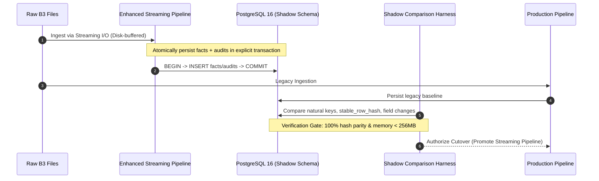

# Tucano B3 - Migration and Remediation Design (Final R6)

Prepared according to [PRD section 19.3](docs/b3_prd.md#193-sequência-de-migração) and [Review Plan](docs/19-plan.md).

Date: 2026-11-06, America/Sao_Paulo  
Scope: Architecture, Data Safeguards, Implementation Sequence, and Release Gates for `tucano-b3`.

---

## 1. Principles of Additive Migration

1. **Immutable Baseline Migration**:
   - `migrations/0001_initial_b3_schema.sql` is frozen and must never be altered retroactively.
   - All future structural additions or column enhancements must be introduced in sequential, additive migrations (`0002_coordination_and_calendar.sql`).
2. **Preservation of Market Facts**:
   - Historical quotes in `b3_cotahist_quotes`, `b3_price_report_quotes`, and `b3_equities_simplified_price_quotes` must never be altered, overwritten, or deduplicated by ticker alone.
   - `NULLS NOT DISTINCT` uniqueness invariants on natural keys guarantee facts remain distinct and uncorrupted.
3. **Audit History Continuity**:
   - Existing records in `b3_field_changes`, `b3_sync_runs`, and `b3_quarantine_records` must remain intact as immutable historical evidence.
4. **Zero-Downtime Consumer Parity**:
   - All 44 public/protected REST endpoints retain their exact URL path (`/api/v1/b3/...`), query parameter names, and standard response envelope:
     ```json
     {
       "items": [ ... ],
       "total": 1520,
       "limit": 100,
       "offset": 0,
       "disclaimer": "..."
     }
     ```
   - Internal refactorings (such as shared query service extraction) must produce byte-level compatible JSON responses matching `PaginatedResponse<T>`.
5. **Strict Transport Boundary**:
   - MCP and REST must execute identical analytical queries via shared service layers (`src/services/query/`).
   - MCP remains strictly read-only and never performs DDL migrations or ingestion mutations.

---

## 2. Implementation & Migration Packages (PRD §19.3 Sequence)

### Package 1: Baseline Preservation & Characterization Tests (PRD Step 1)
- **Status**: Completed in Phase R1.
- **Evidence**:
  - Live OpenAPI 3.1 specification saved in `.scratch/prd-alignment/evidence/openapi_reference.json`.
  - Endpoint and schema inventory recorded in `.scratch/prd-alignment/evidence/contracts_inventory.md`.
  - Representative response scenarios captured in `.scratch/prd-alignment/evidence/response_scenarios.md`.
  - Regression test suite expanded to 35 deterministic tests without skips.

### Package 2: Additive Coordination & Calendar Schema (PRD Steps 2 & 3)
- **Target Migration**: `migrations/0002_coordination_and_calendar.sql`
- **Context & Safeguards**:
  - `b3_trading_calendar` was **already created** in `migrations/0001_initial_b3_schema.sql` with columns `(calendar_date DATE PRIMARY KEY, is_trading_day BOOLEAN NOT NULL DEFAULT TRUE, holiday_name VARCHAR(255), source_note VARCHAR(255), updated_at TIMESTAMPTZ NOT NULL DEFAULT NOW())`.
  - **Never drop or recreate `b3_trading_calendar`**: Doing so would corrupt existing baseline schemas and destroy calendar data on rollback.
- **Additive Scope**:
  - Enhance `b3_trading_calendar` with non-destructive, additive columns:
    ```sql
    ALTER TABLE b3_trading_calendar ADD COLUMN IF NOT EXISTS session_type VARCHAR(32) NOT NULL DEFAULT 'REGULAR';
    ALTER TABLE b3_trading_calendar ADD COLUMN IF NOT EXISTS settlement_day BOOLEAN NOT NULL DEFAULT TRUE;
    ```
  - Populate/seed official B3 trading calendar records (1986–present), including national holidays, Carnival, Corpus Christi, and special half-day sessions (Ash Wednesday).
  - Create `b3_worker_leases` for durable task claiming and heartbeat fencing:
    ```sql
    CREATE TABLE IF NOT EXISTS b3_worker_leases (
        lease_id UUID PRIMARY KEY,
        resource_name VARCHAR(128) NOT NULL UNIQUE,
        owner_worker_id VARCHAR(128) NOT NULL,
        acquired_at TIMESTAMPTZ NOT NULL,
        heartbeat_at TIMESTAMPTZ NOT NULL,
        lease_duration_seconds INT NOT NULL
    );
    ```
  - **Safe Rollback Strategy (`down.sql`)**:
    - Drops `b3_worker_leases`:
      ```sql
      DROP TABLE IF EXISTS b3_worker_leases;
      ```
    - Removes only the added columns from `b3_trading_calendar`, preserving the base table and its rows:
      ```sql
      ALTER TABLE b3_trading_calendar DROP COLUMN IF EXISTS settlement_day;
      ALTER TABLE b3_trading_calendar DROP COLUMN IF EXISTS session_type;
      ```

### Package 3: Streaming Acquisition & Resilient Extraction (PRD Step 4)
- **Scope**:
  - Update `B3DownloadService`:
    - Stream HTTP response bodies directly to disk using `tokio::io::AsyncWriteExt` with bounded buffer chunks (e.g. 64 KB), calculating SHA-256 continuously in flight.
    - Guarantee memory usage remains $< 64\text{ MB}$ even when downloading 500 MB annual COTAHIST archives.
  - Update `extract_archive_members`:
    - Stream ZIP entries to temporary files.
    - Return explicit `AppError::Layout("Maximum ZIP recursion depth (4) exceeded")` instead of silent `Ok(())`.
    - Enforce maximum uncompressed member size limit (e.g., 500 MB).

### Package 4: Transactional Persistence, Publication Scope & Session-Lock Fencing (PRD Steps 4 & 5)
- **Publication Scope Definition**:
  - The publication boundary is strictly the **Complete Source File Scope** (the source archive and 100% of its mandatory members for a given `source_file_type` and `reference_date`).
  - **Zero Partial-Member Leakage**: A multi-member archive must either publish all required members together or publish nothing. Individual members (e.g., member A) must NEVER be committed independently to domain tables if a subsequent member (e.g., member B) fails.
- **Architecture & Invariants**:
  1. **Concurrency Exclusion**:
     - Acquire a session-level advisory lock (`pg_try_advisory_lock`) on a dedicated checkout connection from `PgPool` across the task duration.
     - Guarantees mutual exclusion between workers contending on the same file/date. Provides exclusion only, not transactional rollback.
  2. **Atomic Complete-File Transaction**:
     - The transaction boundary covers the **entire required file scope** (all members of the archive), NOT individual members.
     - Fact insertions across all members, granular field audits (`b3_field_changes`), member progress (`b3_source_file_members`), quarantine entries (`b3_quarantine_records`), and run counters (`b3_sync_runs`) execute within a single PostgreSQL transaction (`sqlx::Transaction`).
     - **Failure Rollback**: If *any* required member fails or an unrecoverable validation error occurs, the entire transaction issues an explicit `ROLLBACK`. All rows inserted across all members are discarded by PostgreSQL simultaneously, ensuring zero orphan or partial member data persists in domain tables.
     - The failure status is recorded in a separate operational transaction (marking `b3_source_files` and `b3_sync_runs` as `failed` with error details).
  3. **Active-Revision Pointer Mechanism in Query Layer**:
     - To ensure that readers never see in-progress or superseded data (even during large historical backfills or staged re-ingestions), all reader queries in `src/services/query/` must strictly join against the active completed file revision:
       ```sql
       JOIN b3_source_files sf ON sf.id = fact.source_file_id AND sf.status = 'completed'
       ```
     - This provides dual-layer protection:
       - **At persistence level**: Complete-file transaction rollback prevents partial member state from ever committing.
       - **At query level**: The active-revision pointer (`sf.status = 'completed'`) ensures external consumers only observe facts that belong to fully validated, published revisions.
  4. **Atomic Publication Pointer Flip**:
     - Only after *all* mandatory members pass structural validation and row counts match trailers:
       - Update all member rows in `b3_source_file_members` to `status = 'processed'`.
       - Update `b3_source_files` to `status = 'completed'` and set `updated_at = NOW()`.
       - Update `b3_sync_runs` to `status = 'completed'`.
       - Issue transaction `COMMIT`.
     - The `COMMIT` acts as an atomic publication flip, making all members and facts visible simultaneously.
  5. **Lock Lifecycle**: The session advisory lock is released in an RAII drop guard or explicit `finally` block before returning the connection to the pool.

### Package 5: Shared Query Services Layer (PRD Step 6)
- **Scope**:
  - Extract query SQL duplicated between `src/api/routers/` and `src/mcp/tools.rs` into:
    - `src/services/query/instruments.rs`: search, detail by security_id/ticker/isin, temporal identifiers history, and coverage diagnostics.
    - `src/services/query/quotes.rs`: COTAHIST raw historical OHLCV series with unadjusted prices disclaimer, BVBG.086 PriceReport quotes, BVBG.186 simplified quotes, and 086 vs 186 price comparison.
    - `src/services/query/indices.rs`: BVBG.087 registered indices list, index close/settlement values by date/code, theoretical portfolio compositions by index and date, and reverse ticker membership.
    - `src/services/query/source_files.rs`: source files catalog, archive member details, ingestion sync runs status/counters, and quarantine records inspection.
  - Wire Axum handlers and MCP tools to call these shared services.
  - Guarantee 100% parameter, ordering, pagination (`PaginatedResponse<T>`), and envelope parity between transports.
  - **Scope Boundary**: Corporate actions, external CVM enrichment, economic groups, and sector classifications are strictly excluded from this query layer, in full compliance with `AGENTS.md` and `PRODUCT.md`.

### Package 6: Worker Scheduler & Discovery Decoupling (PRD Step 6)
- **Scope**:
  - Replace `Local::now()` and Monday–Friday checks in `src/worker/mod.rs` with:
    - `chrono_tz::America::Sao_Paulo` timezone enforcement.
    - Query against `b3_trading_calendar` before triggering daily syncs.
    - Decouple discovery scanner (`b3_pending_updates`) from heavy ingestion.
    - Implement heartbeat update in `b3_worker_leases` during sync execution.

### Package 7: Shadow Comparison, Cutover, and Retirement (PRD Step 7)
- **Scope**:
  - Run shadow pipeline alongside existing pipeline on test datasets (`COTAHIST_A2026.TXT`, `IN260301.zip`).
  - Verify zero discrepancy in `stable_row_hash`, inserted counts, and audit logs.
  - Switch default execution path to streaming/shared query pipeline.
  - Deprecate old unbuffered handlers once full parity is verified.

---

## 3. Shadow Comparison and Cutover Protocol



### Verification Criteria Before Promotion
1. **Fact Equality**: 100% of rows inserted by the enhanced pipeline must have identical `stable_row_hash` to the legacy pipeline for the same input files.
2. **Audit Equality**: `b3_field_changes` must record identical field-level diffs.
3. **Memory Ceiling**: RSS memory during ingestion of full annual COTAHIST file (e.g. `COTAHIST_A2026.TXT`) must not exceed 256 MB.
4. **Lock Invariant**: Concurrent executions attempting the same date/source must return clean conflict status (HTTP 409 or skip) without deadlocking or leaking locks.

---

## 4. Review Plan Milestones vs. PRD Release Gates

### Review Plan Execution Status (docs/19-plan.md)
- [x] **R0 Baseline**: Hardened integration tests and isolated PostgreSQL 16 development environment.
- [x] **R1 Inventory**: Live OpenAPI 3.1 contract reference extracted and response scenarios documented.
- [x] **R2 Parsers**: ISO 20022 schemas and depth limit tests added and verified.
- [x] **R3 Persistence**: `UNIQUE NULLS NOT DISTINCT` invariant verified on natural keys.
- [x] **R4 Coordination**: Transactional fencing and session lock helpers implemented and verified.
- [x] **R5 Transports**: MCP read-only startup verified without migration rights.
- [x] **R6 Consolidation**: Subsystem dispositions recorded; migration roadmap and issue tracking finalized.

### PRD Release Gates Status (PRD §19 / §20)
- [ ] **Gate G0 (Source Viability)**: `needs-info` — External collection disabled awaiting legal eligibility confirmation ([Issue 01](docs/issues/01-source-viability.md)).
- [ ] **Gate G1 (Domain & Contracts)**: `pending-spec` — Contract baseline established; formal qualifier and temporal window specification pending ([Issue 02](docs/issues/02-domain-and-contracts.md)).
- [ ] **Gate G2 (Acquisition & Artifacts)**: `blocked` — Blocked by P1 in-memory download buffering and silent ZIP depth truncation ([Issue 03](docs/issues/03-artifact-acquisition.md)).
- [ ] **Gate G3 (Historical Core)**: `blocked` — Blocked by P1 persistence gap (lack of atomic transaction boundary across facts, audits, and status) and permissive COTAHIST trailer check ([Issue 04](docs/issues/04-historical-core.md)).
- [ ] **Gate G4 (Query Product)**: `blocked` — Blocked by P2 architecture gap (lack of shared query services between REST and MCP) ([Issue 05](docs/issues/05-query-product.md)).
- [ ] **Gate G5 (Operations)**: `blocked` — Blocked by P1 coordination gap (lack of populated trading calendar, worker timezone drift, and lack of durable worker leases) ([Issue 06](docs/issues/06-operations.md)).
- [ ] **Gate G6 (Price Reports)**: `blocked` — Blocked on platform prerequisites G1–G5 ([Issue 07](docs/issues/07-price-reports.md)).
- [ ] **Gate G7 (Indices & Portfolios)**: `blocked` — Blocked on platform prerequisites G1–G5 ([Issue 08](docs/issues/08-indices-and-portfolios.md)).
