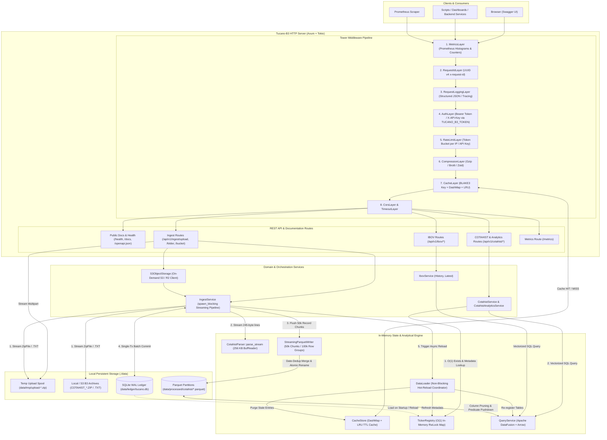

# Tucano-B3 — Architecture Document

`tucano-b3` is a high-performance, self-contained market data ingestion and query engine written in Rust. It ingests official fixed-width B3 `COTAHIST` files and serves historical quotes, compact chart series, price extremes, derived return/volatility/liquidity analytics, multi-ticker comparisons, daily market movers, and IBOVESPA index series over a low-latency REST API.

---

## 1. Architectural Principles

1. **Zero External Runtime Dependencies:** No external database server or message broker is required at runtime. The service combines an embedded **SQLite** ledger (`WAL` mode) for metadata/idempotency with **Apache Parquet** files queried in-process by **Apache DataFusion**.
2. **Columnar Vectorized Execution:** Analytical and time-series queries run directly against ZSTD-compressed, year-partitioned Parquet files using Apache Arrow record batches.
3. **Streaming & Bounded-Memory Ingestion:** Multi-million-row `COTAHIST` archives (`.ZIP` and `.TXT`) are streamed from disk or `ZipArchive` entries through a `256 KB` buffered line parser (`CotahistParser::parse_stream`) into a chunked `StreamingParquetWriter` (`50,000` rows per Arrow batch, `100,000` rows per ZSTD row group). Multipart uploads stream directly to temporary files on disk (`data/tmp`), keeping peak RAM bounded even on small nodes.
4. **Non-Blocking Runtime & Single-Transaction Ledger Commit:** CPU- and disk-intensive ingestion and data reload work runs on `tokio::task::spawn_blocking` so HTTP worker threads and `/health` Kubernetes probes are never starved. All trading dates (`ingested_dates`) and ticker metadata (`tickers`) for an ingested file are committed in a single atomic SQLite transaction (`record_ingestion_batch`) using cached prepared statements, followed by a hot reload of `DataLoader` and `CacheStore`.
5. **Defense-in-Depth Middleware Stack:** Every request passes through a deterministic Tower middleware pipeline enforcing observability, request correlation, token authentication, token-bucket rate limiting, response caching, and compression.

---

## 2. Directory & Module Map

```text
src/
├── main.rs                      # CLI entrypoint, .env/TOML config bootstrap, graceful shutdown
├── lib.rs                       # Shared library exports
├── error.rs                     # Unified AppError -> HTTP status & localized JSON ErrorResponse
├── locale/                      # Brazilian Portuguese user-facing messages (pt_br.rs)
├── config/                      # Layered config loader (Defaults -> config.toml -> .env / TUCANO_*)
├── server/                      # Axum router assembly, middleware wiring, Swagger UI hosting
├── metrics/                     # Application-wide Prometheus metrics registry (AppMetrics)
├── api/                         # HTTP transport adapters & Utoipa OpenAPI 3.0 specification
│   ├── cotahist.rs              # Tickers, quotes, latest, compact series, min/max, date quotes
│   ├── cotahist_analytics.rs    # Ticker analytics, multi-ticker compare, and daily movers
│   ├── ibov.rs                  # IBOVESPA history and latest point handlers
│   ├── ingest.rs                # Streaming ZIP upload, local folder, and S3/R2 bucket ingestion
│   ├── health.rs                # Liveness/readiness probe (/health, /api/v1/health)
│   ├── info.rs                  # Dataset & runtime metadata (/api/v1/info)
│   ├── metrics.rs               # Prometheus scrape endpoint (/metrics, /api/v1/metrics)
│   └── openapi.rs               # OpenAPI 3.0 builder, SecurityAddon (BearerAuth + ApiKeyAuth)
├── middleware/                  # Tower HTTP middleware layers
│   ├── auth.rs                  # Bearer / X-API-Key / X-Token authentication (TUCANO_B3_TOKEN)
│   ├── rate_limit/              # Per-IP and per-API-Key Token Bucket rate limiter
│   ├── cache.rs                 # HTTP GET response caching middleware
│   ├── metrics.rs               # Prometheus request counter & latency histogram recorder
│   ├── logging.rs               # Structured JSON/Pretty request/response logger
│   └── request_id.rs            # UUID v4 x-request-id generator and propagator
├── services/                    # Domain & query orchestration
│   ├── cotahist.rs              # SQL generation & Arrow RecordBatch extraction for COTAHIST
│   ├── cotahist_analytics.rs    # Windowed return, volatility, drawdown, compare & movers logic
│   ├── ibov.rs                  # SQL generation & Arrow RecordBatch extraction for IBOV
│   └── query_optimizer.rs       # Predicate pushdown & SQL query builders
├── data/                        # Storage & analytical query engine
│   ├── query_service.rs         # Apache DataFusion SessionContext & Parquet table registration
│   ├── reload.rs                # DataLoader with non-blocking RwLock hot-reload & TickerRegistry sync
│   ├── ticker_registry.rs       # In-memory RwLock<HashMap> of ticker metadata loaded from SQLite
│   ├── reader.rs                # Parquet file discovery across data/processed/{cotahist,ibov}
│   └── schema.rs                # Canonical Arrow schemas for COTAHIST and IBOV
├── ingest/                      # Streaming ingestion pipeline
│   ├── service.rs               # Orchestrates streaming ZIP/folder parse -> chunked Parquet -> batch ledger
│   ├── zip_handler.rs           # ZIP entry filter/extractor & folder scanner (.ZIP / .TXT)
│   ├── object_storage.rs        # On-demand S3 / Cloudflare R2 / MinIO bucket listing & download
│   ├── cotahist_parser.rs       # 245-byte fixed-width Latin-1/UTF-8 streaming parser & decimal scaler
│   └── parquet_writer.rs        # StreamingParquetWriter with 50k chunks, 100k row groups & date dedup
├── ledger/                      # Embedded SQLite state management
│   └── connection.rs            # WAL-enabled SQLite ledger for ingested_dates and tickers batch upserts
├── cache/                       # In-memory caching engine
│   ├── store.rs                 # DashMap + Mutex<LruCache> with TTL & max body size bounds
│   ├── key.rs                   # Deterministic BLAKE3 cache key generator
│   └── metrics.rs               # Cache hit/miss statistics
└── models/                      # Closed, strongly-typed DTOs & OpenAPI ToSchema definitions
    ├── envelope.rs              # Generic ApiResponse<T> envelope with concrete Utoipa aliases
    ├── cotahist.rs              # QuoteResponse, TickerResponse, SeriesResponse, PreUltExtremeResponse
    ├── cotahist_analytics.rs    # Analytics, comparison, and market movers DTOs
    ├── ibov.rs                  # IbovHistoryEntry, IbovHistoryResponse, IbovLatestResponse
    ├── ingest.rs                # IngestResponse, FolderIngestRequest, BucketIngestRequest, UploadFileRequest
    └── pagination.rs            # PaginationParams & PaginationMeta
```

---

## 3. Core Subsystems

### 3.1. Middleware Pipeline (`src/server/mod.rs`, `src/middleware/`)

Requests traverse the Tower layer stack from outer to inner on ingress, and inner to outer on egress:

1. **`MetricsLayer`**: Captures request arrival, normalizes dynamic URL parameters (e.g., `/cotahist/tickers/{ticker}`), and records status codes and execution duration histograms in Prometheus.
2. **`RequestIdLayer`**: Reads an incoming `x-request-id` header or generates a new UUID v4, attaching it to both the request and response.
3. **`RequestLoggingLayer`**: Emits structured `tracing` events containing method, path, status, latency, cache status, and `request_id`.
4. **`AuthLayer`**: Enforces token authentication configured via `TUCANO_B3_TOKEN` (and optional `TUCANO_B3_READ_TOKEN` / `TUCANO_B3_ADMIN_TOKEN`). Public routes (`/health`, `/api/v1/health`, `/docs`, `/api/docs/*`, `/openapi.json`, `/api/v1/openapi.json`) bypass validation; all other routes require a valid token via `Authorization: Bearer <token>`, `X-API-Key`, or `X-Token`.
5. **`RateLimitLayer`**: Applies a thread-safe Token Bucket algorithm per client IP (`default_requests_per_minute`) or per registered API key (`api_keys.toml`), returning `429 Too Many Requests` with `Retry-After` when exhausted.
6. **`CompressionLayer`**: Compresses outgoing payloads (`gzip`, `br`, `zstd`, `deflate`) negotiated via the client's `Accept-Encoding` header. Because it wraps `CacheLayer`, cached payloads are stored uncompressed and compressed per client on egress.
7. **`CacheLayer`**: Intercepts cacheable `GET` requests, computes a deterministic `BLAKE3(method | path | sorted_query)` key, and serves sub-millisecond `HIT` responses from `CacheStore`.
8. **`CorsLayer` & `TimeoutLayer`**: Enforces CORS headers and aborts requests exceeding `request_timeout_seconds` (with an extended `600s` timeout for `/api/v1/ingest/*`).

### 3.2. Ingestion Engine (`src/ingest/`, `src/ledger/`)

When `POST /api/v1/ingest/upload`, `POST /api/v1/ingest/folder`, or `POST /api/v1/ingest/bucket` is invoked:

- `/ingest/upload` streams multipart chunks (`64 KB` buffered writer) directly to a temporary file under `data/tmp/upload-<uuid>.zip` (enforcing the `500 MB` limit on the fly and automatically unlinking the file via a `Drop` guard when done), then dispatches `IngestService::ingest_zip_path` on `tokio::task::spawn_blocking`.
- `/ingest/folder` dispatches `IngestService::ingest_folder` on `tokio::task::spawn_blocking`, streaming `.ZIP` and `.TXT` files from disk one at a time.
- `/ingest/bucket` lists COTAHIST `.ZIP` keys in the S3-compatible bucket configured by `TUCANO_S3_*` (compatible with AWS S3, Cloudflare R2, and MinIO), downloads matching archives one at a time, and runs ingestion on `tokio::task::spawn_blocking`.

Inside `IngestService`:

1. **Streaming ZIP & File Access (`zip_handler.rs`, `service.rs`)**: Iterates over matching `COTAHIST*.TXT` members inside `ZipArchive` (or local `.TXT` files) and passes the `Read` stream directly to `CotahistParser::parse_stream` without decompressing whole `.TXT` files into memory.
2. **Streaming Positional Parsing (`cotahist_parser.rs`)**: Reads lines using a `256 KB` `BufReader`, borrows valid UTF-8 lines in-place (`Cow::Borrowed`) with an ISO-8859-1 (Latin-1) fallback, skips headers (`"00"`) and trailers (`"02"` / `"99"`), filters for quote records (`TIPOREG == "01"`), normalizes tickers, and converts implied decimal integers using `FAT_COTACAO`.
3. **Incremental Date Filtering & Self-Healing Metadata (`service.rs`)**: Loads previously ingested dates from SQLite (`ingested_dates`). As records stream through `parse_stream`, ticker metadata (`first_seen`, `last_seen`, `isin`, `company_name`) is aggregated in memory, while only records for new trading dates are forwarded to `StreamingParquetWriter`.
4. **Chunked Partitioned Parquet Persistence (`parquet_writer.rs`)**: `StreamingParquetWriter` buffers up to `50,000` records per year (`WRITE_CHUNK_ROWS`) before converting them into an Arrow `RecordBatch`, writing to `cotahist-<YEAR>.tmp` with ZSTD compression (`100,000` max row-group size), and clearing the buffer. On `finish()`, any existing `cotahist-<YEAR>.parquet` is streamed in chunks with overlapping dates filtered out via `arrow::compute::filter_record_batch` (preventing duplicates on retry), followed by an atomic rename from `.tmp` to `cotahist-<YEAR>.parquet`.
5. **Single-Transaction Ledger Commit & Non-Blocking Hot Reload (`ledger/connection.rs`, `reload.rs`)**: `Ledger::record_ingestion_batch` commits all new dates into `ingested_dates` and upserts all aggregated `TickerBatchEntry` rows into `tickers` inside a single SQLite `WAL` transaction using cached prepared statements. `DataLoader::reload` then runs file discovery, DataFusion `QueryService` creation, and `TickerRegistry` SQLite reload on `tokio::task::spawn_blocking` before swapping the `RwLock` handle and purging `CacheStore`.

### 3.3. Analytical Query Engine (`src/data/`, `src/services/`)

- **Fast Ticker Validation (`TickerRegistry`)**: Before executing any DataFusion query for a specific ticker, `CotahistService` and `CotahistAnalyticsService` check `TickerRegistry` (an in-memory `RwLock<HashMap<String, TickerInfo>>` populated from SQLite). Unknown tickers immediately return `404 TICKER_NOT_FOUND` in O(1) time without touching disk.
- **Vectorized Parquet Queries (`QueryService`)**: Validated queries execute SQL over the registered `cotahist` and `ibov` Parquet tables in Apache DataFusion, leveraging Parquet row-group statistics, predicate pushdown, column pruning (e.g., reading only `date, pre_ult, vol_tot, tot_neg` for `/series`), and vectorized aggregation.

---

## 4. Architectural Diagram


