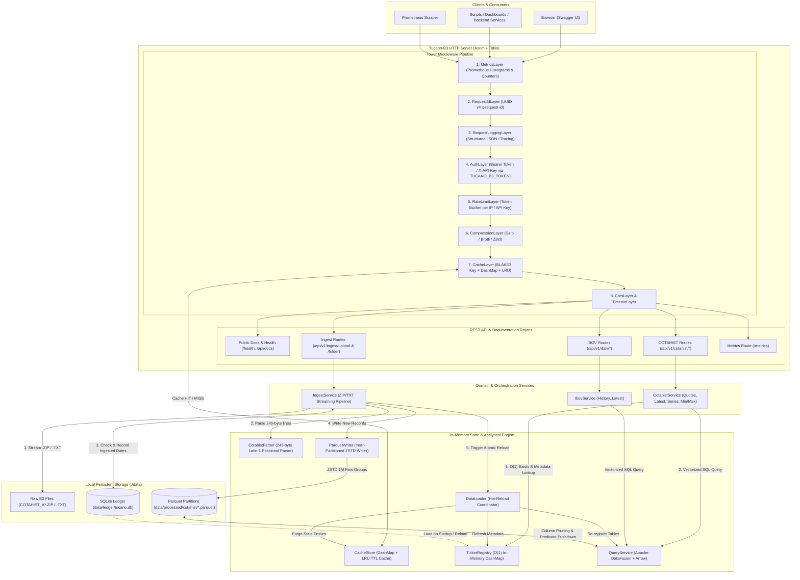

# Tucano-B3 — Architecture Document

`tucano-b3` is a high-performance, self-contained market data ingestion and query engine written in Rust. It ingests legacy fixed-width B3 `COTAHIST` files and serves historical quotes, compact chart series, price extremes, and IBOVESPA index series over a low-latency REST API.

---

## 1. Architectural Principles

1. **Zero External Runtime Dependencies:** No external database server or message broker is required at runtime. The service combines an embedded **SQLite** ledger for metadata/idempotency with **Apache Parquet** files queried in-process by **Apache DataFusion**.
2. **Columnar Vectorized Execution:** Analytical and time-series queries run directly against ZSTD-compressed, year-partitioned Parquet files using Apache Arrow record batches.
3. **Streaming & Bounded Memory Ingestion:** Multi-million-row `COTAHIST` archives (`.ZIP` and `.TXT`) are processed via buffered streams (`1 MB` read buffers) and written in columnar batches (`1M` row groups), preventing memory spikes.
4. **Strict Idempotency & Hot Reload:** The SQLite ledger tracks every ingested trading date (`ingested_dates`) and ticker (`tickers`). Re-ingesting overlapping daily, monthly, or annual files safely skips previously processed dates and triggers an atomic, zero-downtime hot reload of the DataFusion `SessionContext` and in-memory `CacheStore`.
5. **Defense-in-Depth Middleware Stack:** Every request passes through a deterministic Tower middleware pipeline enforcing observability, request correlation, token authentication, token-bucket rate limiting, response caching, and compression.

---

## 2. Directory & Module Map

```text
src/
├── main.rs                 # CLI entrypoint, .env/TOML config bootstrap, graceful shutdown
├── lib.rs                  # Shared library exports
├── error.rs                # Unified AppError -> HTTP status & localized JSON ErrorResponse
├── locale/                 # Brazilian Portuguese user-facing messages
├── config/                 # Layered config loader (Defaults -> config.toml -> .env / TUCANO_*)
├── server/                 # Axum router assembly, middleware wiring, Swagger UI hosting
├── api/                    # HTTP transport adapters & Utoipa OpenAPI 3.0 specification
│   ├── cotahist.rs         # Tickers, quotes, latest, compact series, min/max, date quotes
│   ├── ibov.rs             # IBOVESPA history and latest point handlers
│   ├── ingest.rs           # ZIP upload, local folder, and S3/R2 bucket ingestion handlers
│   ├── health.rs           # Liveness/readiness probe (/health, /api/v1/health)
│   ├── info.rs             # Dataset & runtime metadata (/api/v1/info)
│   ├── metrics.rs          # Prometheus scrape endpoint (/metrics, /api/v1/metrics)
│   └── openapi.rs          # OpenAPI 3.0 builder, SecurityAddon (BearerAuth + ApiKeyAuth)
├── middleware/             # Tower HTTP middleware layers
│   ├── auth.rs             # Bearer / X-API-Key / X-Token authentication (TUCANO_B3_TOKEN)
│   ├── rate_limit/         # Per-IP and per-API-Key Token Bucket rate limiter
│   ├── cache.rs            # HTTP GET response caching middleware
│   ├── metrics.rs          # Prometheus request counter & latency histogram recorder
│   ├── logging.rs          # Structured JSON/Pretty request/response logger
│   └── request_id.rs       # UUID v4 x-request-id generator and propagator
├── services/               # Domain & query orchestration
│   ├── cotahist.rs         # SQL generation & Arrow RecordBatch extraction for COTAHIST
│   ├── ibov.rs             # SQL generation & Arrow RecordBatch extraction for IBOV
│   └── query_optimizer.rs  # Predicate pushdown & SQL query builders
├── data/                   # Storage & analytical query engine
│   ├── query_service.rs    # Apache DataFusion SessionContext & Parquet table registration
│   ├── reload.rs           # DataLoader with RwLock hot-reload & TickerRegistry sync
│   ├── ticker_registry.rs  # In-memory DashMap of ticker metadata loaded from SQLite
│   ├── reader.rs           # Parquet file discovery across data/processed/{cotahist,ibov}
│   └── schema.rs           # Canonical Arrow schemas for COTAHIST and IBOV
├── ingest/                 # Ingestion pipeline
│   ├── service.rs          # Orchestrates ZIP/folder scan -> parse -> dedup -> Parquet -> ledger
│   ├── zip_handler.rs      # Streaming ZIP extractor & recursive folder scanner (.ZIP / .TXT)
│   ├── cotahist_parser.rs  # 245-byte fixed-width Latin-1/UTF-8 parser & implicit decimal scaler
│   └── parquet_writer.rs   # Year-partitioned ZSTD Parquet writer with deduplication & sort
├── ledger/                 # Embedded SQLite state management
│   └── connection.rs       # Tracks ingested_files, ingested_dates, and tickers metadata
├── cache/                  # In-memory caching engine
│   ├── store.rs            # DashMap + Mutex<LruCache> with TTL & max body size bounds
│   └── key.rs              # Deterministic BLAKE3 cache key generator
└── models/                 # Closed, strongly-typed DTOs & OpenAPI ToSchema definitions
    ├── envelope.rs         # Generic ApiResponse<T> envelope with concrete Utoipa aliases
    ├── cotahist.rs         # QuoteResponse, TickerResponse, SeriesResponse, PreUltExtremeResponse
    ├── ibov.rs             # IbovHistoryEntry, IbovHistoryResponse, IbovLatestResponse
    ├── ingest.rs           # IngestResponse, FolderIngestRequest, UploadFileRequest
    └── pagination.rs       # PaginationParams & PaginationMeta
```

---

## 3. Core Subsystems

### 3.1. Middleware Pipeline (`src/server/mod.rs`, `src/middleware/`)

Requests traverse the Tower layer stack from outer to inner on ingress, and inner to outer on egress:

1. **`MetricsLayer`**: Captures request arrival, normalizes dynamic URL parameters (e.g., `/cotahist/tickers/{ticker}`), and records status codes and execution duration histograms in Prometheus.
2. **`RequestIdLayer`**: Reads an incoming `x-request-id` header or generates a new UUID v4, attaching it to both the request and response.
3. **`RequestLoggingLayer`**: Emits structured `tracing` events containing method, path, status, latency, cache status, and `request_id`.
4. **`AuthLayer`**: Enforces token authentication configured via `TUCANO_B3_TOKEN` (and optional `TUCANO_B3_READ_TOKEN` / `TUCANO_B3_ADMIN_TOKEN`). Public routes (`/health`, `/api/v1/health`, `/api/docs/*`) bypass validation; all other routes require a valid token via `Authorization: Bearer <token>`, `X-API-Key`, or `X-Token`.
5. **`RateLimitLayer`**: Applies a thread-safe Token Bucket algorithm per client IP (`default_requests_per_minute`) or per registered API key (`api_keys.toml`), returning `429 Too Many Requests` with `Retry-After` when exhausted.
6. **`CompressionLayer`**: Compresses outgoing payloads (`gzip`, `br`, `zstd`, `deflate`) negotiated via the client's `Accept-Encoding` header. Because it wraps `CacheLayer`, cached payloads are stored uncompressed and compressed per client on egress.
7. **`CacheLayer`**: Intercepts cacheable `GET` requests, computes a deterministic `BLAKE3(method | path | sorted_query)` key, and serves sub-millisecond `HIT` responses from `CacheStore`.
8. **`CorsLayer` & `TimeoutLayer`**: Enforces permissive CORS headers and aborts requests exceeding `request_timeout_seconds`.

### 3.2. Ingestion Engine (`src/ingest/`, `src/ledger/`)

When `POST /api/v1/ingest/upload`, `POST /api/v1/ingest/folder`, or `POST /api/v1/ingest/bucket` is invoked:

`/ingest/bucket` lists COTAHIST `.ZIP` keys in the S3-compatible bucket configured by `TUCANO_S3_*` (Cloudflare R2 uses region `auto` and path-style addressing) and downloads them one at a time. It does not run unless that endpoint is called.

1. **Discovery & Extraction (`zip_handler.rs`)**: Scans the target directory for both `.ZIP` archives and `.TXT` files (or reads uploaded multipart bytes), validating archive size limits (`max 500 MB` compressed) and extracting `COTAHIST*.TXT` members.
2. **Streaming Positional Parsing (`cotahist_parser.rs`)**: Reads lines using a `1 MB` `BufReader`, decodes ISO-8859-1 (Latin-1) or UTF-8 bytes, filters for quote records (`TIPOREG == "01"`), normalizes tickers, and converts implied decimal integers using `FAT_COTACAO`.
3. **Ledger Deduplication (`ledger/connection.rs`)**: Queries SQLite (`data/ledger/tucano.db`) for all previously ingested dates (`ingested_dates`). Records belonging to already-ingested trading dates are skipped, guaranteeing idempotency across overlapping daily/monthly/annual files.
4. **Partitioned Parquet Persistence (`parquet_writer.rs`)**: Groups new records by calendar year, merges them with existing `data/processed/cotahist/cotahist-<YEAR>.parquet` data if present, deduplicates by `(ticker, date)`, sorts by `(date ASC, ticker ASC)`, and writes ZSTD-compressed Parquet files with `1,000,000` row-group size.
5. **Ledger Commit & Hot Reload (`reload.rs`)**: Updates the `tickers`, `ingested_dates`, and `ingested_files` tables in SQLite within a transaction, refreshes the in-memory `TickerRegistry`, swaps the DataFusion `QueryService` behind an async `RwLock`, and purges the HTTP `CacheStore`.

### 3.3. Analytical Query Engine (`src/data/`, `src/services/`)

- **Fast Ticker Validation (`TickerRegistry`)**: Before executing any DataFusion query for a specific ticker, `CotahistService` checks `TickerRegistry` (an in-memory `DashMap` populated from SQLite). Unknown tickers immediately return `404 TICKER_NOT_FOUND` in O(1) time without touching disk.
- **Vectorized Parquet Queries (`QueryService`)**: Validated queries execute parameterized SQL over the registered `cotahist` and `ibov` Parquet tables in Apache DataFusion, leveraging Parquet predicate pushdown, column pruning (e.g., reading only `date, pre_ult, vol_tot, tot_neg` for `/series`), and vectorized ordering.

---

## 4. Architectural Diagram


