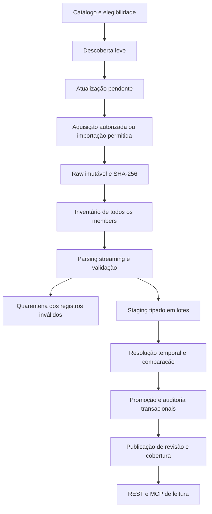
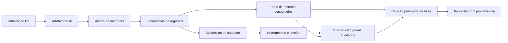

# PRD — Tucano B3: histórico de mercado verificável

Status: vigente

Versão: 2.0. Pesquisa de **05/11/2026**; adoção em **06/11/2026**, America/Sao_Paulo.

Responsável pela decisão de produto: mantenedor do projeto.

Este é o **único PRD de produto vigente** do `tucano-b3`. Define escopo e comportamento-alvo; sua adoção não significa que todas as capacidades estejam implementadas. Contratos publicados e migrations existentes permanecem sujeitos às regras de compatibilidade e migração deste documento.

Documentos associados: [pesquisa e fontes oficiais](RESEARCH.md), [vocabulário de domínio](domain/CONTEXT.md) e [issues de execução](#20-plano-de-entrega-e-issues).

## 1. Direção de produto

Construir uma **base histórica auditável de instrumentos e negociações da B3**, acessível por REST e MCP analítico, cujo diferencial seja responder corretamente:

> Qual informação a B3 publicou para esse instrumento, nessa data, em qual mercado, com quais unidades, de qual arquivo e versão, e com que limitações de cobertura e identidade?

O centro do produto é a confiabilidade do histórico. A stack Rust/Tokio/Axum/SQLx/PostgreSQL 16/quick-xml/rust_decimal/Utoipa permanece. Não será necessário adicionar Redis, Celery, um banco analítico ou uma plataforma de streaming para a primeira entrega.

Recomendações centrais:

1. **COTAHIST como base candidata do histórico longo de cotações.** A B3 apresenta a série desde 1986, sem ajustes retroativos; a cobertura efetiva será demonstrada por arquivos e períodos [R01](RESEARCH.md#r01).
2. **Registro B3 como raiz de identidade, com fontes distintas.** `BVBG.028`, Tradable Security List e `InstrumentsConsolidated` devem ser cruzados por evidência, preservando seus contratos e diferenças.
3. **Boletins diários como produtos específicos.** `BVBG.086`, `BVBG.186` e `BVBG.087` mantêm tabelas, DTOs, edições e linhagem próprias.
4. **Histórico antes de abrangência.** Entregar primeiro cotações históricas, identidade temporal, cobertura, replay e governança. Índices e demais famílias entram por marcos próprios, sem omissão dos requisitos finais.
5. **Disponibilidade, autorização e gratuidade são verificações diferentes.** A pesquisa não demonstrou permissão irrestrita para operar uma API externa gratuita de dados B3. Esse é um requisito de viabilidade, não um detalhe posterior à implementação.
6. **Capturar versões a partir de agora, sem inventar passado informacional.** Um arquivo de 1990 obtido em 2026 informa negociações de 1990; não prova quais bytes estavam disponíveis ao investidor em 1990.

O produto pode ter software aberto e custo de aquisição de dados igual a zero. A operação continua tendo custos de armazenamento, banco, backups e manutenção. A gratuidade dos dados e a possibilidade de distribuição precisam ser comprovadas para o uso escolhido.

## 2. Problema, público e trabalhos atendidos

### 2.1 Problema

Consultar um ticker e receber uma série de números não resolve pesquisa histórica quando faltam origem, mercado, fator de cotação, mudanças de identificação, versões e conhecimento das lacunas.

Os arquivos oficiais também possuem diferenças estruturais: cadastros são fotografias de instrumentos; cotações são fatos de negociação; carteiras têm vigência; um boletim pode ter mais de uma edição. Tornar tudo uma tabela genérica de “stocks” perde informação.

### 2.2 Público prioritário

| Público | Necessidade | Resultado esperado |
| --- | --- | --- |
| Desenvolvedor de produtos financeiros | Integrar histórico com semântica estável | DTOs tipados, paginação, documentação e exemplos reais validados |
| Analista e pesquisador quantitativo | Consultar séries sem confundir identidade ou unidades | Filtros de mercado e período, preços brutos, lacunas e revisões explícitas |
| Auditor e backoffice | Explicar de onde veio um valor e por que mudou | Proveniência até arquivo/member/registro e auditoria transacional |
| Operador da base | Manter a atualização e recuperar falhas | Estado por fase, retomada, cancelamento e fila durável |
| Consumidor MCP | Fazer consultas analíticas verificáveis | As mesmas regras de REST, sem SQL arbitrário ou mutações |

### 2.3 Perguntas que a primeira entrega deve responder

- Quais registros de COTAHIST existem para este ticker, mercado e intervalo, inclusive quando a identidade ainda não foi resolvida?
- Quais cotações foram vinculadas a este instrumento por evidência válida na data?
- Este número representa último negócio, abertura, quantidade negociada ou volume financeiro? Em qual moeda e base de cotação?
- Há dados para o período solicitado? Há falha de aquisição, quarentena ou apenas ausência de registro?
- Qual versão sustenta a resposta e quais arquivos repetiram a mesma informação?
- O que mudou após uma republicação, e o que foi apenas observado novamente?
- Qual trabalho está pendente, em execução, falhou ou pode ser retomado?

### 2.4 Objetivos e indicadores

| Objetivo | Indicador verificável | Critério |
| --- | --- | --- |
| Rastreabilidade | Itens retornados com proveniência navegável | 100% dos fatos publicados |
| Integridade de replay | Diferenças de negócio na repetição do mesmo conteúdo e versão de regras | Zero diferenças e zero eventos de alteração falsos |
| Precisão | Conversão financeira por ponto flutuante | Nenhuma no caminho de parsing, normalização, persistência e serialização |
| Honestidade histórica | Lacunas e identidades incertas ocultadas | Nenhuma nos cenários de aceite |
| Operação recuperável | Casos de falha com retomada sem duplicação | Todos os cenários obrigatórios da seção 18 |
| Custo de fonte | Fontes cuja aquisição ou uso obrigatório exige pagamento | Nenhuma habilitada no escopo gratuito |
| Eficiência | Memória, tempo, WAL e consultas por lote | Medidos no corpus de benchmark; orçamento definido após a primeira medição |

Não há meta de quantidade de ativos baseada na lista atual. O universo cresce com os registros efetivamente preservados, incluindo papéis descontinuados encontrados nas fontes.

## 3. Princípios e riscos de implementação

| Tema | Risco a evitar | Diretriz |
| --- | --- | --- |
| Posicionamento | Ênfase em Rust e números absolutos de velocidade | Ênfase em qualidade, explicabilidade e utilidade histórica |
| Desempenho | Apresenta footprint e throughput sem evidência reproduzível | Mantém eficiência como requisito e exige benchmark antes de publicar resultados |
| Acesso | Mistura site público, BDI e UP2DATA contratado | Catálogo por canal, formato, condições e profundidade verificada |
| Identidade | Trata cadastros como alternativas equivalentes | Fotografias de fontes distintas e resolução com justificativa |
| Ordem de carga | Cadastro como barreira para todo histórico dependente | Priorizar cadastro disponível, preservar fatos históricos mesmo sem vínculo |
| Temporalidade | Estende observações atuais a janelas potencialmente incertas | Distingue validade comprovada, observação e lacunas |
| COTAHIST | Aceita duas convenções de trailer indistintamente | Leiaute estrito, exceção versionada somente com evidência |
| Chaves | Define algumas chaves sem prova sobre o corpus | Chaves candidatas com perfil de colisões antes de migration |
| Revisões | Upsert e metadados não bastam para reproduzir respostas | Artefato imutável, observações e revisão publicada separadas |
| Conclusão operacional | Sucesso genérico e contadores agregados | Integridade, progresso, qualidade e visibilidade com semânticas próprias |
| Entrega | Todas as famílias, transportes e testes ao mesmo tempo | Marcos de produto com critérios de saída e dependências |

O novo desenho não usa as limitações do código para reduzir invariantes de proveniência, idempotência ou auditoria. Também não transforma recomendações em ADRs aceitos sem a decisão do mantenedor.

## 4. Viabilidade de acesso gratuito e publicação

### 4.1 Evidência que precisa orientar o lançamento

Os [termos institucionais](https://www.b3.com.br/pt_br/termos-de-uso-e-protecao-de-dados/termos-de-uso/) impõem condições de uso e difusão. Páginas de dados públicos apresentam restrição à automação; as políticas de Market Data distinguem modalidades e finalidades. A política regulatória estabelece divulgação gratuita para grupos específicos. Esses textos precisam ser considerados em conjunto, sem concluir que um deles concede direitos irrestritos sobre todos os demais [R03–R08](RESEARCH.md#r03).

**Conclusão de pesquisa:** a disponibilidade pública das fontes técnicas foi documentada; a viabilidade de uma API para terceiros com custo zero de licença permanece **não comprovada**.

### 4.2 Cadastro de elegibilidade por fonte e finalidade

Cada entrada do catálogo deverá registrar:

| Dimensão | Informação exigida |
| --- | --- |
| Origem | B3, página editorial e canal de entrega oficial |
| Acesso | Manual, automatizado autorizado ou não confirmado |
| Persistência | Condições para guardar raw, members, resultados e backups |
| Consumo | Uso pessoal/interno, REST, MCP e eventual uso por terceiros |
| Redistribuição | Condições para payloads, exports e disponibilização de arquivos |
| Gratuidade | Evidência de custo de dados igual a zero para a finalidade |
| Restrições | Limites de requisição, retenção, atribuição e finalidade aplicáveis |
| Evidência | URL, versão, vigência, data da verificação e documento/resposta de suporte |

Estado de elegibilidade: `unreviewed`, `eligible`, `restricted` ou `ineligible`. A elegibilidade é do par **fonte/finalidade**, não apenas do hostname. A configuração de um operador não equivale a autorização da B3.

### 4.3 Caminhos de execução

1. **Aquisição e finalidade confirmadas sem cobrança:** habilitar o canal correspondente, respeitando suas condições.
2. **Download manual permitido, automação não confirmada:** pode existir importação local de arquivo oficial licitamente obtido, dentro da finalidade permitida. Isso não libera redistribuição nem serve para contornar restrições de coleta.
3. **Redistribuição não confirmada:** continuar desenvolvimento com fixtures sintéticas ou autorizadas; não lançar uma API de dados para terceiros como se a licença estivesse resolvida.
4. **Licença obrigatória paga:** excluir o canal da configuração gratuita ou rever explicitamente a restrição econômica. Não ocultar esse custo nem inserir um fornecedor intermediário.
5. **Nenhum caminho compatível com todas as restrições:** registrar inviabilidade da modalidade desejada. A alternativa é reduzir a finalidade ou o escopo, ou obter permissão específica; não prometer uma solução técnica para uma permissão ausente.

O marco de viabilidade permite trabalho independente em parsing, contratos e recuperação enquanto são obtidas as evidências externas necessárias.

## 5. Estratégia de fontes

### 5.1 Matriz de escolha

Prioridade indica ordem de entrega; não autorização de acesso. Nenhum canal fica automaticamente habilitado por estar nesta matriz.

| Fonte | Papel recomendado | Histórico sustentado pela pesquisa | Prioridade / limite |
| --- | --- | --- | --- |
| COTAHIST anual | Base de backfill de cotações | Série anunciada desde 1986; validar cada ano | P0, núcleo do produto |
| COTAHIST diário/mensal | Atualização e reconciliação de sobreposição | Janelas distintas no formulário | P0 quando disponíveis |
| BVBG.028.02 | Registro de instrumentos e atributos por categoria | Arquivos retroativos no portal, profundidade não medida | P0 para identidade disponível |
| Tradable Security List | Definição de instrumentos de negociação e IDs | Especificação CSV/JSON; retenção não medida | P0 para evidências de identidade |
| InstrumentsConsolidated | Cadastro complementar com contrato próprio | Glossário e periodicidade documentados | P1, sem tratar como substituto integral |
| BVBG.086.01 | Relatório de preços por edição e mercado | Profundidade não medida | P1, separado do COTAHIST |
| BVBG.186.01 | Relatório simplificado de ações | Profundidade não medida | P1, sem fallback para 086 |
| BVBG.087.01 | Valores do relatório de índices e blocos próprios | Profundidade não medida | P2, preservar tipos de valor |
| Composições oficiais | Fotografias de carteira e vigência | Atual e publicações localizadas; série completa não provada | P2, distinguir prévias |
| Estatísticas históricas de índices | Candidato para ampliar backfill de índices | Datas iniciais divergentes entre páginas | Pesquisa P2; expansão de escopo |
| TradeInformationConsolidated | Candidato para estatísticas recentes | Glossário público, sem cobertura medida | Pesquisa futura; expansão de escopo |
| Eventos corporativos | Avaliação de viabilidade para eventual fase futura | Portal não prova série completa | Fora desta entrega |

As três últimas linhas **não ampliam automaticamente** a lista de fontes aceitas pelo `AGENTS.md`. Estatísticas de índices, TradeInformationConsolidated e eventos exigem decisão explícita de escopo e atualização das regras antes de implementação.

### 5.2 COTAHIST como produto principal

- Preferir arquivos anuais para períodos encerrados e backfill, por cobrirem muitos pregões com poucas aquisições. Essa é uma escolha operacional, não uma regra de autoridade sobre revisões.
- Não exigir diários antigos quando a distribuição oferecida é anual.
- Tratar o anual corrente como acumulado. Sua ausência de datas futuras não é exclusão de registros.
- Preservar os três tipos de arquivo como observações da mesma família. Registros equivalentes podem compartilhar um fato canônico; todas as ocorrências continuam rastreáveis.
- Não escolher silenciosamente entre valores divergentes de diário, mensal e anual. Aplicar a política da seção 8.
- Manter o aviso de preços nominais sem ajustes em REST, MCP, exports e documentação.

### 5.3 Cadastro e Tradable Security List

Recomenda-se ingerir primeiro as fotografias de cadastro disponíveis para o período pretendido e priorizar a preservação diária dessas evidências. O documento do Tradable Security List acrescenta informação útil de identidade; o cadastro consolidado não garante os mesmos campos [R09–R11](RESEARCH.md#r09).

O pipeline histórico não deverá ficar bloqueado pela impossibilidade de obter cadastro de uma época remota. Um registro de preço válido e não resolvido é um resultado preservável. A API por ticker/mercado/data continua disponível; consultas por instrumento retornam apenas vínculos sustentados por evidência.

Homologar explicitamente o relacionamento entre `SecurityID` de negociação e identificação do BVBG.028. Coincidência numérica ajuda a formar uma hipótese; o mapeamento exige qualificadores e amostras verificadas.

### 5.4 Boletins de preços

Cada adaptador informa família, schema, data de referência, edição e escopo de sessão. Não renomear todo preço final como “fechamento oficial” quando o campo representa outra medida. Comparações entre famílias exigem uma especificação de equivalência de campos e unidades.

Preservar distinções de termo, leilão, exercício, mercado fracionário e outros códigos publicados. Um gráfico simplificado de ação à vista deve selecionar esse universo explicitamente, sem misturar contratos ou somar sessões sobrepostas.

### 5.5 Índices e carteiras

No BVBG.087, cada bloco recebe DTO e unidade compatíveis. Um valor de IOPV ou referência de BDR não vira fechamento de índice por compartilharem um arquivo.

Para carteiras, guardar `index_code`, data-base, publicação conhecida, vigência, estágio (`preview` ou `effective`) e member de origem. Pesos diários não são constantes durante toda a vigência de uma carteira. A API não usará composição atual como substituto de um dia passado [R17](RESEARCH.md#r17).

Endpoints internos de frontend, como `GetPortfolioDay` ou `DownloadPortfolioDay`, são candidatos de implementação. Só entram no catálogo operacional após confirmar acesso, formato, semântica de data, paginação e histórico. Não há garantia de estabilidade derivada de seu uso pelo site.

### 5.6 Fontes deliberadamente excluídas

- Yahoo Finance, corretoras, vendors, mirrors e APIs agregadoras, gratuitas ou pagas.
- Ingestão CVM, dados de balanços, indicadores fundamentalistas e âncoras `CNPJ_CIA`/`CD_CVM`.
- Dados macroeconômicos de outros órgãos, renda fixa de balcão, empréstimos e curvas como expansão incidental desta entrega.
- Book de ofertas, ticks, streaming e cotações em tempo real.
- Uma fonte paga apresentada como fallback transparente de uma fonte gratuita indisponível.

Uma aplicação consumidora pode combinar `tucano-b3` e `tucano-cvm` fora deste domínio. Este serviço não fará chamadas ao projeto CVM durante ingestão ou consulta.

## 6. Escopo funcional e universo

### 6.1 Primeira entrega útil

O primeiro produto completo é: **consultar histórico COTAHIST com precisão, proveniência, filtros de mercado, resolução temporal opcional e cobertura explicada**, sustentado por operação recuperável.

O parser preservará todos os registros válidos dos arquivos aceitos. O caso inicial de uso concentra-se em ações à vista; classes adicionais só recebem classificação quando os códigos e cadastros a sustentarem. FIIs, ETFs, BDRs, units, opções e termo encontrados não serão descartados por uma heurística de sufixo do ticker.

`asset_class=equity` não pode ser implementado como “ticker termina em 3 ou 4”. Um ticker descontinuado encontrado no histórico não depende de estar na lista atual para permanecer consultável.

### 6.2 Não objetivos

- Preços ajustados por eventos, retorno total e cálculo completo de rentabilidade para backtests.
- Reconstituição integral de informações disponíveis antes de a plataforma começar a capturar versões.
- Inferir proventos a partir de saltos de preço ou usar `DISMES` como catálogo de dividendos.
- Criar séries contínuas de futuros, preços de ações sintéticos ou agregações entre moedas sem metodologia própria aprovada.
- Produzir valuation, recomendação de investimento ou perfil completo de emissor a partir do cadastro de instrumentos.
- Implementar um data lake, Kubernetes, Kafka, ClickHouse, DuckDB ou Parquet obrigatório para viabilizar o MVP.

## 7. Identidade temporal

### 7.1 Entidades e invariantes

O **instrumento B3** permanece a raiz canônica. Seu UUID interno é estável; ticker, ISIN e códigos externos são identificadores contextualizados. Emissor, instrumento, classe, mercado e código de negociação não são sinônimos.

Guardar a identidade externa com `security_id`, fonte/namespace e local de listagem quando informados. Não eliminar qualificadores que possam diferenciar valores de namespaces distintos. Identificação de distribuição participa das regras quando aplicável.

O preço bruto continua endereçável mesmo sem `instrument_id`. Resolver uma relação não muda o valor publicado pela B3 nem o hash de negócio do fato de mercado.

### 7.2 Ordem de resolução

Respeitar a precedência do domínio existente, com verificação de consistência:

1. `security_id` qualificado e compatível com o período e mercado.
2. ISIN validado, ticker, distribuição quando disponível, mercado e data dentro de janelas sustentadas.
3. Ticker, mercado e data quando houver um único candidato admissível.
4. ISIN e data apenas quando a unicidade e o contexto forem demonstrados.

Se um identificador forte e outros atributos fornecidos apontarem para instrumentos incompatíveis, registrar o conflito. Não ignorar a divergência para produzir um vínculo aparentemente resolvido. ISIN ou mercado ausente não é autorização para ampliar a busca até encontrar qualquer registro.

Resultados: `resolved`, `unresolved`, `ambiguous`, acompanhados de método, versão da regra e evidência. Conflitos de atributo podem ter motivo próprio sem criar um quarto estado público sem migração de contrato.

### 7.3 Janelas e conhecimento incompleto

- `valid_from`/`valid_to` representam validade conforme o contrato; `first_seen_at`/`last_seen_at` representam observação da plataforma.
- Preservar a convenção inclusiva existente em contratos. Se uma implementação adotar intervalos semiabertos internamente, a conversão deve ser explícita, testada e não alterar respostas publicadas.
- Uma fotografia em 2026 não prova que o ticker era o mesmo em 2001, mesmo que o cadastro traga início de negociação anterior.
- Reutilizar uma janela inalterada; fechar substituição conhecida deterministicamente; processar arquivos fora de ordem pela data efetiva, não pela chegada.
- Uma ausência em arquivo parcial, falho ou de escopo diferente não prova deslistagem. Fechamento exige evidência explícita ou regra homologada sobre fotografia completa.
- Uma ausência entre duas fotografias gera lacuna de evidência quando não há base para assumir continuidade. A regra conservadora precisa permanecer disponível para consultas rigorosas.

### 7.4 Cenários obrigatórios

| Cenário | Comportamento |
| --- | --- |
| Mesmo security_id, novo ticker com data comprovada | Reutilizar instrumento e fechar/abrir as janelas correspondentes |
| Mesmo ticker reaparece para outro instrumento | Preservar os dois instrumentos; resolver pela data e contexto |
| Mesma empresa, ON e PN | Manter instrumentos distintos |
| Mesmo papel em mercados diferentes | Preservar a granularidade de negociação; não somar preços |
| ISIN com distribuições distintas | Considerar distribuição; não colapsar automaticamente |
| COTAHIST anterior ao cadastro disponível | Preservar o fato sem vínculo; permitir rebuild posterior |
| Chega cadastro antigo após cadastro recente | Reconstruir apenas intervalos afetados, com auditoria |
| Fonte forte contradiz atributos complementares | Expor ambiguidade/conflito para tratamento |

## 8. Histórico, versões e revisões

### 8.1 Quatro objetos diferentes

| Objeto | Identidade proposta | O que representa |
| --- | --- | --- |
| Artefato bruto | SHA-256 dos bytes + manifesto de aquisição | Arquivo ou payload efetivamente recebido |
| Publicação da fonte | Família, período, edição e versão oficial quando existirem | O que a B3 disponibilizou |
| Observação | Arquivo/member/localizador + execução | Onde um conteúdo foi encontrado novamente |
| Revisão publicada da base | `data_revision` e conjunto de evidências/regra | Estado consistente disponibilizado ao consumidor |

Um ZIP recomprimido pode mudar de hash sem mudar seus members. Um member reordenado pode mudar de hash sem alterar os fatos. Um único preço corrigido muda um fato. Os três eventos precisam de tratamentos diferentes.

### 8.2 Duas dimensões temporais

- **Tempo de mercado:** pregão, data de referência e vigência.
- **Tempo de conhecimento da plataforma:** observação, ingestão e publicação de revisão.

`published_at` da B3 só será preenchido com evidência de publicação; `downloaded_at`, header HTTP e relógio local não são substitutos silenciosos. Guardar também `publication_time_basis` quando a origem da data exigir distinção.

Consultas `as_of` de conhecimento só serão oferecidas após a implementação de versões necessárias e apenas no horizonte efetivamente capturado. O contrato explicará se usa publicação oficial comprovada ou conhecimento local. Não anunciar “backtest sem look-ahead” para um histórico obtido retrospectivamente.

### 8.3 Precedência de revisões e conflitos

1. Mesma chave e conteúdo canônico igual: reutilizar fato; adicionar observação e proveniência de suporte.
2. Revisão oficial ordenável da mesma publicação: preservar a anterior e promover a nova após validação.
3. Sobreposição de granularidades com valores distintos e sem precedência oficial comprovada: registrar conflito; não aplicar “último download vence”.
4. A ordem de inventário de members é determinística, mas não representa autoridade editorial.
5. Uma política de seleção manual precisa ter motivo, ator, versão e linhagem. A API informa a política aplicada; o conflito original permanece consultável.

O anual não vence o diário apenas por ser anual. O diário não vence o anual apenas por ter chegado depois. Esta é uma regra de integridade do produto; os critérios de precedência dependentes de fonte serão homologados com o corpus.

### 8.4 Reprocessamento e remoções

`force_reparse` cria uma execução que reaproveita o raw imutável com regras identificadas. Nunca apaga a execução ou observação anterior para fingir que o novo parser sempre existiu.

Uma versão nova de arquivo pode corrigir ou retirar uma linha. Remoções só são aplicadas após validar que o artefato é uma fotografia completa e substitui exatamente aquele escopo. Publicações parciais, acumulados incompletos ou membro falho não autorizam reconciliação destrutiva. Registrar retirada lógica e evidência; preservar versões históricas e ocorrências.

## 9. Normalização e integridade financeira

### 9.1 Regras transversais

- `rust_decimal::Decimal` para valores e quantidades decimais; `NUMERIC` com precisão e escala suficientes no PostgreSQL. Escala do destino deve ser verificada por campo e categoria, sem truncamento ou arredondamento implícito.
- Guardar moeda, unidade, escala e fator de cotação quando publicados. Semântica desconhecida permanece desconhecida.
- Strings financeiras em JSON usam ponto decimal e nenhuma separação de milhar. Contagem de registros e de negócios pode ser inteiro; quantidade de títulos/contratos permanece decimal quando o contrato assim exigir.
- Canonicalização específica por campo: espaços de preenchimento, caixa de ticker/ISIN, datas sentinela e representação decimal equivalente. Não remover caracteres de códigos arbitrariamente.
- Separar valor bruto, valor canônico e transformação derivada. O hash canônico não inclui UUIDs, timestamps operacionais, ordem das colunas ou vínculo reconstruído.
- Versionar `parser_version`, `normalization_version` e `identity_rule_version`. Uma mudança de normalização exige comparação controlada para não gerar auditoria falsa em massa.

### 9.2 COTAHIST: contrato de interpretação

O leiaute oficial orienta a leitura; detalhes confirmados estão em [R12](RESEARCH.md#r12). Requisitos de implementação propostos:

- Validar largura em bytes antes da decodificação; tratar CRLF/LF e final de arquivo sem alterar os 245 bytes do registro.
- Selecionar encoding por perfil homologado. Não tratar ISO-8859-1 e Windows-1252 como equivalentes universais.
- Exigir registros de controle únicos, ordem válida, datas coerentes, escopo correto e contagem física consistente, incluindo linhas de detalhe inválidas preservadas na quarentena.
- Aplicar as escalas declaradas a cada campo, em vez de uma regra decimal global.
- Preservar `term_days`, distribuição, código original de identificação e atributos opcionais, sem usar sentinelas como datas efetivas.
- Separar `source_identifier` de `isin` validado nos períodos em que a origem não representa necessariamente ISIN. Essa separação requer migração compatível do campo já exposto.
- Não inferir abertura a partir de último preço. Não confundir preço de exercício, pontos de exercício e preço de mercado.
- Erro estrutural de header/trailer torna o escopo não publicável; erro isolado de uma linha permite preservar as demais em revisão marcada com problemas de qualidade.

### 9.3 Fator, moeda e séries

O preço bruto é mantido como recebido após interpretação decimal. Uma eventual opção de preço por unidade deve retornar valor derivado separado, fórmula e política de arredondamento. Não substituir o bruto.

Exemplo **sintético**: preço bruto `"1000.00"`, fator `1000`, moeda conhecida e semântica unitária homologada permitem derivar `"1.00"` por unidade. Isso não calcula proventos, inflação ou câmbio. Não aplicar a mesma fórmula indiscriminadamente a quantidades e volumes.

Um intervalo que atravessa moedas históricas não pode produzir uma única série rotulada BRL. Consultas que exigem moeda uniforme devem rejeitar o pedido incompatível ou devolver segmentos explicitamente distintos. Não fazer conversão externa dentro do serviço.

Séries retornam registros observados. Feriado, falta de negócio e falha de aquisição não viram preço zero. Não preencher o último preço automaticamente.

### 9.4 Chaves e prova de granularidade

Toda ocorrência tem chave técnica `(source_member_id, record_index)`. A chave de um fato canônico é independente do arquivo e do `instrument_id` resolvido.

| Família | Chave candidata / discriminadores mínimos a homologar |
| --- | --- |
| Cadastro com ID de instrumento | Namespace, local de listagem, security_id, data/edição da fotografia |
| Identificadores | Instrumento, tipo, valor, contexto de mercado, distribuição quando aplicável e intervalo |
| COTAHIST | Pregão, ticker, mercado, BDI, distribuição; testar inclusão de `term_days` para termo e demais discriminadores encontrados |
| BVBG.086 | Pregão, identidade publicada, mercado e `days_to_settlement`; edição pertence à camada de versão |
| BVBG.186 | Granularidade homologada específica da família, sem copiar a chave de 086 por conveniência |
| BVBG.087 | Pregão, instrumento/código, bloco e tipo de valor, contexto necessário |
| Composição | Identidade da fotografia de carteira e chave publicada do componente; vínculo resolvido fica fora da chave |

O perfil de colisões deve distinguir duplicata igual, revisão legítima e dois fatos distintos. Chaves candidatas não são declarações de unicidade garantida pela B3. Antes de uma migration, demonstrar que não colapsam prazo, distribuição, sessão ou categoria. Não acrescentar campos ad hoc apenas para esconder uma colisão sem entender seu significado.

Componentes opcionais usam `UNIQUE NULLS NOT DISTINCT` quando a igualdade de ausências fizer parte do contrato. Isso não transforma uma chave insuficiente em uma chave correta.

## 10. Processo completo de aquisição e ingestão

### 10.1 Descoberta leve, execução separada

O scanner identifica publicações e possíveis revisões com o mecanismo permitido por cada canal. Grava checagens, resultados inconclusivos e `b3_pending_updates`. Não executa parsing, rebuild ou promoção.

`HEAD`, ETag e Last-Modified são capacidades opcionais, não pré-condições universais. Metadado igual é evidência limitada quando o servidor não garante estabilidade; ausência de validators exige estratégia documentada e permitida. Mudança de ZIP não prova mudança de dados.

Recomenda-se iniciar com scanner e ingestão separados e promoção disparada por operação administrativa, seguindo o resultado operacional do `tucano-cvm`. Ingestão automática pode ser adicionada como política explícita por fonte elegível, após estabilizar qualidade, limites e recuperação. A migração do worker atual deve preservar rastreabilidade, compatibilidade e recuperação.

### 10.2 Duas fases, com checkpoints internos



**Fase 1: aquisição, integridade e inventário.** Resultado: raw persistido, manifesto, hashes, tamanho, escopo declarado e lista determinística de members, inclusive ZIPs aninhados. Um artefato incompleto ou cujo corpo seja HTML de erro não avança.

**Fase 2: interpretação, resolução e persistência.** Resultado: fatos tipados, rejeições localizadas, relações, auditoria e revisão publicável. Os checkpoints internos permitem retomar sem repetir trabalho já confirmado.

### 10.3 Aquisição e armazenamento

- Fazer download para arquivo temporário com tamanho máximo, timeout, hash incremental e rename atômico após verificação; não manter o corpo inteiro em `Vec<u8>`.
- Raw em filesystem persistente no começo, organizado por conteúdo; manifesto no PostgreSQL. Object storage é evolução opcional, não requisito imediato.
- Validar HTTPS, host exato, porta permitida, redirects e destino de rede. Rejeitar destinos privados, loopback e metadados de nuvem em conectores externos, inclusive após resolução e redirecionamento.
- Dois passos com token só no adaptador do canal homologado. Não salvar tokens temporários em URLs públicas, logs, erros ou proveniência exposta.
- Validar checksum calculado, tamanho, MIME aparente e assinatura do arquivo. Hash local comprova igualdade de bytes, não autenticidade criptográfica da B3.
- Importação local exige confinamento no diretório previsto e manifesto de procedência. Uma requisição do consumidor não pode acessar caminhos arbitrários do servidor.

### 10.4 ZIP, XML, CSV e memória limitada

- ZIP: preservar caminho completo de aninhamento, índice de entrada, pai, nome, hash e tamanhos. Nomes iguais em containers distintos não são o mesmo member.
- Inventariar entradas relevantes e não relevantes, com motivo de seleção ou exclusão. Limite de profundidade excedido é falha visível; nunca omissão silenciosa.
- Aplicar limites a bytes comprimidos, descomprimidos, quantidade de entradas, razão de expansão, profundidade e tamanho individual. Rejeitar path traversal, entradas ambíguas e symlinks quando não previstos.
- XML: interpretar namespace e caminho completo; limitar tamanho de registro, texto e profundidade; rejeitar entidades externas/DTD não suportados. Um erro sintático irrecuperável pode invalidar o member; não fingir que um XML truncado produziu uma base completa.
- CSV: usar perfil versionado de headers, preâmbulo, delimitador, encoding, datas e decimais. Não fazer detecção heurística ilimitada em produção. Campos desconhecidos provocam diagnóstico e aplicação da política de compatibilidade, nunca descarte invisível.
- JSON do Tradable Security List: processar a sequência incrementalmente e tipar grupos repetidos. Não carregar o array inteiro apenas por ser JSON.
- Lotes têm limite de linhas **e de bytes**. Um registro grande não pode exceder o orçamento porque o lote tem poucas linhas. Parsing bloqueante usa capacidade limitada fora das tarefas de I/O do Tokio.

### 10.5 Promoção e visibilidade

Usar staging tipado transitório, `COPY` quando o benchmark justificar, e operações em conjunto para comparação, resolução e upsert. Evitar consulta por registro e staging JSON obrigatório para todo o caminho válido.

Para conciliar lotes limitados e publicação consistente, recomenda-se associar os resultados a uma revisão de escopo. Lotes podem ser persistidos internamente, mas a troca da revisão ativa só ocorre após a conclusão dos members obrigatórios e validações estruturais. A implementação deverá medir a necessidade de projeção separada para leitura; não duplicar toda a base sem justificativa.

Invariantes transacionais:

- Fato alterado, evento de campo, proveniência selecionada e contador do lote confirmam juntos.
- A revisão anterior continua servível até a publicação da substituta.
- Arquivo estruturalmente inválido não substitui revisão válida.
- Linhas inválidas isoladas permanecem em quarentena; se a política permitir publicação das válidas, a revisão expõe qualidade degradada e contagens exatas. Completude estrutural e ausência de rejeições são dimensões diferentes.
- Uma falha entre a confirmação de lotes e a troca de revisão não torna dados parciais públicos.

### 10.6 Contadores e idempotência

No nível de member, contar registros de detalhe, separando controles e entradas não selecionadas. Uma classificação final por ocorrência deverá fechar:

`detail_records_read = inserted + changed + unchanged + duplicate_in_scope + rejected`

`identity_unresolved`, `identity_ambiguous` e conflitos de seleção são dimensões adicionais, não parcelas a somar novamente nessa equação. Um registro pode ser válido e não resolvido. Os contadores são derivados do que foi confirmado, com tentativas e rollbacks identificados separadamente.

Repetir o mesmo member, parser e regras pode reutilizar o resultado anterior; registra nova observação operacional sem visitar ou alterar todas as linhas. Nesse caso, não fingir que cada registro teve `last_seen_at` atualizado individualmente. A execução informa `reused_result` e a referência reaproveitada.

Datas de negócio e auditoria:

- `created_at`: primeira persistência do fato.
- `last_seen_at`: última observação individual efetivamente processada, conforme contrato documentado.
- `data_changed_at`: última alteração real de negócio.
- `field_changed_at`: alteração efetiva de cada campo.

Valores canonicamente iguais não alteram campos de negócio, hash, timestamps de mudança ou `b3_field_changes`. Troca de proveniência equivalente e reconstrução de identidade têm trilhas próprias; não são mudanças de preço.

### 10.7 Quarentena e recuperação

Guardar reason code estável, mensagem em português, fonte, member, registro/linha, byte offset quando disponível, trecho ou referência recuperável ao raw, versões de regra e tentativas.

Replay cria trabalho rastreado a partir do raw ou payload preservado. A correção não remove o registro original de rejeição: muda seu estado de resolução com referência à execução que o tratou. Não aceitar edição arbitrária do dado de mercado por consumidor.

## 11. Coordenação e prioridades

### 11.1 Fila durável

API e CLI submetem o mesmo tipo de comando a serviços compartilhados. O worker consome trabalhos PostgreSQL, com claim por `FOR UPDATE SKIP LOCKED`, lease, heartbeat, tentativas, backoff e prazo de expiração. A implementação precisa impedir que um worker cuja lease expirou continue promovendo resultados: usar geração de claim/fencing validada na confirmação.

Pelo menos três classes de trabalho: manutenção regular, backfill e reconstrução. Reservar capacidade para manutenção. Queries analíticas têm pool, concorrência e timeout limitados para não consumir todas as conexões da ingestão. Cancelamento e recuperação não dependem de uma fila saturada de trabalho pesado.

### 11.2 Locks por escopo real

O lock de aquisição pode usar família e identificador de publicação. O lock de promoção precisa considerar **sobreposição de fatos**: diário, mensal e anual de COTAHIST podem atingir o mesmo pregão. Proteger apenas `source_file_type:reference_date` permite corridas entre granularidades.

Adquirir locks em ordem estável e mantê-los na mesma conexão/transação durante a seção protegida. Não segurar uma transação de banco durante horas de download; separar aquisição de promoção. Não usar mutex local como garantia entre API, CLI e múltiplos workers.

Tentativas concorrentes de uma operação incompatível para o mesmo escopo retornam `409 Conflict`; duplicação com a mesma chave de idempotência e mesmo pedido retorna o trabalho já criado, sem uma segunda execução. Mesma chave com payload diferente retorna conflito.

### 11.3 Cancelamento, falhas e reexecução

Persistir `cancel_requested_at`. O worker verifica cancelamento nos limites de download, member, lote e publicação; limpa temporários e libera conexões. Resultado já confirmado preserva sua trilha; revisão ainda não publicada permanece interna.

Estados propostos: `queued`, `running`, `succeeded`, `succeeded_with_issues`, `failed`, `cancelled`, com fase e motivo separados. A introdução desses estados deve migrar DTOs e enums existentes; não pode ocorrer como texto livre adicionado silenciosamente.

Run de vários escopos pode ter resultados mistos. Cada filho informa seu estado. O pai resume o resultado real; não converte falha de uma data em “sucesso com zero registros”.

## 12. Persistência proposta

Esta seção é um modelo lógico para decomposição, não DDL pronto nem aprovação para reescrever a migration inicial.

| Área | Entidades/tabelas existentes a preservar | Extensão proposta |
| --- | --- | --- |
| Catálogo | Enum de famílias e configuração | Registro de capacidades, schemas, elegibilidade e horizontes |
| Descoberta | `b3_pending_updates` | Runs e checagens do scanner, baseline reconhecido e resultados inconclusivos |
| Aquisição | `b3_source_files`, `b3_source_file_members` | URI raw, árvore de members, edição, manifesto e tentativas separadas |
| Execução | `b3_sync_runs` | Trabalhos/claims, checkpoints por member, cancelamento e heartbeat |
| Qualidade | `b3_quarantine_records` | Motivos tipados, histórico de replay e conflitos de seleção |
| Auditoria | `b3_field_changes` | Escopo de revisão e distinção entre alteração de mercado e de relação |
| Identidade | `b3_instruments`, `b3_instrument_identifiers` | Fotografias de registro, evidência temporal e histórico de resolução |
| Fatos | Tabelas específicas por família | Versões e ocorrências/proveniências de suporte |
| Publicação | Sem contrato completo hoje | Revisão ativa por escopo, política de seleção e manifesto de resposta |
| Cobertura | `b3_trading_calendar` e diagnósticos | Calendário versionado e cobertura por etapa e qualidade |

O relacionamento lógico entre evidência e fatos evita a escolha forçada de um único arquivo de origem:



Uma ocorrência sustenta uma versão de fato; várias ocorrências equivalentes podem sustentá-la. Alteração de vínculo e alteração de mercado são trilhas diferentes. O manifesto de revisão identifica as versões selecionadas sem exigir cópia integral dos fatos inalterados.

Novas tabelas só serão criadas com responsabilidade clara. Evitar uma tabela universal de fatos com payload JSONB arbitrário. JSONB serve para metadados e auditoria delimitados; colunas públicas e chaves devem ser tipadas.

Índices iniciais seguem consultas reais: ticker/mercado/data, instrumento/data, ISIN/data, família/escopo/estado e FKs de proveniência. Particionamento por período só será adotado com evidência de volume, manutenção e plano de consultas; medir o impacto em unicidade e migrações.

Toda mudança estrutural usa nova SQLx migration. Validar banco vazio e upgrade da versão anterior com dados e auditoria preservados. Backfill de metadados desconhecidos usa `unknown`/nulo com explicação; não fabricar datas de publicação ou janelas antigas.

## 13. REST: contrato de consulta

### 13.1 Compatibilidade

Preservar `/api/v1/b3/...`, rotas por família, nomes e campos publicados. A primeira implementação deve comparar OpenAPI e respostas reais com README e PRD; uma rota documentada não prova comportamento completo.

Campos novos opcionais podem ser aditivos quando seguros para consumidores. Alterações de envelope, obrigatoriedade de filtros, significado de preço, enum fechado ou identidade exigem plano de migração. Quando não houver compatibilidade, criar versão nova mantendo a anterior durante janela documentada. Nenhuma implementação fica autorizada a trocar `/api/v1` para um contrato incompatível apenas porque este PRD propõe novos campos.

### 13.2 Convenções

- Bearer em rotas protegidas. Exceções de saúde e documentação são enumeradas e testadas; não cobrem ingestão.
- Separar autorização de leitura e administração antes de disponibilizar operação a consumidores. Enquanto houver token único, documentar a limitação e manter administração em ambiente controlado.
- `limit=100`, máximo 1000; `offset=0`; valores inválidos são `400`, sem silenciosamente transformar negativos em válidos. Ordenação com desempate único.
- `trade_date_from` e `trade_date_to` usam datas ISO e limites inclusivos documentados. Parâmetros fora de ordem são `400`.
- Filtros específicos de mercado, BDI, distribuição, prazo e identidade seguem a família. `ticker` isolado retorna fatos daquele código, não uma promessa de instrumento único.
- Decimais como strings; datas ISO; timestamps UTC com offset `Z`. Unidades e códigos oficiais acompanham o dado.
- Cada fato tem `provenance`; `include_internal=true` acrescenta metadados internos permitidos, sem expor segredos.
- Incerteza de identidade e limitações essenciais de qualidade ficam visíveis no contrato de consumo; não depender de flag interna para descobrir que uma série está incompleta.
- Toda página indica `data_revision`. Paginação de exportação consistente fixa a revisão; se o contrato v1 não suportar isso, introduzir endpoint aditivo com cursor em vez de mudar o significado de `offset`.

### 13.3 Superfícies

| Família | Rotas existentes a preservar / capacidade desejada |
| --- | --- |
| Instrumentos | `/instruments`, detalhe e identificadores; filtro temporal e evidência de origem |
| Lista negociável | `/tradable-securities`; fotografias de referência e identificação publicada |
| COTAHIST | `/cotahist/quotes` e consultas por ticker, ISIN, data e ID |
| Séries COTAHIST | Proposta aditiva `/cotahist/series`; seleção explícita de mercado e granularidade diária |
| PriceReport | `/price-report/quotes`; filtros de edição e prazo |
| Simplificado | `/equities-simplified-price-report/quotes`; contrato próprio |
| Comparação | `/price-report-comparison/{trade_date}`; correspondência tipada e divergências explicadas |
| IndexReport | `/index-report/indices` e `/index-report/values`; bloco, unidade e tipo de valor |
| Carteiras | `/index-composition/portfolios`; data, vigência e estágio |
| Governança | `/source-files`, members, `/sync-runs`, `/pending-updates`, `/quarantine`, `/field-changes`, `/diagnostics/coverage` |

Os caminhos da tabela são relativos a `/api/v1/b3`. Cada fase publica somente as capacidades implementadas e testadas; o catálogo de famílias pode indicar `not_enabled` sem fingir haver dados.

Não remover `/company-data` sem migração caso já tenha consumidores. A projeção atual derivada de instrumentos deve ser descrita como tal: não é cadastro completo de companhias, não usa `asset` como identidade de emissor garantida e precisa de proveniência.

### 13.4 Seleção de série e exemplo de resposta

Uma série de ação à vista não pode colapsar várias linhas incompatíveis no mesmo dia. Se os filtros ainda deixarem múltiplos mercados, distribuições ou prazos, a rota de fatos pode devolver todas as linhas; a rota de série exige desambiguação ou retorna conflito com candidatos. Não escolher a primeira linha do SQL.

Exemplo de requisição **proposta**, não implementada nesta entrega:

```http
GET /api/v1/b3/cotahist/quotes?ticker_symbol=EXMP3&market_type=010&trade_date_from=2025-01-02&trade_date_to=2025-01-02&limit=100&offset=0
Authorization: Bearer <token>
```

Exemplo **sintético**, preservando os nomes gerais do envelope atual e ilustrando adições a especificar em OpenAPI:

```json
{
  "items": [
    {
      "id": "quote-example-01",
      "trade_date": "2025-01-02",
      "ticker_symbol": "EXMP3",
      "market_type": "010",
      "distribution_number": "001",
      "currency": "BRL",
      "quotation_factor": 1,
      "open_price": "30.10",
      "high_price": "30.50",
      "low_price": "29.90",
      "last_price": "30.20",
      "traded_quantity": "1000",
      "traded_volume": "30200.00",
      "identity": {
        "instrument_id": null,
        "status": "unresolved",
        "reason_code": "NO_TEMPORAL_EVIDENCE"
      },
      "provenance": {
        "source_file_type": "COTAHIST_YEARLY",
        "source_file_id": "file-example-01",
        "source_file_name": "COTAHIST_A2025.ZIP",
        "source_member_name": "COTAHIST.2025.TXT",
        "reference_date": null,
        "period_start": "2025-01-01",
        "period_end": "2025-12-31",
        "sha256": "aaaaaaaaaaaaaaaaaaaaaaaaaaaaaaaaaaaaaaaaaaaaaaaaaaaaaaaaaaaaaaaa",
        "ingested_at": "2026-11-05T18:00:00Z"
      }
    }
  ],
  "total": 1,
  "limit": 100,
  "offset": 0,
  "disclaimer": "Preços históricos nominais brutos, na moeda e forma de cotação da época, sem ajustes retroativos por inflação ou eventos corporativos.",
  "meta": {
    "data_revision": "revision-example-01",
    "price_basis": "raw_nominal",
    "coverage_status": "partial",
    "warnings": ["TEMPORAL_IDENTITY_INCOMPLETE"]
  }
}
```

O exemplo não define definitivamente o tipo de ID nem altera o esquema existente. `period_start` e `period_end` ilustram adições propostas; `reference_date` fica nulo quando não houver uma data singular de artefato sustentada pela fonte. O DTO final deverá distinguir referência do artefato anual, período coberto e data do fato, hoje parcialmente condensados em `reference_date`. Dados repetidos em outros arquivos terão suporte navegável pela proveniência, sem multiplicar a cotação na série.

### 13.5 Erros e OpenAPI

| HTTP | Uso |
| --- | --- |
| 200 | Consulta concluída; lista vazia quando o filtro válido não encontra registros na revisão consultada |
| 202 | Trabalho administrativo aceito, com ID e localização para acompanhamento |
| 400 | Filtro, intervalo, paginação ou configuração do pedido inválidos |
| 401 | Credencial ausente ou inválida |
| 403 | Credencial sem permissão administrativa ou finalidade não autorizada, quando essa separação existir |
| 404 | Recurso individual inexistente; não é substituto genérico para ausência de linhas |
| 409 | Operação concorrente, idempotency key divergente ou seleção de série ambígua |
| 429 | Limite de consumo excedido, quando implementado, com política documentada |
| 500 | Falha interna, sem SQL, caminhos privados ou credenciais no corpo |
| 503 | Dependência indisponível ou revisão solicitada ainda não servível |

Erros usam DTO fechado com `code`, `message`, `request_id` e detalhes tipados apropriados. Uma falha de banco não é resposta 200 vazia; uma revisão servível porém parcial pode retornar 200 com cobertura explícita.

Cada endpoint recebe summary extenso, descrição em múltiplas linhas, fonte/família, lógica, filtros, exemplos, defaults, unidades, autenticação, limites e garantias de idempotência pertinentes. Documentar os códigos obrigatórios 200/400/401/404/409/500 e a aplicabilidade de cada um, além dos adicionais. Campos e DTOs têm doc comments completos. O OpenAPI gerado e os testes de contrato devem concordar com o comportamento.

## 14. Operação por API e CLI

Usar as rotas administrativas existentes como base compatível; completar o desenho com operações rastreáveis:

- Scanner: iniciar checagem, inspecionar cobertura de checagens e reconhecer baseline remoto equivalente.
- Pendências: inspecionar, analisar, enfileirar ingestão, descartar com motivo e rever decisão.
- Execuções: obter fase, escopo, prioridade, contadores, heartbeat, erro, próximo retry e ação recomendada; solicitar cancelamento e retomada.
- Arquivos e members: consultar hashes, inventário, resultados reaproveitados, problemas estruturais e proveniência.
- Quarentena: consultar e submeter replay por escopo limitado.
- Identidade: submeter rebuild por família/período, com estimativa de escopo e versão de regra.

Novos caminhos e DTOs serão definidos nas issues; a CLI utiliza os mesmos serviços e estados, sem criar uma coordenação paralela. Pedidos pesados retornam 202 rapidamente após persistir a intenção; o sucesso HTTP não significa ingestão concluída.

Não aceitar uma URL externa arbitrária em uma rota de leitura. Operação administrativa usa catálogo de fontes e caminhos permitidos; importação de raw continua sujeita às regras de procedência.

## 15. MCP analítico

Reutilizar os query services de REST. Ferramentas propostas:

| Ferramenta | Resultado |
| --- | --- |
| `search_instruments` | Candidatos com contexto temporal e identificadores |
| `get_instrument_coverage` | Cobertura por família e período, com limitações |
| `get_ohlcv_series` | Série selecionada, fonte, base de preço, revisão e proveniência |
| `get_index_portfolio` | Carteira na data e estágio solicitados |
| `get_dataset_diagnostics` | Qualidade e cobertura agregadas permitidas |
| `healthcheck` | Saúde da dependência de leitura |

Schemas fechados com limites de período e quantidade. O campo “close” de uma ferramenta não redefine silenciosamente a semântica de `PREULT`; o mapeamento deve ficar explícito. Ferramentas retornam incertezas junto aos dados.

Usar usuário de banco com permissões somente de leitura para o processo MCP e limitar custo de query. Não rodar migrations nesse processo, não aceitar SQL arbitrário e não expor sync, replay, rebuild, export pesado ou qualquer mutação como ferramenta MCP.

Validar negociação de versão, initialize, tools/list, tools/call, erros e saída limpa no transporte adotado com um cliente compatível. O transporte inicial é stdio. HTTP MCP é uma entrega separada, não algo a documentar como existente por haver JSON-RPC no binário.

## 16. Cobertura e qualidade como capacidades de produto

### 16.1 Dimensões independentes

| Dimensão | Pergunta |
| --- | --- |
| Catálogo | A fonte está habilitada e qual finalidade é elegível? |
| Disponibilidade remota | Há publicação identificada para esse escopo? |
| Aquisição | Os bytes foram recebidos e persistidos? |
| Integridade | Arquivo, members e controles são válidos? |
| Ingestão | Quantos registros válidos, rejeitados, conflitantes e reaproveitados? |
| Identidade | Quantos vínculos estão resolvidos, não resolvidos e ambíguos? |
| Publicação | Qual revisão está servível e qual está sendo construída? |
| Calendário | Conhecemos os pregões esperados para esse segmento/período? |

Estados de cobertura propostos: `complete`, `partial`, `unknown`, `not_applicable`, com motivos. Datas futuras ou não pregões conhecidos não são falhas. Um dado que não foi observado não é automaticamente “sem negociação”.

### 16.2 Cálculo de completude

Cobertura de arquivos pode usar escopos esperados e concluídos. Cobertura temporal de mercado só calcula percentual quando o calendário e o universo exigido forem conhecidos. Cobertura por instrumento pode ser mais limitada que a de um arquivo anual.

Não declarar “100% desde 1986” por haver um ZIP de cada ano. Não declarar “ativo sem negociação” sem evidência suficiente para distinguir ausência real de falha de fonte ou classificação.

Retornar no mínimo primeiro/último fato observado, intervalo solicitado, períodos não servíveis conhecidos, quantidade de rejeições, revisão, limite de inferência temporal e status do calendário. Exportações consistentes incluem essas mesmas limitações em manifesto.

## 17. Runtime, custo e operação contínua

### 17.1 Arquitetura mantida

Uma biblioteca de serviços compartilhada; entrypoints de API, worker e MCP separados conforme necessidade operacional. PostgreSQL 16 para domínio, coordenação e estado; filesystem persistente para raw e artefatos reconstruíveis.

Os limites entre módulos permanecem: parsers interpretam; adaptadores de fonte adquirem; serviços orquestram; persistência possui SQL, locks e relações; transportes traduzem pedidos e respostas. Dividir aquisição, scanner, ingestão, consulta, identidade e publicação por responsabilidade/família, sem um `sync_service.rs` com todos os fluxos.

### 17.2 Calendário e frequência

- Planejar aquisição por calendário e janela de publicação da fonte, em `America/Sao_Paulo`, sem usar timezone da máquina.
- Capturar cadastros antes/depois da sessão quando houver evidência de edições distintas; não confundir duas fotografias do mesmo dia.
- Manutenção consulta pendências de sessões encerradas, com janela de retry configurável. Horários exatos vêm de configuração versionada baseada em documentos oficiais.
- Backfill começa por um ano recente fechado para homologação e, depois, avança por anos anteriores. Não começa com uma varredura cega de todo o portal.
- Rever anos correntes e recentes para correções; anos antigos entram em revisão espaçada conforme capacidade e política permitida do canal. Frequências são parâmetros operacionais a medir.
- Reprocessamento, correção e descoberta podem ocorrer em fins de semana. Calendário determina expectativa de mercado, não proíbe manutenção de fatos anteriores.

### 17.3 Recursos e desempenho

Primeiro medir em ambiente reproduzível: versão do código, CPU/RAM/disco, PostgreSQL/configuração, corpus e hashes, tamanho comprimido/descomprimido, quantidade de registros, lote e concorrência.

Benchmarks separados: download, descompactação, parsing, normalização, resolução, staging, promoção, auditoria e consulta. Medir pico RSS, duração, linhas/s, bytes/s, conexões, WAL e latência de queries com ingestão concorrente. Não usar parser isolado para anunciar throughput completo.

Orçamentos de timeout, memória, storage e concorrência são configuráveis. Após a medição inicial, fixar metas para hardware de referência e adicionar regressão de desempenho com tolerância documentada. Não herdar metas como “50 mil req/s por vCPU” ou “500 MB em dois segundos” sem demonstração.

Otimização inicial recomendada: streaming real, lotes limitados, SQL em conjunto, índices adequados e eliminação de trabalho repetido. Cache persistente, read replica e armazenamento colunar só entram quando um gargalo medido justificar.

### 17.4 Observabilidade, segurança e recuperação

- Logs estruturados com request, run, job, família, arquivo e member; nenhum token temporário, senha ou header Bearer.
- Métricas de lag de manutenção, checagens inconclusivas, pendências, fase/duração, heartbeat, retries, rejeições, conflitos, qualidade de identidade e pool/locks.
- Liveness do processo e readiness da dependência são distintas. Worker saudável exige heartbeat recente do loop e trabalho agendado, sem depender de uma execução manual para parecer ativo.
- Readiness não exige que todo backfill esteja completo. Diagnóstico de cobertura comunica isso separadamente.
- Backups de PostgreSQL e raw com manifesto consistente, retenção definida e restauração ensaiada. Um hash sem bytes recuperáveis não satisfaz replay.
- Limpeza de staging e temporários é idempotente; não apaga raw ou auditoria referenciados por uma revisão retida.
- Credenciais por ambiente, banco com papéis de escrita/leitura separados, limites de request e de consulta, dependências verificadas e endpoints administrativos protegidos.

## 18. Estratégia de validação e critérios de aceite

### 18.1 Corpus e testes

Fixtures devem vir de exemplos oficiais redistribuíveis ou amostras cuja retenção seja permitida, com URL, hash, versão e escopo. Fixtures sintéticas complementam extremos e ataques; não substituem validação de estruturas reais.

| Área | Cenário obrigatório | Evidência de aceite |
| --- | --- | --- |
| COTAHIST | Largura, encoding, CRLF/LF, controles e contagem | Resultado tipado correto ou falha estrutural explícita |
| COTAHIST | Escalas, fator, moedas históricas, prazo, distribuição e identificação antiga | Precisão e semântica preservadas |
| COTAHIST | Linha inválida entre válidas | Quarentena localizada e contagem física correta |
| XML | Namespace padrão/prefixado, caminhos e blocos de categorias | Mesmo significado, sem captura indevida de tags homônimas |
| XML | Truncamento, profundidade ou registro excessivo | Falha visível e nenhuma revisão completa publicada |
| Tradable | CSV/JSON, opcionalidade e grupos repetidos | Equivalência tipada do corpus homologado |
| Archives | Vários members, ZIP aninhado, nomes repetidos e traversal | Inventário completo e localizadores únicos |
| Archives | Expansão e profundidade acima do limite | Interrupção explícita, sem sucesso parcial silencioso |
| Aquisição | Redirect indevido, HTML 200, token expirado, 404/429/5xx | Estados e retries corretos, sem segredos |
| Revisões | ZIP diferente com members iguais | Nova observação, nenhuma alteração falsa de negócio |
| Idempotência | Repetição, retry e `force_reparse` | Sem duplicação, auditoria ou timestamps falsos |
| Auditoria | Uma alteração real de campo e falha durante commit | Evento exato e atomicidade com fato/contador |
| Unicidade | Chave com NULL e colisões de prazo/distribuição | Fatos distintos preservados e duplicata evitada |
| Sobreposição | Diário, mensal e anual concorrentes | Sem duplicação ou seleção dependente de ordem |
| Correção | Linha retirada de fotografia substituta completa | Retirada rastreada, sem apagar versão anterior |
| Identidade | Troca/reuso de ticker, ISIN/distribuição e chegada fora de ordem | Janelas corretas ou incerteza explícita |
| Rebuild | Resolução tardia e execução repetida | Vínculo auditado, preços e hash de mercado estáveis |
| Worker | Dois processos, queda, lease expirada e worker antigo ativo | Um resultado publicável por escopo e fencing eficaz |
| Cancelamento | Download, parsing, lote e pré-publicação | Recursos liberados e retomada correta |
| Prioridade | Backfill/rebuild e queries com manutenção pendente | Capacidade reservada funciona no ensaio |
| Calendário | Feriado B3, horário especial, timezone e calendário ausente | Expectativa correta ou status desconhecido |
| REST | Auth, filtros, limites, ordem e paginação | Contrato tipado e estável |
| REST | Proveniência, metadados e aviso COTAHIST | Campos e limitações sempre presentes conforme contrato |
| REST | Várias granularidades no dia e identidade ambígua | Nenhuma seleção arbitrária |
| OpenAPI | Todos os caminhos e DTOs publicados | Spec e implementação concordam |
| MCP | Cliente compatível e tentativa de mutação | Ferramentas somente de leitura, limites e erros corretos |
| Persistência | Banco vazio e upgrade | Migrations e dados históricos preservados |
| Recuperação | Restore SQL + raw e replay | Resposta da revisão de referência reproduzida |

### 18.2 Execução exigida na implementação

Mudanças de Rust, dependências ou migrations devem executar:

```bash
docker compose run --rm cargo cargo fmt --all -- --check
docker compose run --rm cargo cargo clippy --all-targets --all-features -- -D warnings
docker compose run --rm cargo cargo test --all-targets --all-features
```

PostgreSQL 16 real via `DATABASE_URL` é obrigatório para persistência, JSONB, NULLs, transações, concorrência e locks. Teste que retorna cedo por ausência de banco não valida integração. Preferir falha explícita no job de integração em vez de falso verde.

Mudanças de runtime exigem build e smoke de `b3_api` e `b3_worker`. O Compose atual usa host `8010` para a API e `5433` para PostgreSQL; dentro da rede usa `8000` e `5432`. Conferir novamente quando executar. Não iniciar ingestão real no smoke por efeito colateral: usar fonte mockada/fixture ou configuração de aquisição desabilitada apropriada.

Aquisição ao vivo é teste separado, limitado, autorizado e opt-in. Não colocar varredura de datas ou dependência externa em testes determinísticos de CI.

### 18.3 Definição de pronto do primeiro produto

- Finalidade e canal escolhidos passaram pelo marco de viabilidade.
- Um corpus histórico delimitado está publicado com mapa de cobertura, proveniência, aviso nominal e limites de identidade.
- Cadastros disponíveis foram priorizados, sem perda dos fatos não resolvidos.
- Repetição, falha, retomada, correção, concorrência e cancelamento foram demonstrados em PostgreSQL real.
- REST e MCP usam os mesmos serviços de consulta; não há ingestão disparada por query.
- Operador consegue decidir a recuperação pela API, sem inspecionar logs ou SQL manualmente.
- Documentação descreve apenas o que passou nos testes. Metas de performance e cobertura ainda não atingidas permanecem identificadas como metas.

## 19. Aproveitamento do projeto existente e migração

### 19.1 O que reutilizar do tucano-cvm

Reutilizar **resultados e princípios**: separação de aquisição e promoção, raw recuperável, staging tipado quando necessário, classificação de inserido/alterado/inalterado, auditoria de campos, quarentena, operação faseada e detecção separada de ingestão.

Os ADRs recentes do projeto de referência são especialmente úteis: [artefatos e PostgreSQL canônico](../../tucano-cvm/docs/adr/0003-arquitetura-hibrida-de-artefatos-para-ingestao.md), [caminho tipado](../../tucano-cvm/docs/adr/0004-dfp-itr-direct-path-com-postgres-canonico.md), [baseline reconhecido sem reingestão](../../tucano-cvm/docs/adr/0007-referencia-remota-reconhecida-sem-reingestao.md) e [separação entre publicação e observação](../../tucano-cvm/docs/adr/0008-radar-separa-fonte-publicacao-observacao.md).

Não copiar âncoras de companhia, formatos CVM, regras de versão de documentos, Celery/Redis ou pressupostos de portabilidade SQLite. A identidade temporal de negociação exige decisões próprias.

### 19.2 Lacunas observadas por inspeção estática

As observações abaixo não são um laudo de execução nem significam que os testes foram rodados nesta sessão. A árvore local já continha alterações e recebeu outras durante a pesquisa; as evidências descrevem os trechos inspecionados e devem ser reconferidas antes da implementação.

| Evidência no repositório | Impacto no plano |
| --- | --- |
| `download_service.rs` usa `resp.bytes().await?.to_vec()` | Download ainda materializa o corpo inteiro; streaming real é trabalho necessário |
| Extração recursiva lê members em buffers e retorna silenciosamente acima do limite de profundidade | Refazer limites, inventário e tratamento visível de arquivo incompleto |
| Parsers retornam coleções de linhas e a ingestão percorre registros | Medir e substituir retenção integral por lotes limitados |
| Builder de URL monta a rota de Pesquisa por Pregão inclusive para anual; não cobre diários/mensais nativos | Homologar adaptadores por canal e granularidade |
| Worker usa `Local::now()`, fins de semana e tenta ingestão a cada rodada | Implementar calendário B3, timezone e separação scanner/execução |
| Transação do lock é retida no fluxo principal, mas escritas internas usam o pool | Preservar exclusão já existente; provar atomicidade de dados/auditoria/estado em vez de supor transação única |
| Helper de lock transacional também pode ser chamado diretamente no pool | Evitar uso fora de transação retida; revisar os call sites na implementação |
| Parser COTAHIST aceita contagem de detalhes ou detalhes + 2 | Alterar regra com teste de regressão e tratamento de arquivos antigos já aceitos |
| A constraint COTAHIST usa BDI/distribuição; foi observada descrição de endpoint com composição de chave diferente | Alinhar schema, OpenAPI e regras somente após homologar a granularidade; não usar comentário como DDL |
| Resolver inicial por security_id não recebe todos os qualificadores; fallback reúne candidatos | Homologar precedência e conflitos, sem ampliar vínculo indevidamente |
| OpenAPI registra parte dos handlers e há DTOs/projeções com documentação desigual | Inventariar a superfície real antes de declarar cobertura contratual completa |
| Há testes de integração que retornam cedo sem PostgreSQL | Corrigir a comprovação de integração, sem presumir que um verde atual cobre banco |
| A inspeção inicial não encontrou context map/ADRs B3 | Vocabulário incorporado ao [mapa de contextos](../CONTEXT-MAP.md); registrar novas decisões reais sem importar contextos CVM |

O README descreve algumas propriedades como entregues que precisam de comprovação de execução e desempenho. Corrigir essas afirmações no marco de implementação correspondente, com evidência de comportamento e sem substituir instruções operacionais atuais por funcionalidades planejadas.

### 19.3 Sequência de migração

1. Inventariar contratos efetivos e consumidores; salvar OpenAPI de referência e cenários de resposta.
2. Registrar decisões de implementação de escopo/acesso/identidade/publicação e as evidências ainda pendentes.
3. Acrescentar migrations; preservar raw, fatos, IDs e auditoria existentes. Identificar proveniência antiga insuficiente como tal.
4. Implementar aquisição e pipeline novo para escopo pequeno; executar comparação paralela controlada sem dupla publicação.
5. Publicar uma revisão validada por família/período, com caminho de retorno à revisão anterior.
6. Migrar queries e worker por capacidade; contratos incompatíveis recebem versão e janela de transição.
7. Ampliar backfill somente após critérios de integridade e recursos; retirar código antigo quando houver paridade comprovada.

## 20. Plano de entrega e issues

Os marcos abaixo não são estimativas de prazo. A incerteza de acesso e corpus precisa ser reduzida antes de estimar esforço de migração. Os sete grupos de fontes atualmente exigidos continuam no escopo final, com priorização por marcos.

O [plano de marcos de desenvolvimento](prd_dev_milestones.md) detalha a situação atual, as subentregas, as dependências e as evidências de conclusão, preservando este PRD como fonte única dos requisitos de produto.

| Marco | Resultado | Saída obrigatória | Issue |
| --- | --- | --- | --- |
| G0 | Viabilidade e corpus homologável | Canal/finalidade sem custo confirmados, formatos e lacunas registrados | [01](issues/01-source-viability.md) |
| G1 | Contratos e modelo de identidade | Inventário v1, chaves testáveis, janelas e revisão especificadas | [02](issues/02-domain-and-contracts.md) |
| G2 | Aquisição e replay seguros | Raw, inventário, limites, integridade e mocks determinísticos | [03](issues/03-artifact-acquisition.md) |
| G3 | Núcleo histórico completo | COTAHIST + cadastros disponíveis + promoção/auditoria/recuperação | [04](issues/04-historical-core.md) |
| G4 | Produto consultável | REST/MCP, cobertura, documentação e compatibilidade | [05](issues/05-query-product.md) |
| G5 | Manutenção contínua confiável | Scanner, fila, calendário, prioridade, cancelamento e fencing | [06](issues/06-operations.md) |
| G6 | Boletins complementares | 086/186 separados, edições, comparação explícita | [07](issues/07-price-reports.md) |
| G7 | Índices e carteiras | 087 e composições com vigência/estágio, qualidade e fontes permitidas | [08](issues/08-indices-and-portfolios.md) |

G1 e desenvolvimento offline de G2 podem avançar durante a análise de G0. G3 depende de G1/G2 e de corpus obtido de forma permitida; G4 requer G3. G5 precisa começar junto de G2/G3 para não adiar recuperação e locks; G6/G7 exigem a plataforma comum e homologação própria de fonte.

O primeiro lançamento utilizável conclui G0–G5 para um recorte delimitado. Os demais marcos completam a visão de produto sem condicionar a utilidade histórica à implementação simultânea de todos os arquivos.

## 21. Riscos, decisões pendentes e limites do produto

| Risco ou pergunta | Tratamento / decisão proposta |
| --- | --- |
| Automação e API para terceiros incompatíveis com gratuidade | Resolver por fonte/finalidade em G0; não lançar com premissa não demonstrada |
| Cadastro histórico insuficiente | Preços permanecem preservados; vínculo fica incerto, sem retroatividade inventada |
| Catálogo legado muda ou é descontinuado | Adaptadores próprios e raw recuperável; avaliar alternativa oficial permitida sem fallback oculto |
| Chave histórica colapsa fatos | Perfil de colisões e fixtures antes de constraint e migração |
| Republicação muda parte do escopo | Revisões preservadas, remoção controlada e troca atômica de visibilidade |
| Dados válidos com rejeições locais | Política explícita de publicação degradada; nunca chamar de completo sem qualificar |
| Consulta longa compete com manutenção | Limites, pools e prioridade testados em carga concorrente |
| Crescimento de raw/versões/WAL | Medir, definir retenção compatível e ensaiar restauração antes de excluir evidência |
| Suposição de histórico integral de índices/eventos | Manter fora das promessas até homologação e eventual mudança de escopo |

Diretrizes adotadas: priorizar COTAHIST; reforçar Tradable Security List; preservar cadastros separados; iniciar com descoberta e execução separadas; adotar revisões publicáveis; tratar direitos de uso como capacidade de fonte; manter eventos/ajustes fora da primeira visão executável.

Questões que exigem evidência externa: permissões e custos por finalidade; horizonte real por canal; schemas aplicáveis; precedência de republicações não ordenadas; cobertura histórica dos calendários. O projeto não deve resolvê-las com valores inventados ou mudanças silenciosas no significado das respostas.

## 22. Documentação e governança do produto

`docs/b3_prd.md` é a fonte única dos requisitos de produto. Pesquisa, glossário e issues são documentos de apoio e não constituem PRDs alternativos. Alterações de escopo devem ser registradas neste documento; decisões arquiteturais efetivamente tomadas pertencem aos ADRs. O [glossário](domain/CONTEXT.md) acompanha esta versão; sua organização canônica está indicada no [mapa de contextos](../CONTEXT-MAP.md). O [backlog](issues/README.md) distingue trabalho pronto e dependências ainda pendentes.

Em cada implementação de contrato/fluxo: atualizar OpenAPI, README, documentação de consumidor/operação e `docs/frontend_api_changelog.md` com a data real da alteração. Configuração nova exige `.env.example`, Compose e instruções alinhadas. Não registrar esta pesquisa como mudança de API entregue.

Documentos operacionais distinguem comportamento verificado, limitação conhecida e planejamento. Metas de benchmark ficam identificadas como metas até haver relatório reproduzível.

## 23. Stack e processo de desenvolvimento

### 23.1 Stack e responsabilidades

| Camada | Tecnologia mantida | Responsabilidade |
| --- | --- | --- |
| Linguagem e execução | Rust, edition 2021; Tokio | Tipos explícitos, concorrência limitada e I/O assíncrono |
| REST | Axum, Tower | Adaptação HTTP, autenticação, limites e erros tipados |
| Contratos | Utoipa / OpenAPI 3.1, Serde | Esquemas públicos, serialização e documentação gerada |
| Persistência | SQLx e PostgreSQL 16 | SQL tipado, migrations, transações, auditoria, locks e fila durável |
| Interpretação | quick-xml, csv, zip, encoding_rs | Parsers e inventário por formato/família, com limites explícitos |
| Valores e datas | rust_decimal, chrono, chrono-tz | Precisão decimal, datas de mercado e timestamps UTC |
| Aquisição | reqwest com TLS, url, SHA-256 | Transporte validado e identificação de bytes |
| Operação | tracing, Docker e Docker Compose | Logs correlacionáveis e ambiente reproduzível |
| Interfaces locais | clap; MCP stdio | Comandos sobre serviços compartilhados e consultas analíticas |

`Cargo.toml` declara as dependências e `Cargo.lock` fixa a resolução utilizada pela aplicação. Este PRD não duplica números de versão de todas as crates. Atualizações precisam justificar compatibilidade, recursos, segurança e impacto nos parsers/contratos; preservar PostgreSQL 16 como base de validação até decisão explícita de migração. A toolchain deve ser alinhada entre desenvolvimento, imagens Docker e CI, sem atribuir um MSRV não verificado.

### 23.2 Ambiente de desenvolvimento com Compose

Executar os comandos a partir da raiz do repositório. Usar o serviço `cargo` de `Dockerfile.dev` para compilação, formatação, lint e testes, mantendo dependências e volumes definidos no Compose:

```bash
docker compose config --quiet
docker compose run --rm cargo cargo build --all-targets --all-features
docker compose run --rm cargo cargo fmt --all -- --check
docker compose run --rm cargo cargo clippy --all-targets --all-features -- -D warnings
docker compose run --rm cargo cargo test --all-targets --all-features
```

Para aplicar formatação quando necessária:

```bash
docker compose run --rm cargo cargo fmt --all
```

O serviço `cargo` depende de `b3_postgres` e recebe `DATABASE_URL` pela rede Compose. Não redirecionar testes para uma base operacional. Testes devem isolar dados e schemas; ausência de banco não pode produzir falso sucesso de integração.

Para alterações de imagem ou inicialização, construir os componentes afetados:

```bash
docker compose build b3_api b3_worker
```

O smoke test de API/worker exige configuração de teste com aquisição externa controlada ou desabilitada, conforme seção 18.2. O Compose atual habilita sincronização por padrão; preparar essa configuração antes de iniciar o worker. Após isso, usar os serviços `b3_api` e `b3_worker`, verificar saúde, logs e comportamento de inicialização. Não presumir que build bem-sucedido comprove funcionamento do processo.

Não usar `docker compose down -v` como limpeza habitual: remove volumes persistentes. `.env` e credenciais não entram no versionamento; `.env.example` deve apresentar apenas exemplos seguros. Comandos operacionais completos e verificados pertencem à documentação de operação, que deve acompanhar mudanças nos serviços e portas.

### 23.3 Ciclo de implementação e testes

1. Ler este PRD, `PRODUCT.md`, `AGENTS.md`, contexto aplicável e issue; identificar invariantes e contratos afetados.
2. Implementar uma mudança coesa com regression test para comportamento alterado, incluindo falhas e recuperação quando pertinentes.
3. Criar nova migration para mudanças persistidas; validar banco vazio e upgrade. Não reescrever migrations já aplicadas.
4. Executar os três checks obrigatórios da seção 18.2. Acrescentar build/smoke para runtime e ensaios de PostgreSQL conforme a natureza da mudança.
5. Atualizar OpenAPI, documentação e changelog de contratos no mesmo conjunto de alterações; registrar limitações e medições reproduzíveis.
6. Revisar o diff, remover arquivos temporários e relatar validações executadas, falhas e checks não executados com seus motivos.

Mudanças apenas documentais exigem consistência de links, referências, exemplos e comandos; não exigem executar a suíte Rust sem alterações de código/dependências/migrations. Se houver gerador de documentação afetado, executar seu build. Os cenários obrigatórios de integração e domínio permanecem na seção 18; esta seção não os substitui por testes superficiais.

### 23.4 Commits e revisão

- Fazer commits coesos por problema ou capacidade, incluindo migration, testes e documentação necessários para compreender a alteração.
- Usar o padrão já presente no histórico: `feat(ingestion): ...`, `fix(identity): ...`, `test(cotahist): ...`, `docs(prd): ...` ou equivalente, com assunto curto e concreto. O prefixo descreve a mudança; não comprova que uma capacidade foi homologada.
- Explicar no corpo, quando necessário, motivo, compatibilidade, migração de dados e validação relevante. Referenciar a issue local quando houver trabalho rastreável.
- Não incluir dados brutos de mercado, segredos, `.env`, arquivos temporários ou resultados de build por conveniência. Fixtures precisam ter procedência e condições de uso compatíveis.
- Não misturar alterações alheias, reformatar arquivos sem necessidade ou reescrever histórico compartilhado para acomodar uma entrega.
- Antes de merge, revisar precisão, identidade temporal, proveniência, idempotência, atomicidade e contratos afetados. A CI deve verificar os mesmos comandos de qualidade e PostgreSQL 16; divergências com Compose precisam ser corrigidas junto à infraestrutura.

Esta seção define o processo para futuras entregas. A adoção documental do PRD não executa commits, publicação, ingestão ou migrações automaticamente.

## Comments

- 05/11/2026 — Pesquisa e elaboração dos requisitos a partir dos dois projetos e das fontes oficiais B3; evidências e limitações permanecem no relatório associado.
- 06/11/2026 — Versão 2.0 adotada pelo mantenedor como único PRD do produto. Conteúdo consolidado em `docs/b3_prd.md`, com stack e processo de desenvolvimento; implementação e homologação seguem os marcos e critérios de aceite.
