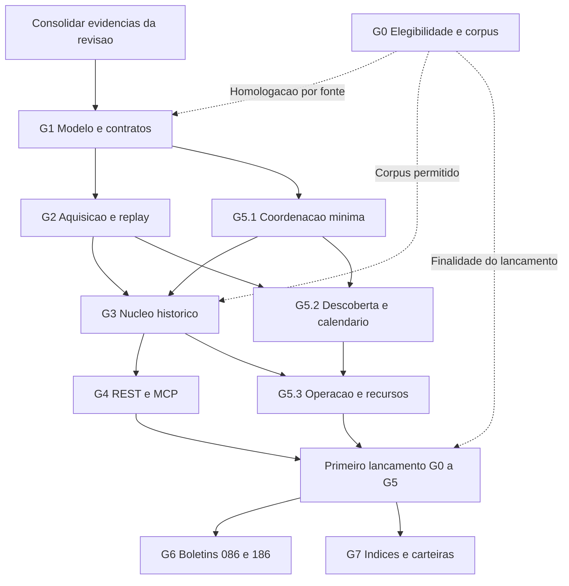

# Marcos de desenvolvimento do Tucano B3

Status: planejamento de execução, sujeito aos critérios de saída de cada marco.

Execução 0.0.1 iniciada no [plano de lançamento](0.0.1-plan.md). Decisão posterior do mantenedor: base nova e primeiro contrato público, sem migração dos registros/IDs anteriores. Os requisitos de preservação passam a reger o novo conjunto após seu lançamento; a reconstrução do legado não integra o caminho crítico desta entrega.

Data da avaliação: **06/11/2026**, America/Sao_Paulo. Base inspecionada: **`fdc804f`**. Referência de produto: [PRD vigente, versão 2.0](b3_prd.md).

Este documento detalha os marcos G0–G7 da seção 20 do PRD a partir do código e da revisão existentes. Define sequência, dependências, entregas e evidências de conclusão; não é um PRD alternativo. O [plano 19](19-plan.md) orienta a avaliação e a migração do legado; as [issues 01–09](issues/README.md) continuam sendo o backlog rastreável. Requisitos de produto e compatibilidade prevalecem sobre propostas de implementação ainda não homologadas.

## 1. Ponto de partida

O projeto está na **transição entre a revisão da implementação existente e a construção do núcleo histórico publicável**. Há código reutilizável, contratos inventariados e testes de regressão. Ainda não há evidência suficiente para considerar concluído o primeiro lançamento definido pelo PRD.

| Área | Situação observada nesta base | Consequência para o desenvolvimento |
| --- | --- | --- |
| Stack e organização | Rust, serviços REST/CLI/worker/MCP, SQLx, PostgreSQL 16 e Compose existentes | Evoluir a implementação por capacidade; preservar módulos e contratos úteis |
| Revisão de aderência | Issue 09 registrada como concluída; avaliação e desenho de migração em `.scratch/prd-alignment/` | Usar os resultados como entrada; conclusão da revisão não conclui os marcos de produto |
| Testes e regressões | A avaliação registra 37 testes aprovados; há cobertura de precisão, hashes, constraints, auditoria, contratos e helpers de lock | Preservar essa cobertura e acrescentar cenários de pipeline; quantidade de testes não comprova os requisitos ausentes |
| Aquisição e parsing | Download ainda usa `resp.bytes().await?.to_vec()`; extração e parsers retêm coleções em memória | G2/G3 precisam demonstrar processamento limitado por bytes e registros |
| Arquivos aninhados | O limite de profundidade já produz erro visível, com regressão para member válido ao lado de aninhamento excessivo | Preservar a correção; não tratá-la como pendente apenas por constar em uma descrição anterior |
| Publicação e persistência | Existe apenas `0001_initial_b3_schema.sql`; não há migrations implementando o novo modelo de revisão | Propostas de `public_id`, ponteiro ativo e unicidade por revisão são desenho, não capacidade entregue |
| Atomicidade e exclusão | A transação de advisory lock é retida durante `run_single_date`; escritas internas usam outras conexões do pool | Preservar a exclusão existente e corrigir as fronteiras de confirmação; o lock não comprova rollback conjunto |
| Worker | Usa `Local::now()` e fins de semana; não consome o calendário persistido nem uma fila com lease/fencing | G5 começa junto de G2/G3, antes da primeira publicação pelo novo pipeline |
| Consultas | REST e MCP existem, com SQL duplicado entre transportes | Extrair serviços compartilhados e integrar a seleção de revisão sem regressão de contrato |
| Homologação de fontes | Existem fixtures sintéticas e uma fixture 086 baseada no catálogo; compatibilidade com corpus oficial representativo continua pendente | Separar teste unitário, aderência ao catálogo e homologação de arquivo oficial |
| MCP restrito | Inicialização dispensa migrations por inspeção; falta teste do processo com cliente e credencial somente leitura | Tratar a comprovação ponta a ponta como saída de G4 |
| Elegibilidade e cobertura | Permissões por finalidade e profundidade histórica não estão encerradas | Trabalho offline pode avançar; habilitação de fonte e lançamento dependem de G0 |

A informação sobre os 37 testes é **evidência registrada na avaliação anterior**, não uma execução realizada para elaborar este documento. A [matriz de aderência](../.scratch/prd-alignment/assessment.md) e o [desenho de migração](../.scratch/prd-alignment/migration.md) contêm seções produzidas em momentos diferentes. Descrições antigas de ZIP, contagens de contratos ou decisões ainda propostas precisam ser reconciliadas com o código antes de orientar uma implementação.

### 1.1 Reutilização e limites

Preservar, com regressões: precisão decimal, normalização, hashes determinísticos, auditoria granular, tratamento de chaves nulas, separação 086/186, aviso COTAHIST, rotas v1 e identidade temporal já suportada. Estender aquisição, parsers, resolução e persistência. Substituir gradualmente o loop de agendamento, reutilizando os serviços de domínio e a coordenação PostgreSQL.

O modelo de dados atual não será congelado para acomodar suas limitações. Chaves, associações reconstruíveis e regras de seleção precisam ser homologadas antes de novas constraints. `0001` permanece imutável; cada alteração estrutural exige nova migration e validação de upgrade com dados.

## 2. Quadro de marcos

Os estados abaixo descrevem **prontidão de produto**, sem substituir os status de triagem das issues. Nenhum G0–G7 é declarado concluído nesta avaliação. “Parcial” indica código ou preparação aproveitável, com critérios de saída ainda pendentes.

| Marco | Estado nesta base | Resultado de saída | Dependência efetiva | Issue |
| --- | --- | --- | --- | --- |
| G0 — Viabilidade e corpus | Pendente de evidência externa | Fonte, canal, finalidade e recorte elegíveis, sem custo de dados obrigatório | Independente; libera uso de corpus e disponibilização conforme a finalidade | [01](issues/01-source-viability.md) |
| G1 — Modelo e contratos | Parcial; decisões e corpus pendentes | Identidade, granularidade, revisões e migração especificadas e testáveis | Baseline da revisão; corpus de G0 para homologação definitiva | [02](issues/02-domain-and-contracts.md) |
| G2 — Aquisição e replay | Parcial; streaming e limites pendentes | Raw íntegro e imutável, inventário completo, aquisição e replay limitados | Contratos mínimos de G1; G0 para aquisição externa | [03](issues/03-artifact-acquisition.md) |
| G3 — Núcleo histórico | Parcial; publicação recuperável pendente | COTAHIST e cadastro disponível, com identidade, auditoria e revisão publicável | G1, G2, corpus permitido e coordenação mínima de G5.1 | [04](issues/04-historical-core.md) |
| G4 — Produto de consulta | Parcial; integração com novo núcleo pendente | REST/MCP consistentes, cobertura explicada e compatibilidade verificada | Revisão publicável de G3; trabalho de caracterização pode começar antes | [05](issues/05-query-product.md) |
| G5 — Operação confiável | Parcial; fila e calendário pendentes | Descoberta separada, recuperação, manutenção prioritária e operação verificável | G1; implementação conjunta com G2/G3, sem aguardar G4 | [06](issues/06-operations.md) |
| G6 — Boletins de preços | Código inicial; homologação posterior ao núcleo | 086/186 por edição, separados, com comparação explícita | Plataforma G1–G5 e G0 específico de cada fonte | [07](issues/07-price-reports.md) |
| G7 — Índices e carteiras | Código inicial; homologação posterior ao núcleo | 087 e composições com tipos, unidades, vigência e estágio | Plataforma G1–G5 e G0 específico de cada fonte | [08](issues/08-indices-and-portfolios.md) |

### 2.1 Sequência e trabalho concomitante



As setas indicam dependências de aceite, não impedem preparação independente. G0 corre em paralelo; fixtures sintéticas ou autorizadas permitem desenvolvimento offline de G1/G2/G5. G5.2 pode avançar com mocks e calendário de teste enquanto G3 é construído. G4 pode caracterizar os contratos atuais antes da integração final. G6 e G7 não dependem um do outro e não precisam esperar o backfill histórico inteiro, mas só entram em operação após comprovar a plataforma comum e a elegibilidade específica.

Não criar uma dependência circular entre “G3 completo” e “G5 completo”: G5.1 fornece coordenação e recuperação mínimas para G3; os ensaios integrados de manutenção, concorrência e restauração encerram G5.3 sobre o núcleo já publicável.

## 3. Preparação imediata: consolidar a revisão

Esta preparação é a saída operacional da issue 09, **não um novo marco de produto** nem uma repetição integral do plano 19.

1. Fixar a referência de código, OpenAPI, migrations e cenários de resposta usados pela próxima entrega. Inventariar consumidores conhecidos e registrar os desconhecidos como risco.
2. Reconciliar avaliação, plano de migração e código: preservar as correções já presentes; classificar cada conclusão como teste executado, inspeção ou hipótese pendente.
3. Transformar propostas de migração em decisões verificáveis de G1. O desenho em `.scratch` não autoriza escolher o último arquivo por `created_at`, renomear enums v1 ou copiar DDL sem comprovar a granularidade.
4. Escolher o recorte piloto com um manifesto de fontes, períodos, mercados, formatos e finalidade. Preferir um ano encerrado de COTAHIST anual quando disponível; acrescentar sobreposição diária/mensal no horizonte em que houver arquivos e fotografias cadastrais obtidas de forma permitida. O recorte definitivo depende de G0.
5. Decompor as issues 02, 03, 04 e 06 em entregas pequenas com interfaces comuns. Registrar o que pode avançar offline e qual evidência libera a parte dependente de corpus.

**Condição de saída:** baseline recuperável e lista de decisões pendentes sem alegações contraditórias de capacidade entregue. A revisão registrada como concluída não substitui migrations, testes de falha ou homologação de produção.

## 4. G0 — Comprovar viabilidade e formar corpus

Referência: PRD §§4–6 e 18; [issue 01](issues/01-source-viability.md).

**Resultado:** saber exatamente quais dados podem ser adquiridos, preservados e expostos, por qual canal e finalidade, respeitando a restrição de custo zero dos dados.

**Entrada:** matriz de fontes e pesquisa já existentes. Não depende de mudanças no código.

### Entregas

- **G0.1 — Catálogo de capacidade e elegibilidade:** registrar fonte, canal oficial, schemas, granularidades, finalidade, condições de aquisição/armazenamento/redistribuição, gratuidade, evidência e data de verificação. Usar `unreviewed`, `eligible`, `restricted` e `ineligible` conforme o PRD.
- **G0.2 — Manifesto de corpus:** relacionar arquivos/amostras, hashes, origem, condições de uso, períodos, edições, encodings, members e finalidade de cada fixture. Distinguir arquivo oficial, amostra baseada em catálogo e exemplo sintético.
- **G0.3 — Recorte liberado:** declarar fontes e períodos do piloto; registrar horizonte disponível, lacunas e condições de acesso. A cobertura anunciada desde 1986 não equivale a arquivos coletados e validados para todos os anos.

### Critérios de saída

- Cada fonte/finalidade habilitada tem evidência compatível com aquisição, retenção e consumo pretendidos. Download manual permitido não libera automaticamente automação ou API para terceiros.
- Corpus permitido permite homologar os formatos efetivamente escolhidos. Formato sem corpus continua pendente, sem impedir entregas offline independentes.
- Fonte restrita ou inviável permanece desabilitada para a finalidade incompatível. Se não houver modalidade gratuita compatível, registrar a inviabilidade e a decisão de escopo necessária.
- A liberação é por fonte e finalidade: G6/G7 precisam de suas próprias evidências, mesmo que o COTAHIST já esteja liberado.

**Evidência de conclusão:** catálogo datado, manifesto de corpus e declaração explícita do recorte/finalidade liberados. A evidência externa não pode ser substituída por configuração do operador ou sucesso de uma requisição HTTP.

## 5. G1 — Fechar identidade, revisões e migração de contratos

Referência: PRD §§7–9, 12–13 e 19; [issue 02](issues/02-domain-and-contracts.md).

**Resultado:** um modelo implementável que preserve fatos, identidade temporal, histórico de versões e contratos existentes.

**Entrada:** baseline consolidada. Especificação e cenários sintéticos podem avançar imediatamente; homologação definitiva de chaves e campos depende do corpus de G0.

### Entregas

- **G1.1 — Contratos e granularidade:** reconciliar rotas, DTOs, enums, filtros, ordenação, IDs, proveniência e OpenAPI. Perfilar colisões das chaves candidatas, preservando `DISMES`, prazo de termo, sessão, mercado e componentes nulos conforme a fonte. Relação reconstruível com instrumento não compõe a identidade de um fato.
- **G1.2 — Identidade temporal:** especificar `security_id` qualificado, ISIN, ticker, mercado e distribuição; precedência, contradições, janelas, chegada fora de ordem, reutilização de ticker e resolução tardia. Não fabricar `security_id` usando ticker nem inventar vigência antiga a partir do cadastro atual.
- **G1.3 — Publicação e histórico:** separar artefato, publicação, ocorrência/observação, versão de fato e `data_revision`. Definir escopo completo de revisão, manifesto de participação, seleção de versões, conflitos, remoções e retorno à revisão anterior. O ponteiro de leitura não pode depender apenas da hora de download.
- **G1.4 — Plano de migração:** definir preservação de IDs públicos, unicidade compatível com versões e transição de queries/worker. Registrar decisões aceitas nos documentos de domínio/ADRs quando justificadas. Nomes como `public_id`, `is_active` e `revision_number` são opções do desenho atual, não requisitos de DDL já homologados.

### Critérios de saída

- Há resultados esperados para ticker reutilizado, identificador forte contraditório, cadastro tardio, vínculo ambíguo e ausência de cadastro histórico.
- Mesma chave e mesmo conteúdo compartilham fato/evidência conforme a política; conteúdo divergente preserva versões e conflito quando não há precedência oficial.
- A política cobre sobreposição anual/mensal/diária sem “último download vence”; ordem de member não se transforma em autoridade editorial.
- A migração não presume que o arquivo mais recente ou aquele com mais fatos contém uma revisão completa. Quando os fatos legados estão distribuídos entre arquivos, reconstruir participação a partir de raw/evidência; sem evidência suficiente, identificar uma baseline legada com limitações explícitas.
- A preservação de IDs inclui detalhe por ID e vínculos publicados. Novo identificador físico de versão não altera silenciosamente a identidade pública do fato.
- Estados operacionais e campos públicos possuem tipos e transição documentada. Renomear `success`/`ingested` para um novo vocabulário exige tratar DTOs, consumidores e dados persistidos.

**Evidência de conclusão:** especificação de chaves/colisões, cenários de aceitação, desenho de migração e matriz de compatibilidade. Migrations e garantias de execução serão comprovadas nas entregas seguintes; concluir G1 não significa que o novo schema já existe.

## 6. G2 — Entregar aquisição, inventário e replay seguros

Referência: PRD §§10.1–10.4 e 18; [issue 03](issues/03-artifact-acquisition.md).

**Resultado:** qualquer entrada aceita pode ser localizada, verificada e reinterpretada sem novo download obrigatório e sem retenção integral em memória.

**Entrada:** contratos mínimos de artefato/member e limites de G1. Adaptadores externos exigem G0; testes locais e HTTP simulado não dependem de acesso à B3.

### Entregas

- **G2.1 — Transporte limitado:** download incremental para temporário, SHA-256 e tamanho incrementais, limites/timeouts e finalização atômica. Validar HTTPS, hosts, redirects e destinos de rede; homologar fluxos de duas etapas por canal. Remover tokens temporários de logs, erros e proveniência pública.
- **G2.2 — Raw e inventário:** persistir bytes imutáveis e manifesto; inventariar todos os members em ordem determinística com caminho aninhado, pai, índice, hashes e tamanhos. Entradas não selecionadas recebem motivo. Confinar importação local ao diretório permitido.
- **G2.3 — Extração e interfaces de leitura limitadas:** aplicar limites de bytes comprimidos/descomprimidos, razão de expansão, entradas e profundidade. Disponibilizar leitura incremental dos members aos parsers das famílias do recorte, sem acumular todos os conteúdos. Os contratos incluem limite de registro e de lote em linhas e bytes; G3/G6/G7 integram a interpretação tipada de cada formato. Parsing bloqueante tem capacidade limitada fora do I/O do Tokio.
- **G2.4 — Replay e recuperação da aquisição:** reutilizar raw sem apagar tentativas, detectar conteúdo já conhecido e recuperar interrupção entre download e registro do manifesto. Nenhum arquivo parcial vira entrada íntegra.

### Critérios de saída

- HTTP simulado cobre redirect permitido/proibido, destino inválido, token de dois passos, timeout, transferência interrompida, HTML de erro, tamanho excedido e ausência de validators HTTP.
- Arquivos com vários members, nomes repetidos em containers diferentes, path traversal, aninhamento excessivo e expansão acima do limite produzem inventário ou falha explícitos, sem omissão silenciosa.
- Replay com rede indisponível funciona a partir do raw preservado; checksum inválido e raw ausente permanecem falhas diagnosticáveis.
- Medição reproduzível mostra que download, inventário e extração respeitam os limites configurados. Os valores iniciais de orçamento são definidos a partir de corpus e hardware medidos.

**Evidência de conclusão:** fixtures com manifesto, testes determinísticos, trilha de falha/retomada e relatório de recursos da fase de aquisição. G2 encerra a primeira fase da ingestão; não comprova, sozinho, publicação de fatos.

## 7. G3 — Construir o núcleo histórico publicável

Referência: PRD §§5–10, 12 e 19; [issue 04](issues/04-historical-core.md).

**Resultado:** COTAHIST consultável com valores exatos, proveniência até registro e identidade sustentada pelo cadastro disponível, publicado em revisões consistentes e recuperáveis.

**Entrada:** G1, G2, corpus permitido e G5.1 operacional. Ingerir primeiro os cadastros disponíveis, preservando preços históricos válidos sem vínculo quando não houver evidência suficiente.

### Entregas

- **G3.1 — Schema e upgrade:** acrescentar as migrations de domínio do recorte inicial sobre a infraestrutura comum iniciada em G2/G5.1. Preservar todos os dados, IDs e auditoria legados, inclusive famílias cuja evolução ficará para G6/G7. Validar banco vazio e upgrade de `0001` com dados representativos.
- **G3.2 — Interpretação e normalização:** streaming COTAHIST com largura de 245 bytes, encoding, header/trailer, decimais implícitos, sentinelas, moeda, `FATCOT` e `DISMES`. Homologar os adaptadores de cadastro utilizados, mantendo BVBG.028, Tradable Security List e InstrumentsConsolidated distintos.
- **G3.3 — Persistência, identidade e auditoria:** staging tipado e operações em lote; resolução temporal; fatos, alterações de campo, proveniência e contadores confirmados atomicamente no escopo do lote. Separar alteração de valor, observação equivalente e rebuild de identidade.
- **G3.4 — Revisão completa:** validar participação de todos os members obrigatórios e promover uma revisão por troca atômica de visibilidade. Manter a anterior servível; suportar revisão degradada apenas pela política explícita de rejeições locais. XML truncado ou controles estruturais inválidos não viram publicação completa.
- **G3.5 — Piloto e recuperação:** executar ingestão e replay do recorte, comparação controlada com a baseline, falhas injetadas e retorno à revisão anterior. Medir recursos antes de ampliar o backfill.

### Critérios de saída

- Repetição, retry e `force_reparse` não duplicam fatos, apagam auditoria ou geram alterações falsas. Mudança de um campo altera somente o conteúdo e os timestamps correspondentes, com evento old/new na mesma transação.
- Duas versões legítimas da mesma chave coexistem sem sobrescrita destrutiva; conteúdo inalterado reaproveita evidência conforme o contrato. IDs públicos continuam resolvíveis.
- Reparse inalterado que cria uma nova observação de arquivo não oculta os fatos ligados ao arquivo anterior. Antes de ativar o novo filtro de leitura, reconciliar participação, contagens e hashes dos fatos selecionados.
- Falha no segundo member, após lotes válidos do primeiro, deixa a revisão anterior pública. Retry recupera o trabalho sem dupla auditoria; retorno à revisão anterior reproduz o conjunto esperado.
- Sobreposição diário/mensal/anual preserva todas as ocorrências de suporte, evita duplicação na consulta e torna divergências explícitas. Remoção de registro exige escopo completo e regra comprovada; ausência no acumulado corrente não elimina datas futuras.
- Linhas inválidas ficam em quarentena recuperável, com razão e localizador. Registros válidos e não resolvidos permanecem preservados. Rebuild temporal não muda valores, hashes de mercado ou timestamps de alteração de preço.
- Contadores confirmados fecham `detail_records_read = inserted + changed + unchanged + duplicate_in_scope + rejected`; ambiguidade e ausência de vínculo são dimensões adicionais.
- Todas as linhas válidas dos arquivos aceitos são preservadas, inclusive mercados e instrumentos fora do caso inicial de ações à vista. Não há classificação por sufixo de ticker, conversão histórica indiscriminada para BRL, preenchimento de lacunas ou ajuste retroativo.

**Evidência de conclusão:** upgrade reproduzível, manifesto da revisão, reconciliação de fatos/IDs/auditoria, cenários de falha e replay no PostgreSQL 16 e benchmark do piloto. Paridade com o legado admite correções intencionais justificadas; não exige reproduzir bugs conhecidos.

## 8. G4 — Entregar consultas REST e MCP confiáveis

Referência: PRD §§13–16; [issue 05](issues/05-query-product.md).

**Resultado:** consumidores consultam o recorte com a mesma semântica em REST/MCP e conseguem identificar origem, revisão, incerteza e lacunas.

**Entrada:** revisão publicável de G3 e contratos de G1. Caracterização de v1 e extração dos serviços podem começar antes; aceite final depende do núcleo novo.

### Entregas

- **G4.1 — Serviços de consulta:** mover regras e SQL de leitura para serviços compartilhados. REST e MCP são adaptadores; consultas não ingerem, reprocessam ou resolvem relações pesadas em tempo de requisição.
- **G4.2 — Contratos e compatibilidade:** aplicar filtros de família, datas, mercado e identidade; `limit=100`, máximo 1000, `offset` e ordenação com desempate único. Preservar contratos v1 ou oferecer migração explícita para mudanças incompatíveis.
- **G4.3 — Revisão, proveniência e cobertura:** indicar `data_revision`, proveniência por item e limitações essenciais de identidade/qualidade. Diferenciar ausência de negociação, arquivo não obtido, falha, quarentena e cobertura desconhecida. Paginação consistente fixa uma revisão por mecanismo compatível/aditivo.
- **G4.4 — Segurança e documentação:** separar leitura e administração antes de liberar a operação a consumidores; manter exceções públicas explícitas. Documentar origem, unidades, filtros, defaults, exemplos e erros em OpenAPI e DTOs, com README, documentação de consumidor e changelog coerentes.
- **G4.5 — MCP ponta a ponta:** testar inicialização e cliente reais com credencial PostgreSQL somente leitura, sem DDL, sync, replay, rebuild ou SQL arbitrário.

### Critérios de saída

- O mesmo filtro REST/MCP seleciona os mesmos fatos, precisão, identidade e proveniência na mesma revisão, respeitando os envelopes de cada transporte.
- Decimais são strings, datas ISO e timestamps UTC. Metadados adicionais obedecem `include_internal`; incerteza essencial não fica escondida nessa flag.
- Séries exigem desambiguação quando restam mercados/distribuições/prazos incompatíveis. O aviso de preços nominais COTAHIST sem ajustes aparece no payload, OpenAPI, MCP e documentação aplicáveis.
- Testes cobrem autenticação, autorização administrativa, 400/401/404/409/500 aplicáveis, paginação, filtros inválidos, limites e proveniência; o OpenAPI gerado corresponde às rotas reais.
- Detalhe por ID preserva os IDs legados; rotas já publicadas, inclusive projeções como `/company-data`, não são removidas ou ressignificadas sem migração.
- Consulta durante promoção não mistura revisões; exportação/paginação mantém o conjunto prometido pelo contrato. `as_of` só é anunciado no horizonte de versões realmente capturado e testado.

**Evidência de conclusão:** comparação contratual com a baseline, testes REST/OpenAPI e MCP, exemplos de cobertura e documentação da finalidade autorizada. Endpoints de famílias ainda não habilitadas não sugerem dados disponíveis.

## 9. G5 — Operar manutenção contínua com recuperação

Referência: PRD §§10–11, 14 e 17–18; [issue 06](issues/06-operations.md).

**Resultado:** atualização regular recuperável, com estado durável e capacidade protegida contra consultas, backfill e rebuild.

**Entrada:** definições de escopo, estado e idempotência de G1. O desenvolvimento começa com G2/G3; somente os ensaios finais dependem do núcleo completo.

### G5.1 — Coordenação mínima para o novo pipeline

- API e CLI submetem comandos aos mesmos serviços e estados PostgreSQL. Jobs possuem claim durável, lease, heartbeat, geração de fencing, tentativas e cancelamento persistido.
- Migrations de coordenação e de suporte ao manifesto acompanham G2/G5.1; não aguardar as migrations de fatos de G3 para persistir o estado mínimo da execução.
- Separar aquisição da transação curta de promoção. Reter a conexão/transação que detém o lock durante toda a seção protegida; não manter transação aberta por horas de download.
- Proteger sobreposição real de fatos, inclusive COTAHIST diário/mensal/anual, com ordem estável de locks. Concorrência incompatível retorna `409`; repetição da mesma chave de idempotência e payload retorna o trabalho existente.
- Cancelamento em download, member, lote e publicação libera recursos e preserva confirmações anteriores sem publicar uma revisão incompleta.

**Saída para iniciar a integração de G3:** executor e estados duráveis implementados, com testes de dois processos sobre claim, exclusão, crash/expiração e fencing da confirmação. O aceite conjunto de G3/G5.1 repete esses cenários no pipeline real de fatos e publicação. Testar um helper isolado não comprova essa integração; lease sem validação de fencing na confirmação também não.

### G5.2 — Descoberta e calendário

- Scanner leve registra checagens conclusivas/inconclusivas e `b3_pending_updates`; não baixa/parsa arquivos pesados nem publica revisões durante descoberta.
- Manter promoção administrativa como política inicial. Automação de ingestão por fonte só é habilitada por política explícita após qualidade, recuperação e elegibilidade comprovadas.
- Usar `America/Sao_Paulo`, datas de mercado e calendário B3 versionado conforme atividade/fonte. Não recriar a tabela de calendário já existente; estendê-la apenas por migration necessária.
- Calendário ausente permanece desconhecido. Não preencher 1986–presente por regra de dias úteis ou feriados presumidos. Manutenção administrativa de referências passadas pode executar no fim de semana.
- Diferenciar saúde da descoberta agendada de execução manual, ausência de publicação esperada e falha de canal. Uma execução manual não renova artificialmente o indicador do agendador.

**Saída:** testes de fronteira UTC/São Paulo, feriados/sessões especiais com evidência, calendário ausente, validators HTTP ausentes, checagem inconclusiva e descoberta sem ingestão embutida.

### G5.3 — Recursos, diagnóstico e restauração

- Reservar conexões e concorrência para manutenção; limitar queries e classes de trabalho. Backfill/rebuild não esgotam capacidade nem impedem cancelamento.
- Expor saúde, cobertura, pendências, quarentena e estatísticas por run, arquivo, member e fase. Runs com resultados mistos mantêm estados dos filhos; falha não vira sucesso com zero registros.
- Permitir que o operador identifique o problema e solicite a recuperação autorizada pela API, sem depender de inspeção manual de SQL ou logs para decidir o próximo passo.
- Correlacionar logs por entidades operacionais sem credenciais/tokens. Documentar retries, limpeza idempotente, retenção e recuperação a partir de raw e banco.
- Executar build/smoke de API e worker em configuração controlada, além de ensaiar backup, restauração e replay.

**Critérios de saída do G5 completo:** concorrência de consulta/backfill/manutenção medida, cancelamento e fencing verificados, recuperação de falhas demonstrada, calendário da manutenção habilitada sustentado, lacunas históricas explícitas e restore reproduzível. Registrar hardware, corpus, configuração, tempos, RSS, conexões e WAL; fixar orçamentos com base nessas medições, sem publicar metas como resultados.

## 10. G6 — Homologar BVBG.086 e BVBG.186

Referência: PRD §§5.4, 6, 8 e 13; [issue 07](issues/07-price-reports.md).

**Resultado:** boletins complementares por edição, com contratos independentes e comparação de campos equivalentes explicitamente definida.

**Entrada:** plataforma comum G1–G5 comprovada e G0 para cada canal/finalidade. Parsers já existentes e a fixture 086 baseada no catálogo são preparação, não homologação dos arquivos distribuídos.

### Entregas e critérios de saída

1. Homologar estruturas ISO 20022, namespaces, paths completos, edições, referência e sessões com corpus oficial permitido; distinguir versões do catálogo e do formato recebido.
2. Persistir 086 e 186 em famílias, tabelas, DTOs e linhagens separados, reutilizando aquisição, revisões, quarentena, auditoria e coordenação comuns.
3. Validar chaves com `days_to_settlement`, mercados e demais qualificadores aplicáveis; não colapsar instrumentos/negociações distintos ou chamar qualquer preço final de fechamento oficial.
4. Especificar comparação tipada com unidades, regras de correspondência, registros não comparáveis e divergências. Ausência em uma família não dispara fallback para a outra.
5. Comprovar repetição, republicação, falha parcial, conflito e queries por edição nos mesmos padrões do núcleo; atualizar REST, MCP quando aplicável, OpenAPI e documentação.

**Evidência de conclusão:** manifesto do corpus por família, perfil de colisões, testes de ingestão/contrato e exemplos de comparação. G6 não converte os boletins em substitutos silenciosos do COTAHIST.

## 11. G7 — Homologar índices e carteiras

Referência: PRD §§5.5, 6, 8 e 13; [issue 08](issues/08-indices-and-portfolios.md).

**Resultado:** valores de índice e composições consultáveis no contexto temporal correto, com tipos e unidades preservados.

**Entrada:** plataforma comum G1–G5 comprovada e G0 específico. Pode avançar independentemente de G6.

### Entregas e critérios de saída

1. Homologar BVBG.087 por bloco, distinguindo índices, IOPV, referências e outros valores publicados. Cada tipo recebe DTO, unidade, chave e semântica adequados.
2. Homologar canais oficiais de composição: data-base, publicação conhecida, vigência e estágio `preview`/`effective`, além de paginação e horizonte demonstrado. Endpoint usado pelo site não é contrato operacional homologado por si só.
3. Separar carteira efetiva, prévias e fotografias diárias de pesos. Não usar composição atual para o passado nem fixar peso diário durante toda a vigência.
4. Preservar componentes sem vínculo resolvido; a chave da composição não depende de `instrument_id` reconstruível. Testar cadastro tardio sem duplicar ou apagar componentes.
5. Integrar revisões, conflitos, proveniência, cobertura e contratos. Documentar períodos indisponíveis sem prometer série histórica integral de carteiras ou índices.

**Evidência de conclusão:** corpus permitido, testes de blocos/unidades e transições de vigência/estágio, queries temporais e documentação por fonte. Novas estatísticas históricas de índices ou outras fontes candidatas permanecem fora do escopo até decisão explícita no PRD.

## 12. Aceite de lançamento e expansão

### 12.1 Entrega técnica de engenharia

G1, G2, G5.1 e partes de G3/G4 podem ser demonstrados com fixtures sintéticas/autorizadas em ambiente isolado. Essa entrega comprova software e recuperação no corpus de teste; não constitui lançamento de dados históricos para terceiros e não encerra a homologação de fonte pendente.

### 12.2 Primeiro lançamento histórico utilizável

Exige **G0–G5 concluídos para um recorte declarado**, incluindo os controles comuns de segurança, precisão, identidade, proveniência, revisão, recuperação e recursos. O manifesto do lançamento deve informar:

- Finalidade autorizada, fontes/canais habilitados, períodos e formatos efetivamente homologados.
- Todos os registros válidos preservados nos arquivos aceitos, mercados consultáveis, resolução de identidade e lacunas conhecidas.
- `data_revision`, versões de parser/regras, política de seleção e tratamento de rejeições/conflitos.
- Contrato REST/MCP disponível, limitações, configuração reproduzível e procedimento de recuperação.
- Evidências de upgrade, compatibilidade, concorrência, cancelamento, restore e recursos do recorte.

Não exige todo o histórico anunciado desde 1986, nem a conclusão simultânea de G6/G7. Também não permite omitir recuperação, autorização administrativa ou clareza de cobertura para antecipar a publicação.

### 12.3 Ampliar cobertura e completar famílias

Após o piloto, ampliar backfill por períodos controlados, com reconciliação, prioridade de manutenção e capacidade medida. A cada expansão, atualizar o manifesto de cobertura e revalidar colisões, formatos, moedas e comportamento de recursos encontrados no novo corpus.

G6/G7 completam a abrangência de famílias do PRD conforme seus próprios gates. Mesmo após esses marcos, “todas as famílias habilitadas” e “histórico integral de cada família” são afirmações diferentes. A disponibilidade real continua sendo demonstrada por cobertura.

## 13. Evidência e processo de encerramento

### 13.1 Matriz mínima de validação

A matriz resume as evidências por marco; os cenários obrigatórios da seção 18 do PRD continuam aplicáveis e não são substituídos por este resumo.

| Marco | Evidência que bloqueia seu encerramento se ausente |
| --- | --- |
| G0 | Elegibilidade por finalidade, condições sem custo e corpus com origem verificável |
| G1 | Chaves/colisões, identidade temporal, política de revisão e plano de compatibilidade inequívocos |
| G2 | Raw/inventário íntegros, limites medidos, HTTP simulado e replay após interrupção |
| G3 | Banco vazio/upgrade; versões e IDs preservados; rollback de publicação; contadores/auditoria; retry/reparse/quarentena |
| G4 | REST/OpenAPI compatíveis; paginação por revisão; serviços compartilhados; MCP real com credencial restrita |
| G5 | Dois processos, sobreposição de escopos, crash/lease/fencing, cancelamento, calendário, prioridade, smoke e restore |
| G6 | Corpus 086/186, edições/chaves e comparação sem merge ou fallback |
| G7 | Blocos/unidades 087 e composições com vigência, estágio e cobertura comprovados |

### 13.2 Validação por entrega

Mudanças em Rust, dependências ou migrations executam, pelo serviço de desenvolvimento Compose:

```bash
docker compose run --rm cargo cargo fmt --all -- --check
docker compose run --rm cargo cargo clippy --all-targets --all-features -- -D warnings
docker compose run --rm cargo cargo test --all-targets --all-features
```

Os testes de persistência, migração, locks e concorrência usam **PostgreSQL 16 real**, com `DATABASE_URL` apontando para base de teste isolada. Ausência de banco deve falhar, não pular integração. Validar upgrades sem tocar uma base operacional. A CI deve manter os mesmos checks e garantias, conforme PRD §23.

Mudanças de runtime, configuração ou inicialização acrescentam build e smoke dos serviços reais `b3_api` e `b3_worker`, com aquisição externa desabilitada ou controlada antes de iniciá-los. O Compose atual habilita sync por padrão. Não usar um worker contra fontes externas como teste determinístico nem remover volumes persistentes para obter uma base vazia.

Entregas de contrato incluem testes REST/OpenAPI, autenticação, filtros, precisão, proveniência, metadados internos e aviso COTAHIST. Alterações MCP incluem teste do transporte/processo quando a garantia depende dele. Atualizar OpenAPI, README, documentação de consumidor/operação e `frontend_api_changelog.md` no mesmo conjunto de mudanças aplicável.

Mudanças apenas documentais exigem consistência de links, caminhos e comandos; build de documentação somente quando houver gerador afetado. Elaborar este plano não executa os checks Rust acima nem altera o estado de implantação.

### 13.3 Registro de conclusão

Para concluir um marco ou subentrega, registrar na issue correspondente:

1. Escopo exato entregue e itens ainda pendentes, com referência ao PRD.
2. Commit de implementação, migrations, versões de parser/regras e corpus identificados por manifesto/hash.
3. Comandos executados, ambiente, resultados, falhas e checks não executados com motivo. Evidência de recurso inclui hardware e configuração.
4. Compatibilidade e integridade da migração: contagens, IDs, hashes, auditoria e revisão ativa esperados/obtidos, além do caminho de recuperação.
5. Links para testes, documentação atualizada e relatórios, sem segredos ou cópias indevidas de dados brutos.

Relatórios intermediários podem ficar em `.scratch/<feature-slug>/`; decisões e evidências necessárias à manutenção devem ter referências duráveis na issue/documentação aceita. Não sobrescrever a baseline anterior para substituir uma falha por um resultado novo.

Uma subentrega concluída não encerra automaticamente o marco. A issue pode continuar `needs-info` enquanto resta dependência externa ou técnica, com o progresso registrado em `## Comments`. Atualizar status e índice juntos quando a prontidão mudar; criar novas issues a partir de `10` apenas se a decomposição justificar, sem duplicar 01–09.

## 14. Próximas entregas recomendadas

| Ordem | Entrega concreta | Trabalho rastreado | O que libera |
| --- | --- | --- | --- |
| 1 | Consolidar evidências atuais e fechar especificação de participação de revisão, chaves, IDs públicos, estados e migração | Preparação da seção 3 e G1 / issue 02 | Migrations e implementação sem consolidar premissas incorretas |
| Paralelo | Confirmar fonte/finalidade e formar corpus do piloto; manter fixtures offline claramente identificadas | G0 / issue 01 | Homologação definitiva e habilitação do recorte permitido |
| 2 | Implementar migrations comuns, aquisição/inventário limitados e coordenação mínima com interfaces comuns | G2 / issue 03 + G5.1 / issue 06 | Primeira ingestão nova com recuperação e exclusão verificáveis |
| 3 | Implementar migrations de domínio e núcleo COTAHIST/cadastro, reconstruir baseline legada e publicar o piloto sem ocultar fatos | G3 / issue 04 | Revisão histórica consistente para consumo |
| 4 | Integrar serviços REST/MCP e finalizar scanner, calendário, recursos e restauração | G4 / issue 05 + G5.2/G5.3 / issue 06 | Primeiro lançamento G0–G5 no recorte declarado |
| 5 | Ampliar backfill medido e homologar boletins, índices e carteiras por fonte | G6/G7 / issues 07–08 | Maior cobertura e abrangência final do PRD |

Não há datas ou duração estimadas neste documento. Estimar após fechar o recorte/corpus de G0 e o desenho de G1, usando o piloto para dimensionar migração e operação. A próxima prioridade é tornar o núcleo publicável com integridade; expandir a quantidade de fontes depende dessa base comprovada.

## Comments

- 06/11/2026 — Marcos detalhados a partir do PRD v2, da base `fdc804f`, do backlog e das evidências da revisão. Nenhum marco foi declarado concluído e nenhuma capacidade proposta foi tratada como implementada. Alteração documental; testes Rust e homologações externas não foram executados nesta elaboração.
