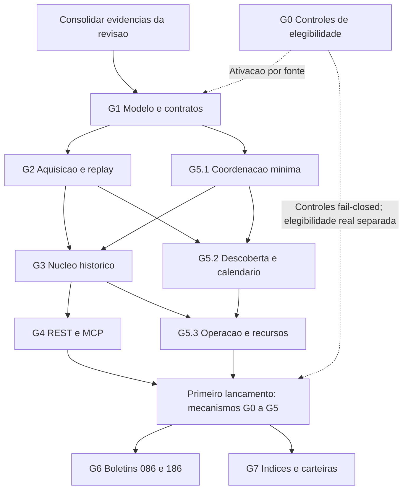

# Marcos de desenvolvimento do Tucano B3

Status: qualificação técnica da plataforma 0.0.1 concluída para G0–G5 com PostgreSQL 16 e fixtures sintéticas. Ativação de fontes externas continua condicionada a evidência por canal/finalidade e é independente do release do software.

Execução 0.0.1 iniciada no [plano de lançamento](0.0.1-plan.md). Decisão posterior do mantenedor: base nova e primeiro contrato público, sem migração dos registros/IDs anteriores. Os requisitos de preservação passam a reger o novo conjunto após seu lançamento; a reconstrução do legado não integra o caminho crítico desta entrega.

Data da revisão: **06/11/2026**, America/Sao_Paulo. Baseline histórica da transição: **`fdc804f`**. A validação abaixo foi executada na árvore de trabalho baseada em **`1ce6b33`**, com as alterações de qualificação ainda não commitadas. Referência de produto: [PRD vigente, versão 2.0](b3_prd.md).

Este documento detalha os marcos G0–G7 da seção 20 do PRD a partir do código e da revisão existentes. Define sequência, dependências, entregas e evidências de conclusão; não é um PRD alternativo. O [plano 19](19-plan.md) orienta a avaliação e a migração do legado; as [issues 01–09](issues/README.md) continuam sendo o backlog rastreável. Requisitos de produto e compatibilidade prevalecem sobre propostas de implementação ainda não homologadas.

## 1. Baseline histórica da transição (`fdc804f`)

Esta seção preserva a fotografia que motivou o plano no commit `fdc804f`. Ela não descreve o estado atual depois da implementação de `0.0.1-plan.md`. Naquela base, o projeto estava na **transição entre a revisão da implementação existente e a construção do núcleo histórico publicável**.

| Área | Situação observada em `fdc804f` | Consequência para o desenvolvimento |
| --- | --- | --- |
| Stack e organização | Rust, serviços REST/CLI/worker/MCP, SQLx, PostgreSQL 16 e Compose existentes | Evoluir a implementação por capacidade; preservar módulos e contratos úteis |
| Revisão de aderência | Issue 09 registrada como concluída; avaliação e desenho de migração em `.scratch/prd-alignment/` | Usar os resultados como entrada; conclusão da revisão não conclui os marcos de produto |
| Testes e regressões | A avaliação registra 37 testes aprovados; há cobertura de precisão, hashes, constraints, auditoria, contratos e helpers de lock | Preservar essa cobertura e acrescentar cenários de pipeline; quantidade de testes não comprova os requisitos ausentes |
| Aquisição e parsing | Download ainda usa `resp.bytes().await?.to_vec()`; extração e parsers retêm coleções em memória | G2/G3 precisam demonstrar processamento limitado por bytes e registros |
| Arquivos aninhados | O limite de profundidade já produz erro visível, com regressão para member válido ao lado de aninhamento excessivo | Preservar a correção; não tratá-la como pendente apenas por constar em uma descrição anterior |
| Publicação e persistência | Existe apenas `0001_initial_b3_schema.sql`; não há migrations implementando o novo modelo de revisão | Propostas de `public_id`, ponteiro ativo e unicidade por revisão são desenho, não capacidade entregue |
| Atomicidade e exclusão | A transação de advisory lock é retida durante `run_single_date`; escritas internas usam outras conexões do pool | Preservar a exclusão existente e corrigir as fronteiras de confirmação; o lock não comprova rollback conjunto |
| Worker | Usa `Local::now()` e fins de semana; não consome o calendário persistido nem uma fila com lease/fencing | G5 começa junto de G2/G3, antes da primeira publicação pelo novo pipeline |
| Consultas | REST e MCP existem, com SQL duplicado entre transportes | Extrair serviços compartilhados e integrar a seleção de revisão sem regressão de contrato |
| Homologação de fontes | Existem fixtures sintéticas e uma fixture 086 baseada no catálogo; compatibilidade com corpus oficial representativo continua pendente | Separar teste unitário, aderência ao catálogo e homologação de arquivo oficial |
| MCP restrito | Inicialização dispensa migrations por inspeção; falta teste do processo com cliente e credencial somente leitura | Tratar a comprovação ponta a ponta como saída de G4 |
| Elegibilidade e cobertura | Permissões por finalidade e profundidade histórica não estão encerradas | Trabalho offline pode avançar; habilitação de fonte e lançamento dependem de G0 |

A informação sobre os 37 testes é **evidência registrada na avaliação histórica**, não uma execução realizada para elaborar este documento. A [matriz de aderência](../.scratch/prd-alignment/assessment.md) e o [desenho de migração](../.scratch/prd-alignment/migration.md) descrevem aquela etapa e não substituem a validação da implementação corrente.

## 2. Estado integrado e qualificação em 06/11/2026

A transição para o núcleo histórico publicável foi concluída para o contrato e a arquitetura `0.0.1`: há migrations, modelos tipados, aquisição limitada, parsers incrementais, staging, revisões, jobs PostgreSQL, API, MCP e descoberta. A decisão do mantenedor separa o release do software da população de dados: corpus real, cutoff e elegibilidade externa não são critérios de conclusão de `0.0.1`. A qualificação usou PostgreSQL 16 e fixtures sintéticas; não afirma compatibilidade com uma publicação oficial B3 nem autorização de uso. BVBG.028 e Tradable Security List ficam explicitamente `deferred` até que suportem corte baseado em data interna por registro.

| Marco | Evidência de implementação e validação | Estado |
| --- | --- | --- |
| G0 — Fontes e fail-closed | Catálogo e gates por canal/finalidade; import de família adiada é recusado antes de criar job; elegibilidade externa documentada e ainda não concedida | Concluído para o software; canal real permanece desativado até sua evidência própria |
| G1 — Modelo e contratos | Migrations `0001`–`0012`; banco vazio e upgrade `0011` → `0012` verificados em PostgreSQL 16; invariantes de fatos/revisões/cortes exercitadas | Concluído para `0.0.1` |
| G2 — Aquisição e replay | SHA-256 incremental, raw imutável, importação local administrativa confinada, inventário de ZIPs aninhados e limites; replay e cenários de aquisição testados com fixtures | Concluído para o fluxo da plataforma; aquisição externa real depende da elegibilidade do canal |
| G3 — Núcleo histórico | COTAHIST por data interna, fontes sobrepostas em uma candidata, auto-publicação limpa, rejeição/conflicto sem promoção, retirada, reimport idempotente e rollback exercitados em PostgreSQL; identidade não resolvida preservada | Concluído para o escopo 0.0.1 |
| G4 — Produto de consulta | REST `/api/v1/b3/...` e MCP stdio compartilham query services; auth, revisão, proveniência, limites e capacidade `deferred` constam no contrato; testes e build docs passaram | Concluído para as famílias disponíveis no 0.0.1 |
| G5 — Operação confiável | Jobs duráveis, lanes, retries, fencing, cancelamento, descoberta desacoplada e calendário desconhecido; build/smoke API-worker, benchmark sintético e restore com consulta REST passaram | Concluído para a plataforma; budgets de produção e agenda real se definem na ativação do canal |
| G6 — Boletins de preços | 086/186 não estão disponíveis na superfície 0.0.1 | Expansão posterior |
| G7 — Índices e carteiras | 087/composições não estão disponíveis na superfície 0.0.1 | Expansão posterior |

Validação da árvore de trabalho baseada em `1ce6b33`: `fmt`, Clippy e 66 testes passaram com PostgreSQL 16.15; a cadeia de migrations também passou em banco vazio e em upgrade de `0011` para `0012`. Build de imagens, smoke API/worker, build Docusaurus, benchmark integrado e backup/restore com consulta REST estão detalhados no [guia operacional](release_operations.md). **A conclusão é da plataforma e de seus contratos sintéticos, não da ativação de dados reais.** Elegibilidade por finalidade continua pendente e bloqueia apenas o canal/finalidade correspondente.

### Reutilização e limites herdados

Reutilizar somente capacidades que atendam ao PRD: precisão decimal, normalização, hashes determinísticos, auditoria granular, tratamento de chaves nulas, separação 086/186, aviso COTAHIST e identidade temporal. O namespace REST `/api/v1/b3` permanece conforme o PRD, mas os contratos, dados, IDs e estado de execução anteriores não são importados nem exigem compatibilidade com `0.0.1`. A partir do lançamento, as garantias de identidade e histórico passam a ser estáveis. O novo runtime usa serviços de domínio e coordenação PostgreSQL compartilhados.

O modelo de dados atual não será congelado para acomodar suas limitações. Chaves, associações reconstruíveis e regras de seleção precisam ser homologadas antes de novas constraints. `0001` permanece imutável; cada alteração estrutural exige nova migration e validação de upgrade com dados.

## Quadro histórico de marcos

Os estados abaixo descrevem a **prontidão na baseline histórica `fdc804f`** e não substituem a tabela de estado corrente acima nem os status de triagem das issues. “Parcial” naquela avaliação indicava código ou preparação aproveitável, com critérios de saída pendentes.

| Marco | Estado em `fdc804f` | Resultado de saída | Dependência efetiva | Issue |
| --- | --- | --- | --- | --- |
| G0 — Viabilidade e corpus | Pendente de evidência externa | Fonte, canal, finalidade e recorte elegíveis, sem custo de dados obrigatório | Independente; libera uso de corpus e disponibilização conforme a finalidade | [01](issues/01-source-viability.md) |
| G1 — Modelo e contratos | Parcial; decisões e corpus pendentes | Identidade, granularidade, revisões e migração especificadas e testáveis | Baseline da revisão; corpus de G0 para homologação definitiva | [02](issues/02-domain-and-contracts.md) |
| G2 — Aquisição e replay | Parcial; streaming e limites pendentes | Raw íntegro e imutável, inventário completo, aquisição e replay limitados | Contratos mínimos de G1; G0 para aquisição externa | [03](issues/03-artifact-acquisition.md) |
| G3 — Núcleo histórico | Parcial; publicação recuperável pendente | COTAHIST por corte interno, identidade não resolvida preservada, auditoria e revisão publicável | G1, G2 e coordenação mínima de G5.1 | [04](issues/04-historical-core.md) |
| G4 — Produto de consulta | Parcial; integração com novo núcleo pendente | REST/MCP consistentes, cobertura explicada e compatibilidade verificada | Revisão publicável de G3; trabalho de caracterização pode começar antes | [05](issues/05-query-product.md) |
| G5 — Operação confiável | Parcial; fila e calendário pendentes | Descoberta separada, recuperação, manutenção prioritária e operação verificável | G1; implementação conjunta com G2/G3, sem aguardar G4 | [06](issues/06-operations.md) |
| G6 — Boletins de preços | Código inicial; homologação posterior ao núcleo | 086/186 por edição, separados, com comparação explícita | Plataforma G1–G5 e G0 específico de cada fonte | [07](issues/07-price-reports.md) |
| G7 — Índices e carteiras | Código inicial; homologação posterior ao núcleo | 087 e composições com tipos, unidades, vigência e estágio | Plataforma G1–G5 e G0 específico de cada fonte | [08](issues/08-indices-and-portfolios.md) |

### Sequência e trabalho concomitante



As setas indicam dependências de aceite, não impedem preparação independente. G0 implementa controles fail-closed em paralelo; a elegibilidade para ativar uma fonte real é acompanhada separadamente e não bloqueia o software com canais desligados. Fixtures sintéticas ou autorizadas permitem qualificar G1/G2/G5. G5.2 pode avançar com mocks e calendário de teste enquanto G3 é construído. G4 pode caracterizar os contratos atuais antes da integração final. G6 e G7 não dependem um do outro e só entram em operação após comprovar a plataforma comum e a elegibilidade específica.

Não criar uma dependência circular entre “G3 completo” e “G5 completo”: G5.1 fornece coordenação e recuperação mínimas para G3; os ensaios integrados de manutenção, concorrência e restauração encerram G5.3 sobre o núcleo já publicável.

## 3. Próximos passos para concluir 0.0.1

A revisão da implementação e a integração do núcleo estão concluídas para qualificação no commit `7e93b0d`. O trabalho remanescente é fechar as evidências e os critérios de lançamento do [plano 0.0.1](0.0.1-plan.md), sem reabrir a migração do estado legado.

1. Validar as migrations em banco vazio e em upgrade sequencial, usando banco de teste isolado.
2. Validar aquisição, retomada e inventário usando fixtures sintéticas ou artefatos de teste cuja utilização seja permitida; não é necessário congelar um corpus de mercado.
3. Qualificar o fluxo por PostgreSQL: intervalos de um dia, parciais e anuais explícitos; seleção de arquivos por catálogo; corte pelos campos de negócio; múltiplos arquivos por revisão; publicação limpa automática; gates de qualidade; retirada, reimportação, rollback, falha e concorrência.
4. Repetir build/smoke de API e worker, backup/restore e medições sintéticas com os limites declarados; confirmar que publicação e recovery não expõem estados parciais.
5. Atualizar issues 01–06 e o manifesto de software com evidências verificáveis. Manter canais sem elegibilidade desativados; ativação externa posterior não bloqueia o código `0.0.1`.

**Condição de saída do software:** schema e runtime validados; import de intervalo, revisão agregada, gates de qualidade, promoção automática, retirada lógica, reimportação, rollback e consultas documentados e testados. Canal sem evidência continua desabilitado, sem bloquear release da plataforma.

## 4. G0 — Registrar fontes e controlar sua ativação

Referência: PRD §§4–6 e 18; [issue 01](issues/01-source-viability.md).

**Resultado:** classificar por fonte/canal/finalidade o que pode ser adquirido, preservado, processado e exposto, e manter inativo todo caminho sem evidência suficiente.

**Entrada:** matriz de fontes e pesquisa já existentes. Não depende de mudanças no código.

### Entregas

- **G0.1 — Catálogo de capacidade e elegibilidade:** registrar fonte, canal oficial, schemas, granularidades, finalidade, condições de aquisição/armazenamento/redistribuição, gratuidade, evidência e data de verificação. Usar `unreviewed`, `eligible`, `restricted` e `ineligible` conforme o PRD.
- **G0.2 — Evidência por finalidade:** registrar evidência e vigência para automação, retenção, processamento, REST, MCP e terceiros, sem propagar permissão de uma finalidade às demais.
- **G0.3 — Fixtures de qualificação:** identificar origem/hash/esquema/período e classificar cada amostra como sintética, autorizada ou não aprovada. Fixture sintética permite validar software, não é dataset de mercado publicado.

### Critérios de saída

- Nenhum canal/finalidade sem evidência recebe estado `eligible`; configuração de administrador ou teste HTTP não concede permissão.
- Fonte restrita permanece desabilitada apenas para a finalidade incompatível. A plataforma e as consultas podem ser lançadas sem dados desse canal.
- Homologação de arquivo de produção é uma validação de dados opcional. Formato sem amostra oficial não impede a qualificação do software com fixtures sintéticas.
- G6/G7 têm finalidade e evidência próprias; implementação de uma família não amplia permissão de outra.

**Evidência de conclusão do mecanismo G0:** catálogo versionado, testes de autorização fail-closed e relatório que mostra que canal/finalidade desconhecidos não executam. A decisão de ativar dados reais permanece por canal, registrada à parte e não bloqueia o release do software.

## 5. G1 — Fechar identidade, revisões e contrato inicial

Referência: PRD §§7–9, 12–13 e 19; [issue 02](issues/02-domain-and-contracts.md).

**Resultado:** um modelo implementável para preservar fatos, identidade temporal, histórico de versões e os contratos definidos pelo PRD para o primeiro lançamento.

**Entrada:** baseline consolidada. Contratos, invariantes e chaves candidatas podem ser validados com fixtures sintéticas; amostra oficial melhora homologação de conteúdo, mas não é requisito para lançar a plataforma.

### Entregas

- **G1.1 — Contratos e granularidade:** definir rotas, DTOs, enums, filtros, ordenação, IDs, proveniência e OpenAPI de `0.0.1` conforme o PRD. Não há obrigação de compatibilidade com respostas ou IDs anteriores ao primeiro lançamento. Perfilar colisões das chaves candidatas, preservando `DISMES`, prazo de termo, sessão, mercado e componentes nulos conforme a fonte. Relação reconstruível com instrumento não compõe a identidade de um fato.
- **G1.2 — Identidade temporal:** especificar `security_id` qualificado, ISIN, ticker, mercado e distribuição; precedência, contradições, janelas, chegada fora de ordem, reutilização de ticker e resolução tardia. Não fabricar `security_id` usando ticker nem inventar vigência antiga a partir do cadastro atual.
- **G1.3 — Publicação e histórico:** separar artefato, publicação, ocorrência/observação, versão de fato e `data_revision`. Definir escopo completo de revisão, manifesto de participação, seleção de versões, conflitos, remoções e retorno à revisão anterior. O ponteiro de leitura não pode depender apenas da hora de download.
- **G1.4 — Inicialização limpa e evolução:** inicializar o schema `0.0.1` em base nova, sem importar registros, IDs, auditoria ou estado de ingestão anteriores. Validar migrations sequenciais desde banco vazio; não reescrever migrations aplicadas. Registrar decisões de domínio aceitas nos contextos/ADRs. A compatibilidade passa a ser garantida para dados/IDs publicados a partir de `0.0.1`.

### Critérios de saída

- Há resultados esperados para ticker reutilizado, identificador forte contraditório, cadastro tardio, vínculo ambíguo e ausência de cadastro histórico.
- Mesma chave e mesmo conteúdo compartilham fato/evidência conforme a política; conteúdo divergente preserva versões e conflito quando não há precedência oficial.
- A política cobre sobreposição anual/mensal/diária sem “último download vence”; ordem de member não se transforma em autoridade editorial.
- O manifesto da revisão declara os arquivos necessários e a precedência admitida; ordem de download ou quantidade de registros não prova completude nem autoridade.
- Identificadores públicos definidos em `0.0.1` permanecem resolvíveis durante as revisões subsequentes. Identidades físicas de versões não alteram silenciosamente o identificador público.
- Estados operacionais e campos públicos têm tipos e transições documentados no contrato inicial. Antes do lançamento, o contrato pode ser alinhado diretamente ao PRD sem obrigação de manter envelopes legados.

**Evidência de conclusão:** especificação de chaves/colisões e identidade temporal, cenários de aceitação com fixtures, contrato inicial e migrations que inicializam o schema vazio e atualizam a versão anterior. Limitações de homologação com publicações de produção ficam documentadas por família, sem bloquear o software.

## 6. G2 — Entregar aquisição, inventário e replay seguros

Referência: PRD §§10.1–10.4 e 18; [issue 03](issues/03-artifact-acquisition.md).

**Resultado:** qualquer entrada aceita pode ser localizada, verificada e reinterpretada sem novo download obrigatório e sem retenção integral em memória.

**Entrada:** contratos mínimos de artefato/member e limites de G1. Adaptadores externos exigem G0; testes locais e HTTP simulado não dependem de acesso à B3.

### Entregas

- **G2.1 — Transporte limitado:** download incremental para temporário, SHA-256 e tamanho incrementais, limites/timeouts e finalização atômica. Validar HTTPS, hosts, redirects e destinos de rede; homologar fluxos de duas etapas por canal. Remover tokens temporários de logs, erros e proveniência pública.
- **G2.2 — Raw e inventário:** persistir bytes imutáveis e manifesto; inventariar todos os members em ordem determinística com caminho aninhado, pai, índice, hashes e tamanhos. Entradas não selecionadas recebem motivo. Confinar importação local ao diretório permitido.
- **G2.3 — Extração e interfaces de leitura limitadas:** aplicar limites de bytes comprimidos/descomprimidos, razão de expansão, entradas e profundidade. Disponibilizar leitura incremental dos members aos parsers das famílias do recorte, sem acumular todos os conteúdos. Os contratos incluem limite de registro e de lote em linhas e bytes; G3/G6/G7 integram a interpretação tipada de cada formato. Parsing bloqueante tem capacidade limitada fora do I/O do Tokio.
- **G2.4 — Replay e recuperação da aquisição:** reutilizar raw sem apagar tentativas, detectar conteúdo já conhecido e recuperar interrupção entre download e registro do manifesto. Nenhum arquivo parcial vira entrada íntegra.

### Critérios de saída

- HTTP simulado cobre redirect permitido/proibido, destino inválido, token de dois passos, timeout, transferência interrompida, HTML de erro, tamanho excedido e ausência de validators HTTP.
- Arquivos com vários members, nomes repetidos em containers diferentes, path traversal, aninhamento excessivo e expansão acima do limite produzem inventário ou falha explícitos, sem omissão silenciosa.
- Replay com rede indisponível funciona a partir do raw preservado; checksum inválido e raw ausente permanecem falhas diagnosticáveis.
- Medição reproduzível mostra que download, inventário e extração respeitam os limites configurados. Os valores iniciais de orçamento são definidos a partir de corpus e hardware medidos.

**Evidência de conclusão:** fixtures com manifesto, testes determinísticos, trilha de falha/retomada e relatório de recursos da fase de aquisição. G2 encerra a primeira fase da ingestão; não comprova, sozinho, publicação de fatos.

## 7. G3 — Construir o núcleo histórico publicável

Referência: PRD §§5–10, 12 e 19; [issue 04](issues/04-historical-core.md).

**Resultado:** COTAHIST consultável com valores exatos, proveniência até registro e identidade vinculada somente quando sustentada por evidência habilitada; neste release, fatos sem cadastro ficam explicitamente `unresolved`. A publicação ocorre em revisões consistentes e recuperáveis.

**Entrada:** G1, G2, G5.1 operacional e uma fixture sintética/permitida. Arquivo oficial de produção não é requisito para lançar a plataforma. Fontes de registro ficam fora do primeiro contrato até suportar o corte interno de cada registro.

### Entregas

- **G3.1 — Schema e inicialização:** aplicar as migrations sequenciais em uma base nova e validar o estado vazio antes da ingestão. Não importar dados, IDs, auditoria ou progresso de ingestão do runtime anterior. Depois do lançamento, alterações estruturais seguem por migrations novas, sem reescrever migrations já aplicadas.
- **G3.2 — Interpretação e normalização:** streaming COTAHIST com largura de 245 bytes, encoding, header/trailer, decimais implícitos, sentinelas, moeda, `FATCOT` e `DISMES`. Preservar a distinção dos adaptadores cadastrais existentes; não os habilitar para ingestão até definir um corte por data interna ao registro.
- **G3.3 — Persistência, identidade e auditoria:** staging tipado e operações em lote; preservar fatos ainda não resolvidos; confirmar alterações de campo, proveniência e contadores atomicamente no escopo do lote. Separar alteração de valor, observação equivalente e rebuild de identidade. A resolução por fotografia cadastral fica fora do release até que a família de registro aceite corte por data interna.
- **G3.4 — Revisão completa:** validar todos os members obrigatórios e promover uma revisão por troca atômica. Uma ingestão COTAHIST pode reunir vários artefatos numa revisão. Import limpo publica automaticamente; rejeições/conflitos mantêm a candidata fora da visão ativa até reconhecimento administrativo. Estrutura COTAHIST inválida não vira publicação completa.
- **G3.5 — Cortes e retirada lógica:** filtrar pelo campo de data de negócio dos registros dentro do intervalo inclusivo solicitado; contar valid records fora do escopo; testar import de um dia, período parcial e ano completo explícito. Retirada gera revisão que omite o intervalo, preservando evidência para rollback e reimportação.
- **G3.6 — Idempotência e recuperação:** repetir/reimportar fixture idêntica após retirada sem duplicar fatos, versões ou auditoria; exercitar falhas, retries e retorno à revisão anterior. Medir recursos usando workload sintético representativo antes de ampliar volume.

### Critérios de saída

- Repetição, retry e `force_reparse` não duplicam fatos, apagam auditoria ou geram alterações falsas. Mudança de um campo altera somente o conteúdo e os timestamps correspondentes, com evento old/new na mesma transação.
- Duas versões legítimas da mesma chave coexistem sem sobrescrita destrutiva; conteúdo inalterado reaproveita evidência conforme o contrato. IDs públicos introduzidos em `0.0.1` continuam resolvíveis.
- Reparse inalterado que cria uma nova observação de arquivo não oculta os fatos ligados ao arquivo anterior. Antes de ativar o novo filtro de leitura, reconciliar participação, contagens e hashes dos fatos selecionados.
- Intervalos `from/to` são inclusivos e aplicados à data interna de negócio, não ao nome/header/data de geração. Metadado de publicação serve para localizar arquivos; não define quais fatos entram no conjunto.
- Vários artefatos adquiridos para uma solicitação de COTAHIST ficam no mesmo manifesto/revisão e são promovidos juntos. A repetição pode gerar nova proveniência/revisão operacional, mas não novos fatos, versões ou auditorias para os mesmos valores.
- Falha no segundo member, após lotes válidos do primeiro, deixa a revisão anterior pública. Retry recupera o trabalho sem dupla auditoria; retorno à revisão anterior reproduz o conjunto esperado.
- Sobreposição diário/mensal/anual preserva todas as ocorrências de suporte, evita duplicação na consulta e torna divergências explícitas. Divergência sem precedência comprovada bloqueia publicação automática.
- Import sem falha estrutural, rejeição, conflito ou inelegibilidade publica automaticamente; candidata degradada permanece fora do ponteiro ativo até ação administrativa explícita.
- Retirada lógica omite apenas datas solicitadas da nova revisão. O raw e as versões anteriores permanecem preservados; rollback/reimportação recupera os mesmos IDs/hash de negócio.
- Linhas inválidas ficam em quarentena recuperável, com razão e localizador. Registros válidos e não resolvidos permanecem preservados. Rebuild temporal não muda valores, hashes de mercado ou timestamps de alteração de preço.
- Contadores confirmados fecham `detail_records_read = inserted + changed + unchanged + duplicate_in_scope + rejected + out_of_scope`; ambiguidade e ausência de vínculo são dimensões adicionais.
- Todas as linhas válidas dos arquivos aceitos são preservadas, inclusive mercados e instrumentos fora do caso inicial de ações à vista. Não há classificação por sufixo de ticker, conversão histórica indiscriminada para BRL, preenchimento de lacunas ou ajuste retroativo.

**Evidência de conclusão:** inicialização e upgrade reproduzíveis, revisão agregada, cortes de data de negócio, publicação automática condicionada por qualidade, retirada/reimportação/rollback, cenários de falha em PostgreSQL 16 e benchmark sintético documentado. Não se exige ingestão de corpus real ou paridade com dados/respostas legados.

## 8. G4 — Entregar consultas REST e MCP confiáveis

Referência: PRD §§13–16; [issue 05](issues/05-query-product.md).

**Resultado:** consumidores consultam o recorte com a mesma semântica em REST/MCP e conseguem identificar origem, revisão, incerteza e lacunas.

**Entrada:** revisão publicável de G3 e contratos de G1. Caracterização de v1 e extração dos serviços podem começar antes; aceite final depende do núcleo novo.

### Entregas

- **G4.1 — Serviços de consulta:** mover regras e SQL de leitura para serviços compartilhados. REST e MCP são adaptadores; consultas não ingerem, reprocessam ou resolvem relações pesadas em tempo de requisição.
- **G4.2 — Contratos e compatibilidade:** aplicar filtros de família, datas, mercado e identidade; `limit=100`, máximo 1000, `offset` e ordenação com desempate único. O contrato inicial é definido pelo PRD em `0.0.1`; não há compatibilidade obrigatória com respostas anteriores ao lançamento. Mudanças posteriores seguem a política de compatibilidade publicada.
- **G4.3 — Revisão, proveniência e cobertura:** indicar `data_revision`, proveniência por item e limitações essenciais de identidade/qualidade. Diferenciar ausência de negociação, arquivo não obtido, falha, quarentena e cobertura desconhecida. Paginação consistente fixa uma revisão por mecanismo compatível/aditivo.
- **G4.4 — Segurança e documentação:** separar leitura e administração antes de liberar a operação a consumidores; manter exceções públicas explícitas. Documentar origem, unidades, filtros, defaults, exemplos e erros em OpenAPI e DTOs, com README, documentação de consumidor e changelog coerentes.
- **G4.5 — MCP ponta a ponta:** testar inicialização e cliente reais com credencial PostgreSQL somente leitura, sem DDL, sync, replay, rebuild ou SQL arbitrário.

### Critérios de saída

- O mesmo filtro REST/MCP seleciona os mesmos fatos, precisão, identidade e proveniência na mesma revisão, respeitando os envelopes de cada transporte.
- Decimais são strings, datas ISO e timestamps UTC. Metadados adicionais obedecem `include_internal`; incerteza essencial não fica escondida nessa flag.
- Séries exigem desambiguação quando restam mercados/distribuições/prazos incompatíveis. O aviso de preços nominais COTAHIST sem ajustes aparece no payload, OpenAPI, MCP e documentação aplicáveis. No `0.0.1`, registros sem cadastro permanecem `unresolved` e rotas cadastrais indicam que a capacidade está adiada.
- Testes cobrem autenticação, autorização administrativa, 400/401/404/409/500 aplicáveis, paginação, filtros inválidos, limites e proveniência; o OpenAPI gerado corresponde às rotas reais.
- O namespace `/api/v1/b3` corresponde às rotas definidas pelo PRD. IDs e payloads anteriores não são migrados; após `0.0.1`, IDs expostos e sua semântica permanecem estáveis conforme a política publicada.
- Consulta durante promoção não mistura revisões; exportação/paginação mantém o conjunto prometido pelo contrato. `as_of` só é anunciado no horizonte de versões realmente capturado e testado.

**Evidência de conclusão:** comparação contratual com a baseline, testes REST/OpenAPI e MCP, exemplos de cobertura e documentação da finalidade autorizada. Endpoints de famílias ainda não habilitadas não sugerem dados disponíveis.

## 9. G5 — Operar manutenção contínua com recuperação

Referência: PRD §§10–11, 14 e 17–18; [issue 06](issues/06-operations.md).

**Resultado:** atualização regular recuperável, com estado durável e capacidade protegida contra consultas, backfill e rebuild.

**Entrada:** definições de escopo, estado e idempotência de G1. O desenvolvimento começa com G2/G3; somente os ensaios finais dependem do núcleo completo.

### G5.1 — Coordenação mínima para o novo pipeline

- API e CLI submetem comandos aos mesmos serviços e estados PostgreSQL. Jobs possuem claim durável, lease, heartbeat, geração de fencing, tentativas e cancelamento persistido.
- Migrations de coordenação e de suporte ao manifesto acompanham G2/G5.1; não aguardar as migrations de fatos de G3 para persistir o estado mínimo da execução.
- Separar aquisição da transação curta de promoção. Reter a conexão/transação que detém o lock durante toda a seção protegida; não manter transação aberta por horas de download.
- Proteger sobreposição real de fatos, inclusive COTAHIST diário/mensal/anual, com ordem estável de locks. Concorrência incompatível retorna `409`; repetição da mesma chave de idempotência e payload retorna o trabalho existente.
- Cancelamento em download, member, lote e publicação libera recursos e preserva confirmações anteriores sem publicar uma revisão incompleta.

**Saída para iniciar a integração de G3:** executor e estados duráveis implementados, com testes de dois processos sobre claim, exclusão, crash/expiração e fencing da confirmação. O aceite conjunto de G3/G5.1 repete esses cenários no pipeline real de fatos e publicação. Testar um helper isolado não comprova essa integração; lease sem validação de fencing na confirmação também não.

### G5.2 — Descoberta e calendário

- Scanner leve registra checagens conclusivas/inconclusivas e `b3_pending_updates`; não baixa/parsa arquivos pesados nem publica revisões durante descoberta.
- Manter promoção administrativa como política inicial. Automação de ingestão por fonte só é habilitada por política explícita após qualidade, recuperação e elegibilidade comprovadas.
- Usar `America/Sao_Paulo`, datas de mercado e calendário B3 versionado conforme atividade/fonte. Não recriar a tabela de calendário já existente; estendê-la apenas por migration necessária.
- Calendário ausente permanece desconhecido. Não preencher 1986–presente por regra de dias úteis ou feriados presumidos. Manutenção administrativa de referências passadas pode executar no fim de semana.
- Diferenciar saúde da descoberta agendada de execução manual, ausência de publicação esperada e falha de canal. Uma execução manual não renova artificialmente o indicador do agendador.

**Saída:** testes de fronteira UTC/São Paulo, feriados/sessões especiais com evidência, calendário ausente, validators HTTP ausentes, checagem inconclusiva e descoberta sem ingestão embutida.

### G5.3 — Recursos, diagnóstico e restauração

- Reservar conexões e concorrência para manutenção; limitar queries e classes de trabalho. Backfill/rebuild não esgotam capacidade nem impedem cancelamento.
- Expor saúde, cobertura, pendências, quarentena e estatísticas por run, arquivo, member e fase. Runs com resultados mistos mantêm estados dos filhos; falha não vira sucesso com zero registros.
- Permitir que o operador identifique o problema e solicite a recuperação autorizada pela API, sem depender de inspeção manual de SQL ou logs para decidir o próximo passo.
- Correlacionar logs por entidades operacionais sem credenciais/tokens. Documentar retries, limpeza idempotente, retenção e recuperação a partir de raw e banco.
- Executar build/smoke de API e worker em configuração controlada, além de ensaiar backup, restauração e replay.

**Critérios de saída do G5 completo:** concorrência de consulta/backfill/manutenção medida, cancelamento e fencing verificados, recuperação de falhas demonstrada, calendário da manutenção habilitada sustentado, lacunas históricas explícitas e restore reproduzível. Registrar hardware, corpus, configuração, tempos, RSS, conexões e WAL; fixar orçamentos com base nessas medições, sem publicar metas como resultados.

## 10. G6 — Homologar BVBG.086 e BVBG.186

Referência: PRD §§5.4, 6, 8 e 13; [issue 07](issues/07-price-reports.md).

**Resultado:** boletins complementares por edição, com contratos independentes e comparação de campos equivalentes explicitamente definida.

**Entrada:** plataforma comum G1–G5 comprovada e G0 para cada canal/finalidade. Parsers já existentes e a fixture 086 baseada no catálogo são preparação, não homologação dos arquivos distribuídos.

### Entregas e critérios de saída

1. Homologar estruturas ISO 20022, namespaces, paths completos, edições, referência e sessões com corpus oficial permitido; distinguir versões do catálogo e do formato recebido.
2. Persistir 086 e 186 em famílias, tabelas, DTOs e linhagens separados, reutilizando aquisição, revisões, quarentena, auditoria e coordenação comuns.
3. Validar chaves com `days_to_settlement`, mercados e demais qualificadores aplicáveis; não colapsar instrumentos/negociações distintos ou chamar qualquer preço final de fechamento oficial.
4. Especificar comparação tipada com unidades, regras de correspondência, registros não comparáveis e divergências. Ausência em uma família não dispara fallback para a outra.
5. Comprovar repetição, republicação, falha parcial, conflito e queries por edição nos mesmos padrões do núcleo; atualizar REST, MCP quando aplicável, OpenAPI e documentação.

**Evidência de conclusão:** manifesto do corpus por família, perfil de colisões, testes de ingestão/contrato e exemplos de comparação. G6 não converte os boletins em substitutos silenciosos do COTAHIST.

## 11. G7 — Homologar índices e carteiras

Referência: PRD §§5.5, 6, 8 e 13; [issue 08](issues/08-indices-and-portfolios.md).

**Resultado:** valores de índice e composições consultáveis no contexto temporal correto, com tipos e unidades preservados.

**Entrada:** plataforma comum G1–G5 comprovada e G0 específico. Pode avançar independentemente de G6.

### Entregas e critérios de saída

1. Homologar BVBG.087 por bloco, distinguindo índices, IOPV, referências e outros valores publicados. Cada tipo recebe DTO, unidade, chave e semântica adequados.
2. Homologar canais oficiais de composição: data-base, publicação conhecida, vigência e estágio `preview`/`effective`, além de paginação e horizonte demonstrado. Endpoint usado pelo site não é contrato operacional homologado por si só.
3. Separar carteira efetiva, prévias e fotografias diárias de pesos. Não usar composição atual para o passado nem fixar peso diário durante toda a vigência.
4. Preservar componentes sem vínculo resolvido; a chave da composição não depende de `instrument_id` reconstruível. Testar cadastro tardio sem duplicar ou apagar componentes.
5. Integrar revisões, conflitos, proveniência, cobertura e contratos. Documentar períodos indisponíveis sem prometer série histórica integral de carteiras ou índices.

**Evidência de conclusão:** corpus permitido, testes de blocos/unidades e transições de vigência/estágio, queries temporais e documentação por fonte. Novas estatísticas históricas de índices ou outras fontes candidatas permanecem fora do escopo até decisão explícita no PRD.

## 12. Aceite de lançamento e expansão

### 12.1 Primeiro release da plataforma

Exige **mecanismos G0–G5 implementados e qualificados** com fixtures sintéticas/permitidas e PostgreSQL real: import administrativo por intervalo, seleção de arquivos baseada em catálogo, corte de fatos pela data de negócio, revisão atômica multi-artefato, publicação limpa automática, tratamento de qualidade, retirada lógica, reimportação idempotente, REST/MCP, autorização, recuperação e limites operacionais.

O release do software não requer arquivo oficial real carregado, cutoff 2025–2026 ou cobertura publicada. Canais sem evidência de aquisição/retencão/processamento/entrega continuam desligados; capabilities deve reportar isso sem inventar dados.

### 12.2 Ativação de dados reais

Ativar um canal para consumidores é uma decisão separada e exige evidência por canal/finalidade, formato, retenção e redistribuição conforme G0. Quando permitido, registrar o manifesto/cobertura das publicações adquiridas, revisões, regras de identidade, rejeições/conflitos e limites da série. Uma licença/autorização pendente pode impedir dados reais de terceiros sem reabrir o aceite do software.

### 12.3 Ampliar cobertura e completar famílias

Após o piloto, ampliar backfill por períodos controlados, com reconciliação, prioridade de manutenção e capacidade medida. A cada expansão, atualizar o manifesto de cobertura e revalidar colisões, formatos, moedas e comportamento de recursos encontrados no novo corpus.

G6/G7 completam a abrangência de famílias do PRD conforme seus próprios gates. Mesmo após esses marcos, “todas as famílias habilitadas” e “histórico integral de cada família” são afirmações diferentes. A disponibilidade real continua sendo demonstrada por cobertura.

## 13. Evidência e processo de encerramento

### 13.1 Matriz mínima de validação

A matriz resume as evidências por marco; os cenários obrigatórios da seção 18 do PRD continuam aplicáveis e não são substituídos por este resumo.

| Marco | Evidência que bloqueia seu encerramento se ausente |
| --- | --- |
| G0 | Catálogo e controle fail-closed testados; canais/finalidades sem prova permanecem desabilitados. Prova externa real bloqueia apenas a ativação do canal/finalidade correspondente |
| G1 | Chaves/colisões, identidade temporal, política de revisão, contrato 0.0.1 e migrations para banco vazio |
| G2 | Raw/inventário íntegros, limites medidos, HTTP simulado e replay após interrupção, com fixtures sintéticas ou permitidas |
| G3 | Banco vazio e upgrade; corte por data de negócio do registro; revisão multi-artefato; publicação automática com gates; retirada/reimport/rollback; contadores/auditoria/retry/reparse/quarentena |
| G4 | REST/OpenAPI do contrato 0.0.1; paginação por revisão; serviços compartilhados; MCP real com credencial restrita |
| G5 | Dois processos, sobreposição de escopos, crash/lease/fencing, cancelamento, calendário, prioridade, smoke e restore |
| G6 | Corpus 086/186, edições/chaves e comparação sem merge ou fallback |
| G7 | Blocos/unidades 087 e composições com vigência, estágio e cobertura comprovados |

### 13.2 Validação por entrega

Mudanças em Rust, dependências ou migrations executam, pelo serviço de desenvolvimento Compose:

```bash
docker compose run --rm cargo cargo fmt --all -- --check
docker compose run --rm cargo cargo clippy --all-targets --all-features -- -D warnings
docker compose run --rm cargo cargo test --all-targets --all-features
```

Os testes de persistência, migração, locks e concorrência usam **PostgreSQL 16 real**, com `DATABASE_URL` apontando para base de teste isolada. Ausência de banco deve falhar, não pular integração. Validar upgrades sem tocar uma base operacional. A CI deve manter os mesmos checks e garantias, conforme PRD §23.

Mudanças de runtime, configuração ou inicialização acrescentam build e smoke dos serviços reais `b3_api` e `b3_worker`, com aquisição externa desabilitada ou controlada antes de iniciá-los. O Compose não habilita descoberta nem canais por padrão; jobs de aquisição exigem comando administrativo e elegibilidade explícita. Não usar um worker contra fontes externas como teste determinístico nem remover volumes persistentes para obter uma base vazia.

Entregas de contrato incluem testes REST/OpenAPI, autenticação, filtros, precisão, proveniência, metadados internos e aviso COTAHIST. Alterações MCP incluem teste do transporte/processo quando a garantia depende dele. Atualizar OpenAPI, README, documentação de consumidor/operação e `frontend_api_changelog.md` no mesmo conjunto de mudanças aplicável.

Mudanças apenas documentais exigem consistência de links, caminhos e comandos; build de documentação somente quando houver gerador afetado. Elaborar este plano não executa os checks Rust acima nem altera o estado de implantação.

### 13.3 Registro de conclusão

Para concluir um marco ou subentrega, registrar na issue correspondente:

1. Escopo exato entregue e itens ainda pendentes, com referência ao PRD.
2. Commit de implementação, migrations, versões de parser/regras e corpus identificados por manifesto/hash.
3. Comandos executados, ambiente, resultados, falhas e checks não executados com motivo. Evidência de recurso inclui hardware e configuração.
4. Integridade do novo conjunto: corpus/hash, contagens, IDs publicados, auditoria e revisão ativa esperados/obtidos, além do caminho de recuperação. Migração de dados/IDs do runtime anterior não faz parte do escopo `0.0.1`.
5. Links para testes, documentação atualizada e relatórios, sem segredos ou cópias indevidas de dados brutos.

Relatórios intermediários podem ficar em `.scratch/<feature-slug>/`; decisões e evidências necessárias à manutenção devem ter referências duráveis na issue/documentação aceita. Não sobrescrever a baseline anterior para substituir uma falha por um resultado novo.

Uma subentrega concluída não encerra automaticamente o marco. A issue pode continuar `needs-info` enquanto resta dependência externa ou técnica, com o progresso registrado em `## Comments`. Atualizar status e índice juntos quando a prontidão mudar; criar novas issues a partir de `10` apenas se a decomposição justificar, sem duplicar 01–09.

## 14. Itens posteriores ao release de plataforma

| Trabalho posterior | Condição | Resultado |
| --- | --- | --- |
| Habilitar aquisição, retenção, processamento, consulta e distribuição para uma fonte real | Fechar evidência de elegibilidade separada para cada finalidade e canal; sem isso, manter desativado | Permite operar o canal real, sem alterar a conclusão da plataforma 0.0.1 |
| Definir budgets de produção e agenda de descoberta por canal | Hardware-alvo e fonte/corpus autorizados disponíveis | Ajusta capacidade e calendário com medição representativa; benchmark sintético atual não fixa SLOs |
| Homologar cadastro e novas famílias | Registros com referência de data compatível, elegibilidade e corpus representativo; planejar expansão das issues 07–08 | Habilita BVBG.028/TSL ou G6/G7 numa entrega posterior |

Não há trabalho de software bloqueando o escopo `0.0.1` qualificado. O que resta antes de servir dados de mercado reais é uma decisão operacional/legal por fonte e finalidade; nenhuma evidência foi presumida. G6/G7 e homologação cadastral permanecem expansões posteriores.

## Comments

- 06/11/2026 — Marcos detalhados a partir do PRD v2, da base `fdc804f`, do backlog e das evidências da revisão. Esta anotação descreve a elaboração inicial; a qualificação técnica atual de G0–G5 e seus testes estão registrados acima e no plano 0.0.1.
- 06/11/2026 — Decisão do mantenedor: concluir a plataforma, não uma importação específica. Intervalos são cortes inclusivos sobre datas de negócio; import é administrativo sem upload consumidor; sucesso limpo publica automaticamente; remoção é lógica e reversível; elegibilidade externa é gate de ativação por canal, não do release de software.
